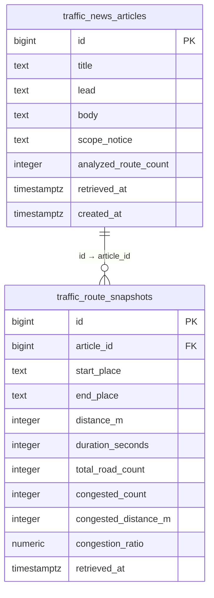

# 서울 도로교통정보·뉴스 브리핑 서비스

> **저장소 대표 README:** 이 문서는 `traffic_app_domain` 저장소 최상위 문서입니다. 현재 FastAPI 애플리케이션 소스는 [`traffic-api/`](traffic-api/) 아래에 있으며, 개발·테스트 시 이 폴더를 프로젝트 작업 디렉터리로 사용합니다.

> **문서 기준:** 2026-10-19 · **작업 브랜치:** `kakao` · **개발 방식:** 문서 선행 → 사용자 검토 → 코드 구현 → 테스트 → README 갱신
>
> **범위 안내:** 카카오 자동차 길찾기 API에서 조회한 **선택된 자동차 경로**에 한정된 교통정보 서비스입니다. 서울 전체 도로의 실시간 혼잡도나 서울의 대표 통계로 일반화하지 않습니다. 데이터의 ‘조회 완료 시각’은 도로 센서의 실제 관측 시각과 다릅니다.
>
> **상태 표시:** ✅ 구현·테스트 확인 / 🟡 부분 구현·추가 검증 필요 / ⬜ 계획(미구현). 아래의 계획 기능은 아직 사용할 수 없습니다.

## 0. 변경 관리 규칙 — 코드 수정 전에 반드시 확인

기능을 신규 추가하거나 수정할 때 **아래 순서**를 지킵니다.

1. **기능정의서 업데이트:** 기능 ID, 사용자 역할, 입력·출력, 예외, 상태(구현/계획)를 수정합니다.
2. **DB 설계 업데이트:** 컬럼·PK/FK·인덱스·RLS 및 데이터 이동/호환성 영향 여부를 기록합니다. DB 변경이 없다면 ‘변경 없음’으로 적습니다.
3. **화면설계서 업데이트:** 메뉴 트리, URL, 페이지 목적, 화면 요소, 접근 권한, 모바일 동작을 수정합니다.
4. **개발환경 업데이트:** Python·패키지·환경변수·외부 API·배포/보안 설정이 바뀌면 기록합니다. 변동이 없으면 ‘변경 없음’으로 적습니다.
5. **검토 게이트:** 위 4개 항목의 변경안을 README에 먼저 반영하고 **사용자 확인을 받은 후** 코드·SQL 변경 작업을 시작합니다.
6. **구현·테스트:** 로컬 테스트, 권한 검사, 기존 기능 회귀 테스트, 필요 시 DB 마이그레이션/백업을 수행합니다.
7. **완료 기록:** 구현 상태와 실제 검증 결과를 갱신하고, 코드와 README를 함께 커밋합니다. 비밀정보는 커밋하지 않습니다.

### 변경 이력

| 날짜 | 구분 | 내용 | 코드 변경 |
|---|---|---|---|
| 2026-10-19 | F17·F22·D01 통합 설계 | 사용자가 세 기능 모두 적용 요청; 저장 스냅샷으로 추세를 제한하고 CSV/통합 UI/API·DB 영향·단계별 테스트 설계 | README만 수정, 세부 승인 대기 |
| 2026-10-19 | F23 뉴스→지도 경로 연동 설계 | 기존 기사 상세의 요약 경로와 /map의 신규 Kakao 선형 데이터를 분리하는 1차 기능, URL·화면·예외·DB/환경·테스트 기준 문서화 | README만 수정, 기능 승인 대기 |
| 2026-10-19 | D01 디자인 설계 | 뉴스 포털+데이터 대시보드 결합형 4개 화면·색상·컴포넌트·모바일·DB/환경 영향 문서화 | README만 변경, 디자인 검토 대기 |
| 2026-10-19 | 문서 구조 개편 | 현행 기능·DB·화면·개발환경 명세 정리, 확장 메뉴 및 우선순위 제안 | 없음 — 검토 전 |
| 2026-10-19 | README 위치 변경 | `traffic-api/README.md`에서 저장소 최상위 `README.md`로 대표 명세 적용 | 앱 코드 변경 없음 |
| 2026-10-19 | 설계 상세화 | F13~F15 저장 API·중복 방지·관리자 UI·DB 변경안 문서화 | 앱 코드/DB 변경 없음 |
| 2026-10-19 | 승인 후 구현 | generation_id UNIQUE 적용, 서명 기사 생성·저장 API, 관리자 작업실·단위 테스트 추가 | 완료, 실제 검증 진행 중 |
| 2026-10-19 | 검증 | 문법 검사 및 서명 검증 단위 테스트 4/4 통과, 관리자 기사 #2 DB 저장·3개 경로·기존 데이터 보존 확인 | 동시요청 테스트 대기 |
| 2026-10-19 | 중복 재전송 확인 | 기사 #6 같은 증표 2회 저장 요청 → 첫 응답 신규, 두 번째 already_saved=true, DB 기사 1건·연결 경로 3건 | 순차 중복 방지 검증 완료, 동시요청 미검증 |
| 2026-10-19 | 테스트 설계 | F14 동시 재전송 및 필수 화면/API 회귀 검사 절차 추가 | 기능 변경 없음 |
| 2026-10-19 | 테스트 스크립트 | 로컬 관리자 입력·동시 저장·공개 페이지 및 미인증 차단 회귀 검사용 스크립트 추가 | 테스트 코드만 변경 |
| 2026-10-19 | 통합 테스트 완료 | 기사 #8 동시 저장 2회 HTTP 200: 신규 1회·중복 1회, DB 같은 generation_id 1건·경로 3건. 홈·지도·뉴스·관리자·이력 HTTP 200, 미인증 요청 HTTP 401 확인 | F13~F15 로컬 핵심 테스트 완료, 운영 배포 검증 별도 |
| 2026-10-19 | 다음 기능 설계 수정 v2 | 실제 메뉴 우선·정적 파일 라우팅·단계별 개발·KST 검색 조건 보완 | 문서 승인됨 |
| 2026-10-19 | M01·M02 구현 | 공통 CSS/JS, 4개 페이지 연결, StaticFiles 정적 라우팅, 회귀 검사 코드 추가 | GitHub 구현 완료, 로컬 테스트 대기; F16 미착수 |
| 2026-10-19 | M01·M02 테스트 결과 | 사용자 PowerShell에서 test_navigation.py 테스트 4개 모두 ok. StarletteDeprecationWarning 안내 | 브라우저 UI/실기능 회귀는 추가 확인 필요 |
| 2026-10-19 | M01·M02 화면 확인 | PC 메뉴·하위 메뉴·기존 경로 기능 사용자 확인, 모바일 400px 화면의 메뉴 열림 스크린샷 검토 | 모바일 하위 메뉴·키보드·배포 점검 남음 |
| 2026-10-19 | F16 검색 구현 | 읽기 전용 검색 SQL/API, /news 검색·조회 날짜·페이지 이동 및 테스트 추가 | 로컬 단위/브라우저 테스트 대기, DB 변경 없음 |
| 추후 | 예정 | 관리자 전용 뉴스 저장 API, 중복 방지, 웹 UI 연결 | 사용자 승인 후 진행 |

## 1. 서비스 개요

- **목적:** 이용자가 서울 주요 자동차 이동 경로의 현재 조회 결과를 비교하고, 그 수치를 근거로 만든 뉴스형 브리핑을 읽을 수 있도록 지원
- **대상:** 교통정보 이용자, 뉴스 브리핑 독자, 서비스 운영 관리자
- **데이터 원천:** Kakao Local 장소 검색, Kakao Mobility 자동차 길찾기
- **뉴스 생성 방식:** 현재는 별도의 생성형 AI 호출이 아니라 **수치 기반 Python 규칙/템플릿**으로 기사 제목·리드·본문을 만듭니다.
- **기본 경로:** 서울역→잠실역, 광화문→강남역, 여의도역→잠실역
- **현재 DB:** Supabase PostgreSQL; 별도 과제용 MySQL 전환은 이 프로젝트의 현재 범위에 포함되지 않습니다.

## 2. 기능정의서 (현행 + 확장)

| ID | 기능명 | 사용자 | 입력 → 출력 | 상태 |
|---|---|---|---|---|
| F01 | 장소 검색·자동차 경로 조회 | 방문자 | 출발지·목적지 → 경로·거리·소요시간 | ✅ |
| F02 | 구간별 교통정보·지도 | 방문자 | 경로 → 도로별 속도·교통상태·지도 | ✅ |
| F03 | 단일 경로 브리핑 | 방문자 | 경로 데이터 → 문장 브리핑 | ✅ |
| F04 | 3개 대표 경로 비교 | 방문자 | 고정 경로 3개 → 비교 지표 | ✅ |
| F05 | 뉴스형 브리핑 생성 | 방문자 | 경로별 수치 → 제목·리드·본문·한계 | ✅ |
| F06 | 뉴스 대시보드 | 방문자 | 분석 결과 → 카드·막대 비교 | ✅ |
| F07 | 조회 완료 시각 표시 | 방문자 | 서버 조회 시각 → 한국 시간 표시 | ✅ |
| F08 | 뉴스 DB 저장 모듈 | 개발자 | 뉴스+경로 → PostgreSQL 1+N 트랜잭션 | ✅ (CLI 검증) |
| F09 | 뉴스 이력 목록·상세 조회 | 방문자 | 기사 ID → 저장된 기사·경로 정보 | ✅ |
| F10 | 과거 기사 웹 조회 | 방문자 | 기사 선택 → 본문·그래프 복원 | ✅ |
| F11 | 관리자 로그인·권한 확인 | 관리자 | Supabase Auth 계정·토큰 → 관리자 검증 | ✅ (로컬 검증) |
| F12 | 관리자 로그인 화면 | 관리자 | 이메일·비밀번호 → 인증 상태 UI | ✅ (로컬 검증) |
| F13 | 관리자 전용 기사 저장 API | 관리자 | 인증된 저장 요청 → 기사 ID | ✅ 실제 기사 저장 확인 |
| F14 | 같은 기사 중복 저장 방지 | 관리자 | 생성 결과 식별자 → 1회 저장 | ✅ 순차·동시 중복 저장 확인 |
| F15 | 뉴스 저장 UI | 관리자 | 생성된 기사 → 저장·결과 표시 | ✅ 실제 기사 미리보기·저장 확인 |
| F16 | 기사 검색·필터·페이지네이션 | 방문자 | 기간·경로·키워드 → 이력 목록 | ⬜ |
| F17 | 일자·시간별 경로 통계 | 방문자 | 저장된 스냅샷 → 추세 그래프 | ⬜ |
| F18 | 경로 즐겨찾기·프리셋 | 방문자 | 자주 쓰는 경로 → 빠른 조회 | ⬜ |
| F19 | 자동 수집·캐시 | 운영자 | 예약 주기 → API 호출 최적화·저장 | ⬜ |
| F20 | 기사 검토·발행 상태 | 관리자 | 초안 → 검토·공개/보류 | ⬜ |
| F21 | 수집 실패·장애 모니터링 | 관리자 | 오류 로그 → 운영 경고·진단 | ⬜ |
| F22 | CSV 다운로드·데이터 출처 표기 | 방문자 | 분석 결과 → CSV·메타데이터 | ⬜ |

**기능 규칙:** 경로마다 거리가 달라 단순 소요시간 또는 정체·지체 **구간 개수만으로** 혼잡 우열을 판단하지 않습니다. 비율 비교도 조회된 경로의 거리 구성 비교일 뿐 실제 도시 전체 혼잡도를 뜻하지 않습니다. 중복 경로 구간 합산 시 별도 식별/제거 규칙을 수립해야 합니다.

### 주요 API

| 메서드 | 경로 | 설명/접근 |
|---|---|---|
| GET | `/` · `/map` · `/news` | 홈·지도·뉴스 페이지 |
| GET | `/api/route` | 경로 검색 |
| GET | `/api/briefing/overview` | 고정 3개 경로 종합 요약 |
| GET | `/api/briefing/news` | 새로운 데이터 기반 뉴스 생성(저장은 안 함) |
| GET | `/api/news/history` | 저장된 뉴스 목록 |
| GET | `/api/news/history/{article_id}` | 저장된 뉴스 상세 |
| GET | `/admin` | 관리자 로그인 페이지 |
| POST | `/api/admin/login` | 로그인, 액세스 토큰 응답 |
| GET | `/api/admin/me` | Bearer 토큰 + 관리자 UID 검증 |
| POST | `/api/admin/news/generate` | 관리자 전용 기사 생성·서명 증표 발행 (구현, 검증 대기) |
| POST | `/api/admin/news/save` | 서명된 초안만 저장 및 중복 요청 처리 (구현, 검증 대기) |

## 3. DB 설계서 (PostgreSQL · Supabase)

**기존 보존:** `public.traffic_information`은 이전 ITS 개발 단계의 약 30,538행이 있는 구형 테이블이며, 현재 카카오 기능에서는 사용하지 않습니다. 이 테이블의 이름·컬럼을 추정해 수정하거나 삭제하지 않습니다.

### 현재 테이블 및 관계



| 테이블 | PK | FK | 주요 제약/인덱스 | 상태 |
|---|---|---|---|---|
| `traffic_news_articles` | `id` BIGINT IDENTITY | 없음 | 필수 제목·본문·리드, `retrieved_at`, `idx_traffic_news_retrieved_at` | ✅ |
| `traffic_route_snapshots` | `id` BIGINT IDENTITY | `article_id` → `traffic_news_articles.id` (ON DELETE RESTRICT) | 거리 양수·비율 0~100·정체 구간 수 제한·`idx_traffic_routes_article_id` | ✅ |
| `traffic_information` | `id` | 없음 | 과거 교통 데이터; 현재 저장 로직과 분리 | 보존 |

- **현재 저장 모델:** 기사 1건과 해당 경로 N건을 한 PostgreSQL 트랜잭션으로 저장. Python `app/news_database.py`의 `save_news_article()`로 **CLI 테스트 완료**. 웹 저장 엔드포인트는 아직 없음.
- **저장 검증 기준:** 현재 테스트로 뉴스 1건 + 관련 경로 3건 저장/조회 확인. 테스트 시점의 실제 행 수는 변할 수 있음.
- **보안:** 새 두 테이블은 RLS 활성화, `anon`/`authenticated` 직접 권한 제거. FastAPI가 서버 측 DB 연결. DB 비밀번호 브라우저 전달 금지.
- **미해결 보안 점검:** 기존 `traffic_information`은 RLS 비활성화 상태로 확인됨. 기존 연동 영향 분석 후 별도 승인하에 설정 변경 필요.
- **DB 변경 완료(2026-10-19):** `traffic_news_articles.generation_id UUID UNIQUE NULL` 추가. 기존 기사 1건, 경로 3건, 구형 30,538행 보존 확인.
- **미래 DB 변경(계획):** 검토·발행 상태, 관리자 ID, 수집·오류 로그. 변경 시 별도 승인 필요.

## 4. 화면설계서 — 메뉴 구조 및 페이지 배치

### 역할별 정보 구조(IA) / 복잡한 메뉴 설계안

```text
서울 도로교통정보
├─ 1. 교통 현황
│  ├─ 주요 경로 종합 현황 [현재 /news]
│  ├─ 출발지·목적지 검색 [현재 /]
│  ├─ 지도에서 경로 확인 [현재 /map]
│  ├─ 구간별 속도·교통상태 [현재 /]
│  └─ 관심 경로/즐겨찾기 [계획]
├─ 2. 분석·통계
│  ├─ 경로별 비교 그래프 [현재 /news]
│  ├─ 시간대별 정체 추이 [계획]
│  ├─ 일별·주별 기록 비교 [계획]
│  ├─ 구간 데이터 내보내기 [계획]
│  └─ 데이터 출처·방법론 [계획]
├─ 3. 교통 뉴스
│  ├─ 최신 자동 브리핑 [현재 /news]
│  ├─ 저장된 뉴스 아카이브 [현재 /news]
│  ├─ 기사 검색·기간 필터 [계획]
│  ├─ 경로별 기사 모아보기 [계획]
│  └─ 기사 공유·읽기 모드 [계획]
├─ 4. 서비스 안내
│  ├─ 조회 범위와 통계 한계 [일부 화면 문구 구현]
│  ├─ 이용 방법·FAQ [계획]
│  ├─ API·데이터 이용 안내 [계획]
│  └─ 장애·공지 사항 [계획]
└─ 5. 관리자 전용 (/admin 로그인 후)
   ├─ 관리자 인증·계정 상태 [현재 /admin]
   ├─ 기사 생성 결과 검토 [계획]
   ├─ 기사 저장·중복 확인 [계획]
   ├─ 기사 승인·게시 상태 [계획]
   ├─ 수집 일정·API 호출량 [계획]
   ├─ 저장된 데이터 관리 [계획]
   └─ 오류 로그·운영 설정 [계획]
```

메뉴 복잡성은 **1차 메뉴 5개 / 2차 메뉴 약 25개 이상**으로 설계하되, 한꺼번에 모두 구현하지 않습니다. 방문자에게 관리자 메뉴를 불필요하게 노출하지 않고, 계획 메뉴는 비활성/개발 예정 표시 후 단계별 출시합니다.

### 화면별 정의

| 화면 | URL | 주요 구성 | 접근 | 구현 상태 |
|---|---|---|---|---|
| 메인·경로 검색 | `/` | 출발/도착 검색, 거리·시간, 도로별 속도, 단일 브리핑, 3개 경로 종합 카드/표 | 공개 | ✅ |
| 경로 지도 | `/map` | OpenLayers 경로·교통상태 구간 표시 | 공개 | ✅ |
| 뉴스·대시보드 | `/news` | 조회 버튼, 지표 카드, 비교 막대, 뉴스 본문·시각, 과거 기사 목록/상세 | 공개 | ✅ |
| 관리자 로그인·기사 작업실 | `/admin` | 로그인, 기사 생성·검토·저장, 로그아웃 | 관리자 | 🟡 저장 기능 로컬 검증 대기 |
| 데이터 통계 | `/statistics` (가칭) | 시점·경로별 과거 비교 그래프 | 공개 | ⬜ |
| 기사 편집·저장 | `/admin/articles` (가칭) | 기사 미리보기, 저장, 중복 경고, 승인 | 관리자 | ⬜ |
| 운영·설정 | `/admin/operations` (가칭) | 수집 간격, 호출량, 오류 | 관리자 | ⬜ |

### 목표 화면 와이어프레임 (계획)

```text
┌───────────────────────────────────────────────────────────────┐
│ 로고/서비스명  [교통 현황 ▾] [분석·통계 ▾] [교통 뉴스 ▾]  안내 │
├───────────────────────────┬───────────────────────────────────┤
│ 선택 경로·기간 필터       │ [조회 시각] [분석 경로] [최고 비율] │
│ ┌───────────────────────┐ │ ┌───────────────────────────────┐ │
│ │ 경로 조회/프리셋      │ │ │ 경로별 비교/변화 차트        │ │
│ └───────────────────────┘ │ └───────────────────────────────┘ │
├───────────────────────────┴───────────────────────────────────┤
│ [지도/구간 정보]         [최신 교통 뉴스 브리핑]               │
├───────────────────────────────────────────────────────────────┤
│ 저장된 뉴스 · 필터 · 아카이브 · 데이터 출처/분석 한계         │
└───────────────────────────────────────────────────────────────┘
관리자 로그인 후 별도 운영 메뉴: 기사 검토/저장/이력/운영 설정
```

- **반응형 원칙(계획):** PC 상단 드롭다운 + 선택 페이지별 사이드바, 모바일 햄버거/아코디언. 주요 화면은 모바일에서 카드 1열 배치. 키보드 메뉴 접근·포커스 표시 필요.
- **상태 분리:** 조회 중/성공/조회 실패, 과거 조회 vs 방금 생성, 권한 없음, 저장 완료/중복 저장을 명확히 구분.
- **색상:** 교통 상태 색과 일반 UI 강조색의 의미를 혼동하지 않도록 별도 범례 제공.

## 5. 개발환경 정의서

| 구분 | 현재 적용 | 변경 발생 시 갱신할 항목 |
|---|---|---|
| OS/로컬 | Windows PowerShell, `traffic-api` 디렉터리 | OS·경로·실행 명령 |
| 서버 | Python / FastAPI / Uvicorn | Python 버전, FastAPI 버전, ASGI 엔트리 |
| 외부 API | Kakao Local, Kakao Mobility Directions | 권한, 응답 구조, 요청량 |
| 데이터 분석·기사 생성 | Python 규칙형 계산·템플릿 | 계산법, 수치 표시 기준, 생성기 변경 |
| DB | Supabase PostgreSQL, `psycopg[binary]` | 스키마·연결 방식·RLS·백업 |
| 인증 | Supabase Auth + FastAPI Bearer·관리자 UID 검증 | 로그인, 토큰 만료, 세션 정책 |
| 프런트엔드 | HTML/CSS/JavaScript, OpenLayers | 외부 CDN, 브라우저 호환성 |
| 협업 | Git / GitHub `kakao` 브랜치 | 브랜치·커밋·CI 정책 |
| 배포 | `vercel.json` 설정 파일 존재; 실제 운영 배포 확인 필요 | Vercel Root Directory, 환경변수, 네트워크·로그 |

### 실행

```powershell
cd C:\workspace\traffic_app_domain\traffic-api
py -m venv .venv
.\.venv\Scripts\python.exe -m pip install -r requirements.txt
.\.venv\Scripts\python.exe -m uvicorn app.main:app --reload
```

> 기존 `.venv`가 정상이라면 새로 만들지 않아도 됩니다. 앱 URL: `/`, `/map`, `/news`, `/admin`; 개발용 API 문서: `/docs`.

### 환경변수 이름(값은 절대 저장하지 않음)

- `KAKAO_REST_API_KEY`: 카카오 API 비밀키
- `POSTGRES_HOST`, `POSTGRES_PORT`, `POSTGRES_USER`, `POSTGRES_PASSWORD`, `POSTGRES_DB`, `POSTGRES_SSLMODE`: PostgreSQL 연결
- `SUPABASE_URL`, `SUPABASE_ANON_KEY`, `ADMIN_USER_ID`: Supabase Auth와 관리자 UID 검사
- `NEWS_DRAFT_SIGNING_KEY`: 서버 전용 기사 서명키, 최소 32바이트 (신규, `.env` 필수)

`.env`는 `.gitignore`로 제외합니다. 서비스 비밀키나 관리자 액세스 토큰은 README, 화면 캡처, 클라이언트 JS에 넣지 않습니다. 로그아웃의 화면 토큰 초기화와 **서버 측 토큰 무효화는 현재 서로 다름**을 유의합니다.

### 개발 환경/배포에 대한 주의

- `requirements.txt`에 과거 개발 단계의 MySQL 패키지가 남아 있으나 현재 카카오 교통정보 저장은 PostgreSQL 사용. 정리 전 사용 여부 점검 필요.
- **저장소 최상위 `README.md`가 `kakao` 브랜치의 기준 문서입니다.** 이전 위치의 `traffic-api/README.md`는 과거 사본이므로 향후 별도 정리 여부를 결정합니다.
- 배포 전 인증 로그인 요청 제한·저장 API 권한·중복 저장·토큰/세션 관리·에러 로그·Vercel 연결을 점검해야 합니다.

## 6. 확장 기능 제안 및 우선순위

| 우선순위 | 추가 기능 | 사용자 가치 | 선행 조건 |
|---|---|---|---|
| P0 | 관리자 저장 API + 중복 방지 | 기사·경로를 안전하고 일관되게 보관 | 서버 측 생성 결과 식별·권한 검사 |
| P0 | 기사 저장/검토 UX | 실수 저장 방지, 상태 파악 | 관리자 UI 흐름 |
| P1 | 기사 날짜·키워드·경로 필터 | 누적 기사 탐색 | DB 조회 필터·인덱스 |
| P1 | 시간대별 교통 추세 | 시점별 수치 비교 | 주기적 수집, 같은 경로 정의 |
| P1 | 조회 캐시·호출량 제한 | API 과호출 및 응답 지연 완화 | 만료 정책·운영 지표 |
| P2 | 관심 경로 프리셋 | 자주 조회하는 경로 재사용 | 사용자 선호 저장 방식 |
| P2 | 데이터 내보내기 CSV | 분석 결과 재사용 | 공개범위·출처 |
| P2 | 기사 승인·게시·수정 이력 | 뉴스 품질 및 편집 흐름 | 게시 상태·감사 로그 테이블 |
| P3 | 장애 대시보드·알림 | 운영 신뢰성 강화 | 모니터링 및 알림 연동 |
| P3 | 반응형 메뉴·접근성 향상 | 다양한 기기 사용성 | 화면설계 확정 |

## 7. 다음 개발 상세 설계 — F13/F14/F15 (2026-10-19 · 사용자 검토 전)

> **상태: 설계안, 아직 구현되지 않음.** 이 절의 내용은 사용자 검토/승인 전에는 앱 코드 또는 Supabase 스키마에 적용하지 않습니다.

### 7.1 기능정의서 변경안

| ID | 단계 | 입력 | 정상 결과 | 예외·검증 |
|---|---|---|---|---|
| F13 | 관리자 전용 교통 뉴스 생성 및 저장 API | Bearer 인증, 서버가 발급한 임시 기사 식별 증표 | 뉴스+연관 경로를 한 트랜잭션 저장하고 기사 ID 반환 | 인증 없음 401, 비관리자 403, 기한 초과·위조 400/422, DB 장애 503 |
| F14 | 동일 생성 결과 중복 저장 방지 | 서버가 생성한 고유 `generation_id` | 최초 저장 1회, 동일 ID 재요청 시 기존 ID 반환 | DB UNIQUE로 동시 저장 요청까지 차단 |
| F15 | 관리자 웹 기사 검토·저장 | 로그인 후 ‘새 기사 생성’ → 내용 검토 → ‘저장’ | 화면에서 확인한 정확히 같은 뉴스 데이터 저장; 저장 결과·이력 링크 표시 | 중복 클릭 방지, 토큰 만료 안내, 오류 발생 시 기존 미리보기 유지 |

**생성된 기사의 데이터 무결성:** 브라우저가 기사 제목·거리·본문을 자유롭게 바꿔서 저장하도록 허용하지 않습니다. 관리자 인증을 통과한 FastAPI가 카카오 데이터를 수집하고 기사·경로를 구성한 뒤, 서버에서 서명한 **만료 시각이 있는 기사 증표(signed draft token)**를 관리자 브라우저에 전달합니다. 미리보기는 해당 서버 생성 결과로 구성합니다. 저장 요청 때 서버는 관리자 토큰, 기사 증표 서명·유효시간·관리자 UID를 다시 검증하고, 증표에 서명된 동일 데이터를 DB에 저장합니다. 토큰 발급·서명에는 별도 `NEWS_DRAFT_SIGNING_KEY` 비밀키를 서버 환경변수로 관리합니다. 이 키는 브라우저/README에 기재하지 않습니다.

**API 구상(미구현):**

- `POST /api/admin/news/generate`: 관리자 인증 필수. 3개 경로 조회 → 뉴스 생성 → 관리자 UID와 `generation_id`, 발급/만료 시각을 포함한 서명 증표 및 화면 미리보기 응답. DB 저장 없음.
- `POST /api/admin/news/save`: 관리자 인증 필수. `draft_token`만 받아 서버 서명과 기한 확인, 트랜잭션 저장. 응답 `article_id`, `already_saved` 반환. 카카오 API 재호출 없음.
- 기존 `GET /api/briefing/news`는 공개 브리핑 조회·생성으로 유지(저장 없음).
- 기존 `GET /api/news/history`·`/{article_id}`는 이력 조회로 유지. 공개 범위는 배포 전 별도 재검토.

**보안 주의:** 문서와 GitHub에 실제 관리자 UID·DB 암호·서명 비밀키·토큰을 넣지 않습니다. 로그인 토큰/임시 기사 증표는 관리자 페이지 메모리에서만 보관하고 새로고침 시 초기화합니다. 서버는 저장 요청마다 `require_admin`을 호출하며, 서명 검증 실패 시 저장하지 않습니다. 로그인 시도 횟수 제한/세션 만료/운영 HTTPS는 배포 전 필수 검토 항목입니다.

### 7.2 DB 변경 설계안

기존 `traffic_news_articles`에 아래 **한 컬럼만 추가**하는 것을 제안합니다.

| 테이블 | 변경 | 타입/제약 | 기존 데이터 영향 |
|---|---|---|---|
| `traffic_news_articles` | `generation_id` 추가 | `uuid UNIQUE NULL` | 기존 레코드의 `NULL` 허용, 삭제/수정 없음 |
| `traffic_route_snapshots` | 변경 없음 | 기존 `article_id` FK 유지 | 없음 |
| `traffic_information` | 변경 없음 | 기존 데이터 유지 | 없음 |

- 서버가 기사 생성 시 매번 새로운 UUID를 부여합니다. 같은 기사를 다시 ‘저장’해도 **동일 생성 UUID이면 한 번만 저장**합니다. 내용이 동일해도 별도로 다시 생성한 경우는 새 기사로 취급합니다.
- UNIQUE 제약이 DB 레벨에서 동시 저장 중복을 차단합니다. `INSERT ... ON CONFLICT (generation_id) DO NOTHING` 후 이미 저장된 기사 ID를 확인하는 방식을 사용합니다.
- 기사 1건과 경로 N건의 원자적 트랜잭션을 유지합니다. 중복 요청에서는 경로를 다시 삽입하지 않습니다.
- 마이그레이션은 사용자 승인 뒤 사전 행 수·제약 검사 → 새 컬럼 추가 → 검증 순으로 수행. 기존 1건과 3개 경로 및 `traffic_information`을 보존합니다.
- RLS는 신규 테이블에 이미 적용되어 있으며, 구형 `traffic_information`의 RLS 문제는 별도 점검 과제로 유지합니다.

### 7.3 웹 화면·메뉴 변경 설계안

**관리자 메뉴:** `관리자 로그인` → `기사 작업실` → `기사 생성` → `기사 검토` → `Supabase 저장` → `저장 이력 보기`.

- 1차 구현은 이미 존재하는 `/admin`의 로그인 성공 패널을 **기사 생성/검토/저장 작업실**로 확장합니다. 별도의 `/admin/articles` 페이지는 관리 기능이 늘어날 때 분리합니다.
- 미리보기에는 제목·리드·본문·조회 시각·3개 경로 비교·범위 제한 설명을 배치합니다. ‘저장’은 생성 성공 이후에만 활성화합니다.
- 성공 시 `저장 완료 — 기사 #N`, 중복 시 `이미 저장된 기사 #N`, 인증 만료 시 `다시 로그인` 등 상태를 구분합니다.
- 방문자용 `/news`는 기존의 기사 생성·조회·아카이브 화면을 그대로 유지합니다. 관리자 토큰을 다른 페이지에 공유하거나 URL 쿼리에 싣지 않습니다.

### 7.4 개발환경 변경 설계안

- 기존 Python·FastAPI·psycopg·Supabase Auth·Kakao API·OpenLayers 유지.
- 신규 서버 전용 환경변수 **`NEWS_DRAFT_SIGNING_KEY`** 추가 예정: 충분히 예측하기 어려운 난수 기반 비밀키 사용. 실제 값은 `.env`/배포 설정에만 입력하고 README 및 소스에 작성하지 않음.
- 서명 구현은 Python 표준 라이브러리 `hmac`, `hashlib`, `secrets`, `base64`, `json`을 사용하여 별도 패키지 설치 없이 구현하는 방향을 제안. 서명 직렬화·시간 제한·검증은 별도 테스트로 확인.
- 수정 예정 파일: `app/main.py`, `app/news_database.py`, 별도 서명 모듈 `app/news_drafts.py`, `static/admin.html`; DB는 승인 후 마이그레이션 적용. 요구사항 변화 시 이 절을 먼저 수정.
- 기존 `/api/admin/login`의 브라우저 토큰 메모리 저장 방식과 `require_admin`을 유지. 배포 전 HTTPS·CORS·브루트포스 방어·토큰 수명 검토.


### 7.6 F14 동시 저장 및 회귀 검증 절차 (테스트 실행 대기)

- **목적:** 승인된 F14의 미검증 항목인 동일 증표의 동시 제출을 두 요청으로 재현한다. 기능이나 DB 스키마를 새로 추가하지 않는다.
- **테스트 방법:** `tests/manual_concurrent_news_save.py`(GitHub에 추가 완료)를 로컬에서 실행한다. 이메일은 입력으로, 비밀번호는 `getpass`로 받으며 소스·로그·README에 비밀번호, 액세스 토큰, 임시 기사 증표를 기록하지 않는다. 스크립트는 `/api/admin/login` → `/api/admin/news/generate` → 동일 증표로 저장 API 2건을 `asyncio.gather`로 동시에 전송한다.
- **합격 기준:** 양 요청 HTTP 200, 동일한 `article_id`, `already_saved=false`가 1건 / `already_saved=true`가 1건, 공개 조회 API에서 연결 경로 3건. DB의 실제 `generation_id` 행도 1건인지 검증한다.
- **부가 회귀 검사:** `/`, `/map`, `/news`, `/admin`, `/api/news/history`의 HTTP 200, 미인증 관리자 생성·저장 API의 HTTP 401. 외부 Kakao 호출 여부와 에러 사유는 별도 점검한다.
- **데이터 영향:** 새 기사를 1건만 정상 저장해야 하는 통합 테스트이며 영구 DB에 실데이터가 1건 누적될 수 있다. 운영 배포 전 별도의 권한·부하·외부 API 회귀 검사 필요.
- **상태:** ✅ 2026-10-19 로컬 테스트 통과. 기사 #8 두 요청 모두 HTTP 200, 같은 기사 ID, already_saved False/True 각 1회. DB에도 generation_id 동일 행 1건, 경로 3건 확인.
- **로컬 실행:** FastAPI 서버가 가동 중인 별도 PowerShell 창에서 `cd C:\\workspace\\traffic_app_domain\\traffic-api` → `.\\.venv\\Scripts\\python.exe tests/manual_concurrent_news_save.py`. 시작 확인 문구에 `YES`를 입력하고 관리자 이메일과 비밀번호를 **로컬 터미널에만** 입력한다. 비밀번호는 표시되지 않는다. 성공 시 `PASS` 및 기사 ID, 두 요청의 `already_saved` 결과를 확인한다.

### 7.5 구현 전 테스트 기준

1. 관리자 아닌 요청으로 generate/save → 401/403, DB 저장 0건.
2. 관리자로 generate → 기사·3개 경로·서명 증표 반환; DB 쓰기 0건.
3. generate 이후 save → 기사 1건 + 연결 경로 3건 정확히 저장.
4. 동일 증표로 save 2회/동시 요청 → 기사와 경로가 추가 중복되지 않고 동일 기사 ID 반환.
5. 임의로 변조/만료/다른 관리자와 연결된 증표로 요청 → 차단.
6. 화면 미리보기와 DB 저장 값(제목·본문·거리·조회 시각)이 동일.
7. 기존 일반 뉴스 생성, 이력 읽기, 지도 및 로그인 동작 회귀 테스트.

**승인 및 검증 상태:** ✅ 2026-10-19 승인·DB/코드 반영. 기사 #8 동시 저장 2건의 중복 차단 및 기본 공개 화면·API 회귀 검사 통과. 운영 배포와 전체 성능·보안 검사는 별도 진행.

---


## 9. 다음 개발 검토안 — M01 공통 메뉴 / F16 뉴스 아카이브 검색 (2026-10-19)

> **검토 상태: 미승인 · 설계만 추가.** 이 절을 승인하기 전에는 HTML/JS/Python 코드나 Supabase 테이블을 변경하지 않습니다. 기존 F01~F15 서비스, 데이터 및 API 응답 호환성을 유지합니다.

### 9.1 기능정의서 (추가·변경)

| ID | 기능/접근권한 | 입력 | 출력 및 기준 | 상태 |
|---|---|---|---|---|
| M01 | 반응형 공통 내비게이션 / 전체 방문자 | 상단 5개 분류, 하위 메뉴 선택 | PC 드롭다운, 모바일 펼침 메뉴, 현재 페이지 강조 | ⬜ 설계 |
| M02 | 메뉴 접근성·상태 관리 / 전체 방문자 | 키보드/모바일 화면/메뉴 상태 | 키보드 탐색, 포커스 표시, ARIA 확장 상태, 예정 메뉴 비활성 표기 | ⬜ 설계 |
| F16-A | 뉴스 제목·리드 키워드 검색 / 방문자 | `q` (최대 100자) | 저장된 기사에서 제목 또는 리드 검색 | ⬜ 설계 |
| F16-B | 뉴스 기간 필터 / 방문자 | `start_date`, `end_date` (KST 날짜) | **교통정보 조회 완료 시각(`retrieved_at`)** 기준 시작일 00:00~종료일 다음날 00:00 미만 | ⬜ 설계 |
| F16-C | 페이지네이션 / 방문자 | `page`(1 이상), `page_size`(10/20/50) | `total`, `page`, `page_size`, `total_pages`, `articles` 반환; 최신 조회 완료 순 | ⬜ 설계 |
| F16-D | 과거 기사 연동 / 방문자 | 검색 결과 기사 ID | 기존 상세 API를 이용해 제목·리드·본문·그래프 복원 | ⬜ 설계 |

**기존 구현 확인:** `GET /api/news/history`는 현재 `limit=10`으로 목록을 제한하며 `count`와 `articles`를 반환합니다. `static/news.html`에는 이력 불러오기·상세 열람이 있고 검색/기간/페이지 선택 컨트롤은 없습니다.

**권장 API 호환성:** 기존 `GET /api/news/history`는 변경하지 않고, 새 `GET /api/news/search?q=&start_date=&end_date=&page=1&page_size=10`을 추가합니다. 따라서 이전 프런트엔드 사용자가 받던 `count` 형식은 계속 유지됩니다. 빈 검색어와 기간 미선택 시 전체 저장 기사가 최신 순으로 나옵니다. 기본 10건, 최대 50건. 날짜 역전·허용 범위 초과는 HTTP 422로 거부하고, 검색어는 매개변수 바인딩으로 처리합니다.

**범위:** 저장된 뉴스만 검색하며 카카오 API를 호출하거나 실시간 기사 생성을 수행하지 않습니다. 검색된 기사 수는 지역 전체 교통 분석 자료 수를 의미하지 않습니다.

### 9.2 DB 재설계/영향

현재 테이블 `public.traffic_news_articles`(기사)와 `public.traffic_route_snapshots`(기사별 경로)를 그대로 사용합니다.

| 요소 | 변경안 | 기존 데이터 |
|---|---|---|
| 테이블·컬럼·PK/FK | **변경 없음** | 모든 저장 기사·경로 보존 |
| 검색 대상 | `traffic_news_articles.title`, `lead`, `retrieved_at` | 읽기 전용 |
| 정렬 | `retrieved_at DESC, id DESC` | 동일 시각에도 안정적 페이지 순서 |
| 색인 | 현행 `retrieved_at` 인덱스 재사용 가능 여부 확인. 검색량이 많아질 때 `(retrieved_at DESC, id DESC)` 복합 인덱스 및 문자열 검색 인덱스 추가 검토 | 새 인덱스 승인 후 별도 마이그레이션 |
| 보안 | DB 연결은 FastAPI 서버만 사용, 기존 RLS 유지 | 변경 없음 |

**1차 계획에서는 DB DDL/마이그레이션을 하지 않습니다.** 데이터 규모와 실제 쿼리 속도를 먼저 검증한 뒤 인덱스가 필요한 경우 README 변경·승인을 다시 거칩니다. 전체 건수 COUNT와 페이지 조회에 **같은 검색 조건**을 적용하고, `LIMIT/OFFSET` 경계를 서버에서 검사합니다.

### 9.3 웹 화면설계 — 복잡한 메뉴를 단계별로 적용

**대분류 5개 유지:** 교통 현황 / 분석·통계 / 교통 뉴스 / 서비스 안내 / 관리자. README 4절의 2차 메뉴 구조는 그대로 유지하되, 구현된 URL과 예정된 기능을 명확히 구분합니다.

- **공통 상단바:** 로고·현재 메뉴·상위 5개 항목. PC에서 드롭다운, 모바일에서는 메뉴 버튼을 눌러 아코디언을 펼칩니다.
- **하위 메뉴:** 현재 사용 가능 `/`(경로 검색), `/map`(지도), `/news`(뉴스 및 기존 대시보드), `/admin`(관리자 로그인/작업실)으로 연결. 미구현 메뉴는 '준비 중'으로 표시하고 빈 URL이나 가짜 이동을 만들지 않습니다.
- **관리자 접근:** 관리자 UI 링크가 보이더라도 **서버의 Bearer 검증이 실제 접근 권한을 결정**합니다. 공통 메뉴에는 비밀번호·토큰을 넣지 않습니다.
- **구현 방식:** 중복 내비게이션 코드를 줄이기 위해 `static/navigation.css`, `static/navigation.js`(가칭)를 별도 작성하고 기존 HTML 4개 화면에 일관되게 연결하는 방안을 제안합니다. 기존 `index.html`, `map.html`, `news.html`, `admin.html`의 핵심 조회/저장 코드는 유지합니다.

**뉴스 아카이브 화면 (`/news`의 기존 목록 영역을 확장):**

```text
┌────────────────────────────────────────────────────────────┐
│ 서울 도로교통정보   [교통 현황 ▾] [분석·통계 ▾] [뉴스 ▾] ... │
├────────────────────────────────────────────────────────────┤
│ 새 뉴스 생성 (기존 기능 유지)                              │
│                                                            │
│ 저장된 교통 뉴스 아카이브                                  │
│ [키워드 검색................] [검색] [초기화]              │
│ [시작일]  ~  [종료일]       [10/20/50개 보기]               │
│ 검색 결과 N건                     [이전] 1 / 3 [다음]      │
│ ┌ 날짜/제목 ───────────────────────────────────────────┐   │
│ │ 저장 기사 제목                         [기사 열기]  │   │
│ └──────────────────────────────────────────────────────┘   │
├────────────────────────────────────────────────────────────┤
│ 기존 비교 카드 · 경로 막대그래프 · 기사 제목/리드/본문     │
│ 선택 기사는 위 기존 읽기·대시보드 영역에서 복원            │
└────────────────────────────────────────────────────────────┘
```

- 뉴스 검색/초기화 시 1페이지부터 조회, 검색 중/결과 없음/오류/마지막 페이지 상태 명확히 표시.
- 버튼과 입력에는 한국어 레이블, 날짜 조건 안내, 키보드 조작 지원. 좁은 화면에서는 필터 세로 배치.
- 메뉴 UI/뉴스 필터 UI의 두 기능은 **동일 단계에 코드 통합하되 각자 독립적으로 테스트**합니다.

### 9.4 개발환경 변경

- **변경 없음:** Windows PowerShell, Python/FastAPI, psycopg, Kakao API, Supabase Auth, PostgreSQL, OpenLayers, Vercel 설정을 유지합니다.
- 신규 파이썬 패키지와 서버 환경변수 추가 **없음**. 프런트엔드는 기존 HTML/CSS/Vanilla JavaScript만 사용합니다.
- 문서 승인 시 예정 변경 파일: `traffic-api/static/index.html`, `map.html`, `news.html`, `admin.html`, 새 공통 내비게이션 CSS/JS, `traffic-api/app/main.py`, `app/news_database.py`, 테스트 파일, 루트 `README.md`.
- 정적 파일 경로(`/static/...`)가 Vercel과 로컬 모두에서 접근 가능한지 확인하고, 필요한 경우에만 별도 변경안으로 기록합니다.

### 9.5 승인 후 테스트 조건

1. `/`, `/map`, `/news`, `/admin`에서 동일 메뉴 표시; 기존 버튼·지도·로그인·기사 생성/저장 유지.
2. PC/모바일에서 대분류 열기, 현재 위치 강조, 키보드 접근 가능. 미구현 하위 메뉴는 이동 불가로 표시.
3. 저장된 기사 전체·키워드·KST 날짜 구간별 검색, 빈 검색 결과, 잘못된 날짜 HTTP 422.
4. 페이지 이동 시 기사 중복·누락 여부와 안정적인 정렬 확인. 결과 `total`과 실제 페이지 항목 수 일치.
5. 검색 결과에서 과거 기사 선택 시 기존 본문/경로 3개/그래프 복원, 카카오 API 호출 없음.
6. 관리자 뉴스 저장·서명·중복 방지 및 기존 API `/api/news/history` 호환성 회귀 검사.
7. 기존 Supabase 기사·경로·구형 교통 기록 변화 없음.

**검토 상태:** ⬜ 사용자 승인 대기. 이번 변경은 README 문서만 수정합니다.

---

### 9.6 설계 재검토 및 수정안 v2 (2026-10-19)

> **미승인: 아래 수정안 우선 적용.** 아직 앱 코드와 DB를 변경하지 않습니다. 기존 9.1~9.5는 최초 제안으로 남기며, 충돌하는 사항은 이 수정안을 우선합니다.

#### M01·M02 메뉴 수정

- 5개 대분류(교통 현황·분석/통계·교통 뉴스·서비스 안내·관리자)는 유지합니다. 2차 메뉴는 사용할 수 있는 실제 페이지를 먼저 배치하고, 미구현 기능에는 '준비 중'을 표시하되 작동하지 않는 링크를 만들지 않습니다.
- 현재 사용 가능: 경로 검색(/), 지도(/map), 교통 뉴스·기존 비교 그래프(/news), 관리자 로그인·기사 작업실(/admin). 같은 페이지 안의 섹션 링크는 실제 요소 ID가 확인된 뒤 추가합니다.
- PC에서는 클릭형 드롭다운을 우선하고, 모바일에서는 햄버거 + 한 번에 한 분류를 펼치는 아코디언을 적용합니다. Escape 키 닫기, 키보드 조작, 포커스 표시, aria-expanded, aria-current를 테스트합니다.
- 로그인 페이지 진입 링크는 제공하되 권한은 FastAPI 서버가 검증합니다. 관리자 토큰을 공통 메뉴 JS·URL로 전달하지 않습니다.
- **중요한 구현 제약:** 현재 app/main.py는 StaticFiles 마운트를 사용하지 않습니다. 공통 navigation.css 및 navigation.js를 만들려면 정적 파일 경로(/static/...)의 FastAPI 로컬 동작과 Vercel 라우팅을 모두 검증하고, 다른 API 경로를 가리지 않도록 구성해야 합니다.

#### F16 뉴스 검색 화면 수정

- 기존 /news의 '저장된 교통 뉴스' 영역을 확장하며 새로운 페이지는 만들지 않습니다. 새 기사 생성 버튼, 비교 카드, 그래프 및 과거 기사 선택 동작은 유지합니다.
- 검색 입력: 제목·리드 키워드(최대 100자), 조회 시작일, 조회 종료일, 페이지 크기(10·20·50), 검색·초기화·이전·다음 버튼.
- 날짜 필터 기준은 저장 시각(created_at)이 아니라 교통정보 조회 완료 시각(retrieved_at)입니다. 날짜는 KST로 해석하고 시작일 00:00 이상, 종료일 다음 날 00:00 미만으로 비교합니다. 한쪽 날짜만 입력해도 검색할 수 있습니다.
- 검색 조건 변경 시 1페이지로 돌아갑니다. 로딩·오류·검색 결과 없음·마지막 페이지 상태를 구분합니다. 검색 결과에서 기사 선택 시 기존 상세 조회 API로 제목/본문/경로 그래프를 복원합니다.
- 검색 결과 건수는 저장된 기사 수이며 서울 전체 도로의 교통정보 규모를 의미하지 않습니다.

#### API 및 DB 영향 수정

- 기존 GET /api/news/history 응답(count, articles)과 동작을 **그대로 유지**합니다.
- 새 GET /api/news/search?q=&start_date=&end_date=&page=1&page_size=10을 추가합니다. 응답은 total, page, page_size, total_pages, articles로 정의합니다.
- 정렬은 retrieved_at DESC, id DESC이고, LIMIT/OFFSET과 COUNT에 같은 검색 조건을 적용합니다. SQL 매개변수 바인딩을 사용하고 LIKE의 %, _ 및 이스케이프 문자는 문자 그대로 검색하도록 처리합니다.
- 허용하지 않는 날짜·페이지 크기·역전된 날짜 범위는 HTTP 422로 처리합니다. 범위를 벗어난 유효한 페이지 요청은 HTTP 200의 빈 목록으로 처리합니다.
- 이번 단계의 DB 테이블·컬럼·PK/FK·RLS 변경은 **없음**입니다. 기존 인덱스로 먼저 성능을 확인한 후 필요한 경우 별도 변경 승인을 받습니다. 검색으로 카카오 API를 호출하거나 DB 기록을 변경하지 않습니다.

#### 개발환경 및 순서 수정

- 기존 Python/FastAPI, psycopg, Supabase, Kakao API, Vanilla JS/CSS, OpenLayers를 유지합니다. 신규 패키지·비밀 환경변수 추가는 계획하지 않습니다.
- **1단계 M01·M02:** 공통 메뉴와 정적 파일 경로를 구현한 뒤 기존 4개 페이지, 모바일·키보드 조작, 관리자 저장, 지도 기능을 회귀 테스트합니다.
- **2단계 F16:** 새 검색 SQL/API와 /news 검색 UI를 구현한 뒤 필터·KST 날짜 경계·페이지 이동·결과 상세 조회를 테스트합니다.
- 두 단계를 나눠 커밋하고 각각 최상위 README의 기능 상태·검증 결과를 갱신합니다. Vercel Preview는 배포 시 별도 검증합니다.

**v2 설계 승인됨:** M01·M02 PC·모바일 메뉴 표시 확인 및 자동 테스트 통과 후 F16 코드를 kakao 브랜치에 반영했습니다. F16 로컬 테스트와 전체 회귀 검증은 대기 중입니다.

### 9.9 M01·M02 PC/모바일 화면 확인 및 F16 구현 착수 기준 (2026-10-19)

- **사용자 확인:** PC 화면에서 상단 5개 메뉴 및 관리자 하위 메뉴 펼침이 정상이고 기존 경로·지도·뉴스 동작도 정상이라고 보고됨. Chrome 개발자 도구 Responsive 400×738 화면에서 모바일 '메뉴 닫기'와 5개 대분류가 열린 상태를 스크린샷으로 확인. 테스트 4개 통과.
- **남은 검증:** 모바일 하위 메뉴를 실제로 펼친 화면, Escape 키 닫기, 배포 환경의 정적 자산 접근성 및 관리자 저장 회귀는 아직 확인되지 않음. 이를 완료한 것으로 표시하지 않음.
- **착수 판단:** 사용자가 승인한 '메뉴부터 구현 후 F16' 순서에 따라 핵심 모바일 메뉴 표시까지 확인했으므로 F16 코드 작업을 시작하되, 잔여 M02 브라우저·배포 검증은 체크리스트에 보존.
- **F16 구현 범위 재확인:** 기존 `/api/news/history` API·기사 상세·뉴스 생성 버튼 보존, 새 GET `/api/news/search`만 추가, `/news` 이력 화면에 검색/조회일자/KST/페이지네이션 UI 추가, 테스트 추가. 기존 DB 테이블/데이터/환경변수/패키지 변경 없음.
- **기본 검색 정책:** `q` 제목·리드 부분검색(공백 제거, SQL 특수문자 리터럴 처리), KST `retrieved_at` 경계, `page` 기본 1, `page_size` 10/20/50, `total`과 안정적 `retrieved_at DESC, id DESC`, 오류 시 HTTP 422 또는 503.
- **승인 근거:** 기존 사용자 승인된 README M01·M02·F16 v2 설계의 2단계 진행. 새 범위 확장은 하지 않음.

### 9.8 M01·M02 구현 반영 및 로컬 검증 대기 (2026-10-19)

**현재 진행 상태:** PC 메뉴 및 모바일 열린 메뉴(400px) 화면 확인, 메뉴 JS/CSS 및 HTML·FastAPI·테스트 코드 GitHub 반영 완료. **2026-10-19 사용자 로컬 `test_navigation.py`의 4개 테스트 모두 `ok` 확인(출력 마지막 요약은 일부 잘렸음).** StarletteDeprecationWarning(`httpx`/`starlette.testclient`)이 있었으나 테스트 실패는 아님. **실브라우저 PC·모바일·키보드 조작과 지도·관리자 저장 회귀 확인은 대기** 중이므로 M01·M02 전체 완료 확정 전입니다. F16 뉴스 검색은 아직 구현하지 않았습니다.

| 분류 | 실제 변경 파일 | 변경 내용 |
|---|---|---|
| 정적 자산 | `traffic-api/static/navigation.css` · `navigation.js` | 클릭형 5개 상위 메뉴, 모바일 메뉴, 준비 중 항목, 현재 페이지 강조·키보드 Escape 처리 |
| 화면 | `static/index.html`, `map.html`, `news.html`, `admin.html` | 동일한 공통 내비게이션 삽입. `/news#historySection`, `/news#trafficDashboard` 앵커 활용 |
| 백엔드 | `traffic-api/app/main.py` | `/static` → 기존 static 폴더를 읽는 FastAPI StaticFiles mount 추가 |
| 자동 테스트 | `traffic-api/tests/test_navigation.py` | 정적 자산, 4개 페이지, 뉴스 앵커, 관리자 API 비로그인 차단 검사 |
| DB | 변경 없음 | 기존 Supabase 스키마·행 데이터 무변경 |
| 개발환경 | 새 패키지·비밀키 추가 없음 | 기존 의존 FastAPI·Starlette 정적 자산 기능 활용; Vercel Preview 추후 확인 |

**로컬 검증 명령 (PowerShell, `traffic-api` 작업 디렉터리):**

```powershell
git status
# 커밋되지 않은 변경 사항이 없는지 확인한 뒤
git pull origin kakao
.\.venv\Scripts\python.exe -m py_compile app/main.py
.\.venv\Scripts\python.exe -m unittest discover -s tests -p "test_navigation.py" -v
```

Uvicorn 서버 실행 후 `/`, `/map`, `/news`, `/admin`에서 상단 메뉴 클릭, 모바일 폭에서 햄버거 메뉴, 키보드 Tab/Enter/Escape, '준비 중' 항목의 링크 없음, 기사 생성·저장 및 지도 동작을 확인합니다. 정적 파일 `/static/navigation.css`, `/static/navigation.js`가 HTTP 200인지 확인하며 Vercel 배포 검사는 별도로 기록합니다.

**다음 게이트:** 자동 테스트 4개 통과. 실브라우저 PC·모바일 메뉴 동작, 키보드 Tab/Enter/Escape, 지도·기존 뉴스·관리자 기능 회귀 검증 후 M01·M02 완료 처리하고 F16을 시작합니다.

### 9.16 F16 줄바꿈 수정 후 7개 테스트 재검증 (2026-10-19)

- 사용자가 로컬 PowerShell에서 `python -m unittest discover -s tests -p "test_news_search.py" -v`를 재실행한 결과, **7개 테스트 전부 `ok`**, 최종 `Ran 7 tests in 0.074s / OK` 확인.
- 이전 `test_page_state_reset_code_present`의 CRLF/LF 비교 실패는 수정 후 통과함.
- `test_database_failure_returns_503`에서 출력된 `RuntimeError: test DB error` traceback은 의도적으로 주입된 mock 예외를 로깅한 것이며 해당 검사는 `ok`. `StarletteDeprecationWarning`은 비치명적 라이브러리 경고.
- **검증 완료:** 검색 API 기본값/검증, KST 기간, 기존 이력 API 호환, 모의 2페이지 요청 전달, 0건 화면 코드 존재 검사.
- **미검증:** 페이지 이동의 실제 브라우저 DOM 동작(현재 저장 기사 5건으로 2페이지 생성 불가), 모바일 입력 배치, 관리자 저장·기존 지도 전체 회귀 및 배포 테스트. 기존 Supabase 데이터 추가 없이 별도 모의 데이터 검사를 계획.

### 9.15 F16 Windows 줄바꿈 환경 테스트 수정 (2026-10-19)

- 사용자 로컬 `test_news_search.py` 실행 결과: **7개 중 6개 통과, 1개 실패**. 실패 테스트는 `test_page_state_reset_code_present`.
- 원인: 웹 응답의 Windows `CRLF (\r\n)` 줄바꿈과 테스트에서 문자열로 기대한 `LF (\n)`가 달라 `assertIn`이 실패함. 응답에는 `historyList.replaceChildren();` 및 `currentNewsPage = 0;` 코드가 모두 존재함.
- 해결: 테스트의 단순 문자열 비교를 줄바꿈·들여쓰기 차이를 허용하는 `assertRegex`로 변경함. **뉴스 HTML·검색 API·DB는 변경하지 않음.**
- `test_database_failure_returns_503`에서 출력되는 `RuntimeError: test DB error`의 traceback은 오류 로깅을 확인하기 위한 의도된 가짜 DB 예외로 테스트는 `ok`.
- 변경 반영 후 7개 전부 통과 여부를 사용자 로컬에서 **재실행 필요**. 7개 전체 재검증 통과함. 단, 브라우저 다중 페이지와 운영 회귀는 별도 검증 대상.

### 9.14 F16 날짜 역전 검사 및 페이지 상태 UI 보완 명세 (2026-10-19)

- **사용자 화면 검증:** 조회 시작일 `2026-10-20`, 종료일 `2026-10-19` 검색 시 `시작일은 종료일보다 늦을 수 없습니다.` 안내를 정상 표시함. F16 역전 날짜 브라우저 검증 통과.
- **UI 개선 범위:** 결과 0건이면 현재 페이지를 `0 / 0 페이지`로 표시하고 이전/다음 버튼 비활성화. 잘못된 날짜 구간을 입력한 경우 기존 기사 결과를 제거하고 페이지를 `0 / 0 페이지`로 초기화하여 이전 검색 결과를 새 조건의 검색 결과처럼 보이지 않도록 함. 진행 중인 비동기 검색 응답도 새 조건을 덮어쓰지 못하도록 기존 요청 ID 검증 유지.
- **DB 설계 영향:** 없음(읽기 결과 표시만 변경). 기사·경로·ITS 테이블과 데이터, 쿼리/API 형식 변경 없음.
- **화면:** `/news`의 검색 상태 메시지·페이지 표시·목록만 수정. 다른 화면 및 생성/저장 기능 영향 없음.
- **개발환경:** 기존 바닐라 JavaScript와 테스트 도구 활용. 신규 의존성·환경변수·배포 설정 변경 없음.
- **승인 근거:** 기존 승인된 F16 검색 UI 및 실패/빈 결과 상태 처리 범위와 9.13 개선 기록. 테스트 후 완료 여부 별도 기록.
- **실제 코드 반영:** `static/news.html`에서 결과 0건의 페이지 번호를 `0 / 0 페이지`로 표시하고, 날짜 역전 시 이전 목록·페이지·버튼 상태 초기화. `tests/test_news_search.py`에 모의 2페이지 응답 전달 및 화면 코드 구조 확인 테스트 2개 추가. 사용자 로컬 실행 및 실브라우저 검증은 대기.

### 9.13 F16 결과 0건 브라우저 검증 (2026-10-19)

- 사용자 스크린샷에서 시작일/종료일 모두 `2026-01-01`, 검색어 미입력, 페이지 크기 10 설정 시 `검색 조건에 맞는 저장 기사가 없습니다.` 안내와 빈 기사 목록이 확인됐습니다.
- 이전/다음 버튼은 비활성화됨. **검색 결과 0건 처리 통과.**
- **추가 UI 개선 필요:** 결과 0건임에도 페이지 표시가 `1 / 0 페이지`로 나타남. 결과가 없을 때 `0 / 0 페이지` 또는 `검색 결과 없음`으로 표시하도록 F16 화면 코드 보완 후 별도 테스트할 것. 기존 DB/API는 변경할 필요 없음.
- **남은 테스트:** 날짜 역전, 2페이지 이상 이동, 모바일 필터, 관리자 회귀 검증. F16 전체 완료 판정은 보류.

### 9.12 F16 KST 조회 날짜 필터 실제 검증 (2026-10-19)

- 사용자가 뉴스 아카이브에서 시작일과 종료일을 모두 `2026-10-19`로 설정하고, 검색어를 비운 채 검색했습니다.
- 화면에 `검색 결과 4건 · 현재 4건 표시`가 나타나고 해당 기사가 목록으로 정상 표시됐습니다.
- Supabase에서 `retrieved_at >= '2026-10-19 00:00:00+09'` 그리고 `retrieved_at < '2026-10-20 00:00:00+09'`로 읽기 전용 COUNT를 확인한 결과 **4건**으로 화면과 일치했습니다.
- **아직 미검증:** 검색 결과 0건 날짜, 기간 역전 사용자 안내, 여러 페이지 간 이동, 모바일 필터 입력과 전체 운영 회귀 검증. 이 단계만으로 F16 완료 처리하지 않습니다.

### 9.11 F16 실제 브라우저 검색·기사 복원 검증 (2026-10-19)

**검증 상태: 🟡 주요 기능 및 KST 2026-10-19 날짜 필터 통과, 결과 0건·역전 날짜·여러 페이지 이동은 대기.**

- 사용자 제공 브라우저 화면에서 저장 기사 전체 검색 **5건**, 키워드 `서울역` 검색 **2건**을 확인했습니다.
- 읽기 버튼으로 기사 #8을 열었을 때 제목·본문·조회 완료 시각·경로별 막대그래프·분석 한계 안내가 표시됐습니다. 검색 결과 2건에서 `1 / 1 페이지` 및 이전/다음 비활성화도 정상 확인했습니다.
- Supabase 직접 읽기 조회에서도 기사 전체 5건, 제목·리드의 `서울역` 일치 기사 2건, 기사 #8 연결 경로 3건, 보존된 레거시 ITS 30,538행을 확인했습니다. 이번 검증은 DB 읽기만 수행했습니다.
- **미검증:** 시작일/종료일 경계 및 역전 오류, 0건 검색, 2페이지 이상 이동, 모바일 뉴스 검색 배치, 배포 환경 검색, 관리자 저장 회귀. 해당 항목 통과 전에는 F16을 최종 완료로 표시하지 않습니다.

### 9.10 F16 승인된 범위 코드 반영 및 로컬 테스트 대기 (2026-10-19)

| 2026-10-19 | F16 API 단위 테스트 | 사용자 PowerShell에서 F16 검색 테스트 5개 `ok`(HTTP 503 처리, KST 기간, 입력 검증, 기본값, 기존 API 호환) | 실 DB 및 브라우저 테스트 대기 |
| 2026-10-19 | F16 실제 브라우저 확인 | 전체 기사 5건 및 `서울역` 검색 2건이 Supabase COUNT와 일치, 기사 #8 본문·그래프 표시 확인 | 날짜·다중 페이지 검증 대기 |
| 2026-10-19 | F16 빈 결과/날짜 역전 수정 | 잘못된 날짜 안내 확인, 이전 목록 초기화·0/0 페이지 표시 변경, 추가 모의 페이지 테스트 작성 | 로컬 테스트·브라우저 재확인 대기 |


**구현 상태: 🟡 GitHub 코드 반영, 로컬 API 단위 테스트 5/5 통과, 실제 Supabase 데이터 일치 확인(전체 5건·서울역 2건)과 기사 열람 성공. 날짜 필터·다중 페이지·전체 회귀 검증 대기.** 수정 설계 v2 사용자 승인 범위 이내이며 신규 DB 마이그레이션은 수행하지 않았습니다.

| 대상 | 반영 내용 |
|---|---|
| `traffic-api/app/news_database.py` | `search_saved_news_articles`: DB 읽기 전용, 제목·리드 키워드 일반 문자열 검색, 조회 시각 조건, COUNT/정렬/페이지 |
| `traffic-api/app/main.py` | 새 `GET /api/news/search`: KST 날짜 경계, 값 검증(422), DB 장애 응답(503) |
| `traffic-api/static/news.html` | 기사 검색, 조회일 범위, 10/20/50건 선택, 이전·다음, 기존 기사 상세 보기 |
| `traffic-api/tests/test_news_search.py` | 기본값·KST 날짜 종료 포함·입력값 거부·DB 장애·기존 이력 API 호환 테스트 |
| DB | 테이블·컬럼·인덱스·RLS·기존 기사·경로·ITS 레거시 데이터 변경 없음 |
| 개발환경 | 신규 패키지·환경변수 없음 |

**로컬 테스트 명령:** `traffic-api` 작업 디렉터리에서 변경 사항을 확인한 뒤 `git pull origin kakao` 수행.

```powershell
.\.venv\Scripts\python.exe -m py_compile app/main.py app/news_database.py
.\.venv\Scripts\python.exe -m unittest discover -s tests -p "test_news_search.py" -v
.\.venv\Scripts\python.exe -m unittest discover -s tests -p "test_navigation.py" -v
```

**사용자 로컬 테스트 결과 (2026-10-19):** `test_news_search.py`의 5개 테스트 모두 `ok`, 최종 `OK`(0.099초). `test_database_failure_returns_503`의 `RuntimeError: test DB error` traceback은 mock으로 의도적으로 유발한 예외를 서버가 로깅한 것이며 테스트 실패가 아님. StarletteDeprecationWarning은 현재 테스트 결과에 영향 없음. 실제 데이터 검색/DB 계수 검사는 아직 실행하지 않았음.

**추가 확인(실제 데이터):** 서버 기동 후 `http://127.0.0.1:8000/news`에서 전체 검색, 일부 키워드, KST 조회일자, 기간 역전, 페이지 이동, 기사 읽기를 확인. `/api/news/history`와 관리자 저장 기능 유지 및 DB 행 수 변화 없음 검증. 동시 검색 요청·배포 환경·운영 부하 검사는 추가로 확인할 수 있습니다.


## 8. 다음 구현 전 승인 체크리스트

- [x] 기존 구현 현황과 기능정의서 반영
- [x] 기존 테이블 보존·현재 PK/FK 및 보안 현황 정리
- [x] 현행 화면과 복잡한 확장 메뉴 트리 작성
- [x] 실행·인증·외부 API·DB 개발환경 기록
- [x] **사용자 검토/승인**
- [x] 첫 기능 DB 변경안 작성 및 generation_id 마이그레이션
- [x] 코드 및 단위 테스트 파일 반영
- [x] 로컬 문법·서명 단위 테스트 4개 및 실제 관리자 기사 #2 저장 확인
- [x] 동일 증표 순차 재전송에 대한 중복 저장 방지 검증(기사 #6)
- [x] 동일 증표 동시 요청 중복 저장 방지 검증 (기사 #8, 신규/중복 각각 1회)
- [x] 공개 5개 화면·API 정상 응답 및 미인증 관리자 2개 API 차단 기본 회귀 검사
- [ ] 배포 및 회귀 테스트
- [x] README 상태·변경 이력 갱신 (F13~F15 로컬 핵심 검증)

**관리자 기사 #2 저장, 기사 #6 순차 중복 방지, 기사 #8 동시 중복 방지와 기본 회귀 검사까지 통과했습니다. 운영 배포·추가 부하/보안 검사는 별도 검증 대상으로 유지합니다.**


### F13~F15 로컬 검증 절차 (미완료)

1. 로컬에서 `git status` 확인 후 변경 사항이 안전한 상태에서 `git pull origin kakao`.
2. `traffic-api/.env`에 서버 전용 `NEWS_DRAFT_SIGNING_KEY` 추가. 난수 생성: `.\\.venv\\Scripts\\python.exe -c "import secrets; print(secrets.token_urlsafe(48))"`; 출력값은 `.env`에만 복사.
3. 문법 검사: `.\\.venv\\Scripts\\python.exe -m py_compile app/main.py app/news_database.py app/news_drafts.py`
4. 단위 테스트: `.\\.venv\\Scripts\\python.exe -m unittest discover -s tests -p "test_news_drafts.py" -v`
5. `/admin` 로그인 → 기사 생성 → 미리보기 검토 → 저장. 기사 ID만 공유하고 키·비밀번호·토큰은 공유하지 않음.
6. 동일 증표 중복 요청·무인증 차단·기존 뉴스 조회와 지도 회귀 테스트 후 상태를 ✅로 갱신.

관리자 기사 #2 저장, 기사 #6 순차 중복 저장 방지, 기사 #8 동시 중복 저장 방지를 확인했습니다. 2026-10-19 재조회 기준 기존 ITS 정보 30,538행, 뉴스 총 5건·경로 총 15건을 확인했고, 기사 #8의 동일 generation_id는 단 1건입니다. 기본 회귀 검사 통과. 운영 배포·성능/보안 검사는 별도 단계입니다.

---

## 10. D01 하이브리드 시각 디자인 설계 — 뉴스 포털 + 교통 데이터 대시보드 (2026-10-19)

> **단계: 설계 제안 / 최종 디자인 승인 대기.** 사용자가 C형(뉴스 포털 + 데이터 대시보드 결합형)을 선택했습니다. 이번 작업은 문서만 수정하며 기존 HTML·CSS·JS, API, 인증, DB 및 Vercel 설정을 변경하지 않습니다. F16의 남은 다중 페이지·회귀 검증 상태도 그대로 유지합니다.

### 10.1 디자인 목표 및 기능정의서

**목표:** 주요 선택 경로의 데이터를 대시보드로 빠르게 살피고, 그 근거를 뉴스 기사처럼 읽을 수 있도록 시각적 위계를 개선합니다. 시각 개편은 기존 수치와 작업 흐름을 변경하지 않습니다.

| ID | 적용 영역 | 변경 계획 | 보존할 기능 | 상태 |
|---|---|---|---|---|
| D01-A | 공통 헤더·내비게이션 | 강화된 브랜드 띠, 명료한 활성 메뉴와 드롭다운 | M01/M02 5개 대분류, 모바일 메뉴, 키보드 접근 | 설계 |
| D01-B | 홈 / | 핵심 브리핑/검색 강조, 경로 요약 카드, 상세 구간 표 재배치 | 경로 검색, 지도 링크, 단일·3경로 브리핑, 구간별 표 | 설계 |
| D01-C | 뉴스 /news | 기사 중심 제목/리드/본문 + 그래프 대시보드 + 검색 카드 | F16 키워드·날짜·페이지네이션, 기사 조회·복원 | 설계 |
| D01-D | 지도 /map | 지도 넓게 유지, 경로 입력바, 교통 범례·결과 패널 | OpenLayers 경로와 기존 교통 상태 색 | 설계 |
| D01-E | 관리자 /admin | 로그인 화면과 인증 후 작업실 시각적 분리, 단계 안내 | 로그인·인증·기사 생성·미리보기·저장·중복 방지 | 설계 |
| D01-F | 디자인 시스템 | 공통 색상/타이포/여백/카드/버튼/상태 규칙 | API와 DB 의미, 기존 메시지/DOM 연동 | 설계 |

**제외:** 새로운 교통 수집·실시간 전체 서울 교통 상태, 사고 알림, 기사 사진의 임의 생성, 신규 지도 공급자, 신규 검색 옵션, 새 API는 이번 디자인 범위가 아닙니다. '최신'은 서버 조회 완료 시각으로 표현하고, 도로 센서 관측 시각으로 오인할 표현을 피합니다.

### 10.2 정보 우선순위와 콘텐츠 원칙

1. **조회 대상:** 사용자가 선택한 출발지·도착지 또는 비교 대상으로 고정된 자동차 경로 3개.
2. **조회 완료 시각:** KST로 명확히 표시. 실제 도로 관측 시각과 구분.
3. **주요 숫자:** 거리(km), 소요시간(분), 해당 경로의 정체·지체 거리 및 비율(%).
4. **근거:** 경로별 비교 차트/도로 구간 표/본문 문장.
5. **범위 고지:** 세 경로 분석 결과를 서울 전체 도로의 교통 혼잡도로 일반화하지 않음.

검색 전·값이 없는 경우 '조회 전' 또는 '—'로 표시합니다. 데이터가 없는데 0 또는 장식 수치를 넣지 않습니다. 아이콘·강조색도 실제 제공하지 않는 교통 신호/사고 데이터를 암시하지 않습니다.

### 10.3 색상·글꼴·간격 디자인 토큰

| 목적 | HEX | 적용 |
|---|---|---|
| 상단 브랜드 남색 | #13243B | 헤더·내비게이션 |
| 기본 액션 파랑 | #2463EB | 조회·검색·저장 주요 버튼 |
| 보조 청록 | #087E8B | 보조 액션·그래프 포인트 |
| 페이지 배경 | #F3F6FA | 대시보드 공통 배경 |
| 카드 배경 | #FFFFFF | 카드·기사·폼 |
| 본문 | #17253A | 주요 문장·제목 |
| 보조 글자 | #52647A | 시각·설명·범위 고지 |
| 경계선 | #DEE6F0 | 카드·목록·표 |
| 입력 경고 | #B45309 | 날짜 등 사용자 입력 문제 |
| 오류 | #B42318 | 실패 상태 |
| 저장 성공 | #087443 | 실제 성공 응답 상태 |

**교통 상태 색의 독립성:** 지도에서 이미 사용하는 미확인 회색/원활 초록/서행 노랑/정체 빨강은 그대로 유지합니다. UI의 청록과 파랑은 교통 상태를 뜻하지 않으며 범례와 수치 라벨을 함께 보여 줍니다.

**글꼴:** 기존 시스템 한글 폰트 우선(Malgun Gothic, Noto Sans KR, Arial, sans-serif). 신규 유료 글꼴이나 외부 폰트 CDN 없음. 본문 16px(줄간격 1.65~1.8), 큰 제목 28~36px, 섹션 제목 21~24px, 지표 숫자 26~32px, 보조 설명 13~14px. 길이가 긴 뉴스 제목은 자연스럽게 줄바꿈합니다.

**레이아웃:** 일반 콘텐츠 최대폭 1180~1200px, 기사 본문 읽기폭 약 720~780px(지도 제외); 간격 8/16/24/32px; 카드 모서리 12~16px; 버튼 모서리 8px. 필요 이상의 그림자/그라데이션 남용 없이 카드 크기·폰트·여백의 차이로 강조합니다. 버튼과 입력의 터치 영역은 가능하면 44px 이상.

### 10.4 공통 메뉴·반응형

- **PC:** 서비스명 왼쪽, 교통 현황/분석·통계/교통 뉴스/서비스 안내/관리자 5개 대분류 오른쪽. 현재 페이지를 과하지 않게 강조하고 클릭형 하위 메뉴를 유지.
- **모바일(850px 이하):** 기존 햄버거와 한 그룹씩 확장되는 아코디언 구조 유지. 메뉴가 펼쳐져도 페이지 콘텐츠가 가로로 밀리지 않게 설계.
- **접근성:** 키보드 Tab·Enter·Escape 및 포커스 윤곽, aria-expanded/current 유지. 준비 중인 항목은 실제 링크를 만들지 않음.
- **주의:** 관리자 메뉴 링크는 접근권한이 아닙니다. 서버 인증과 저장 권한을 그대로 유지.

### 10.5 화면별 설계 — 홈 (/)

~~~text
[공통 상단 메뉴: 서울 도로교통정보 · 5개 메뉴]
[선택 경로 교통 브리핑]                 [조회 완료 시각/분석 범위]
[출발지 서울역] → [목적지 잠실역] [경로 조회] [지도에서 확인]
[선택 경로 요약: 거리·소요 시간]       [기존 자동 문장 브리핑]
[선택된 주요 3개 경로 비교 / 요약 카드와 표]
[도로 구간별 속도·상태 상세 표]
[교통정보 분석 범위·한계 안내]
~~~

- 첫 화면에는 출발지/도착지와 경로 조회 CTA가 우선 보이도록 배치.
- 조회된 경로 요약과 본문 브리핑을 2열(좁은 화면에서는 1열)로 배치.
- 기존 3개 고정 경로 비교는 별도 섹션이며 '서울 전체 평균' 같은 표현을 쓰지 않음.
- 기존 HTML 요소 ID와 경로 검색·교통정보 표·브리핑 호출은 보존.

### 10.6 화면별 설계 — 교통 뉴스 (/news)

~~~text
[공통 메뉴]
[교통 뉴스] 선택된 자동차 경로 데이터 브리핑
[최신 경로정보 조회 및 뉴스 생성] + 조회 대상·시각 안내
[지표 카드 3개: 분석 경로 / 최고 정체·지체 거리 비율 / 해당 구간 수]
[경로별 비교 막대그래프: 값·단위·한계 설명]
[저장된 교통 뉴스: 제목 검색 / 시작일 / 종료일 / 10·20·50 / 검색·초기화]
[검색 결과 N건: 조회 완료 시각 / 기사 제목 / 리드 / 이 기사 읽기]
[이전] [현재 페이지/총 페이지] [다음]
[선택 기사 본문: 큰 제목 → 조회 완료 시각 → 리드 → 본문 → 분석 한계]
~~~

- 헤드라인과 리드가 실제 기사처럼 구분되며, 데이터 카드와 그래프는 기사 내용의 근거 역할을 하게 배치.
- 검색/날짜/페이지네이션의 기존 파라미터, API, 상태 메시지는 변경 금지. 결과 없음/날짜 오류/로딩 시 명확한 텍스트 안내 유지.
- 빈 기사 카드에 가상 썸네일을 채우지 않음. 기존 기사 읽기 버튼과 그래프 복원 코드는 보존.
- 기사 시각은 저장 시각과 구분하여 **교통정보 조회 완료 시각(KST)** 표시.

### 10.7 화면별 설계 — 지도 (/map)

~~~text
[공통 메뉴]
[지도에서 경로 확인: 출발지 / 목적지 / 경로 표시]
[넓은 OpenLayers 지도]   [보조 요약 패널: 거리·시간·데이터 한계]
[범례: 미확인/원활/서행/정체]
~~~

- OSM/OpenLayers 타일, 폴리라인, 출발·도착 마커, 기존 색상 체계 보존.
- PC는 지도와 보조 패널을 배치하되 지도 자체의 가독성을 우선하며, 모바일은 지도 아래에 범례/결과를 놓음.
- 지도 상의 색상은 기존 데이터 기준만 사용하며, 미확인 상태를 원활로 칠하지 않음.

### 10.8 화면별 설계 — 관리자 (/admin)

~~~text
[공통 메뉴]
[관리자 작업실]   [1 로그인 → 2 기사 생성 → 3 검토 → 4 저장]
[미로그인: 이메일·비밀번호 로그인 폼만 표시]
[로그인 후: 기사 생성 버튼 + 뉴스 미리보기 + 3경로 표 + 저장 버튼]
[저장 완료 기사 ID / 중복 요청 / 오류·만료 안내]
~~~

- 로그인 전·후 시각적 위계를 분리. 상태 표시가 서버의 Bearer 인증을 대체하지 않음.
- 기존 서명 초안과 20분 만료, 저장 성공 후 중복 클릭 방지, 실패 재시도 정책 유지.
- 토큰과 비밀번호는 URL, 화면 상단, 로그, 클라이언트 저장소에 추가 노출하지 않음.

### 10.9 반응형 상세 기준과 UI 상태

| 화면 폭 | 레이아웃 원칙 |
|---|---|
| 1200px 이상 | 너비 제한된 콘텐츠, 홈 2열, 뉴스 넓은 카드, 지도 우선 |
| 851~1199px | 남는 폭 따라 카드 2열/1열 전환, 필터 줄바꿈 |
| 601~850px | M02 햄버거 유지, 카드 1~2열, 모바일 메뉴와 본문 충돌 금지 |
| 600px 이하 | 입력·카드·뉴스 기사 1열, 필요한 표 내부만 가로 스크롤 |
| 320px 너비 | 전체 페이지 가로 스크롤·잘림 없이 필수 작업 가능 |

- 주요 상태: 조회 전/로딩/성공/결과 없음/검증 오류/외부 API 실패/관리자 인증 실패·성공/기사 저장 완료·중복.
- 글자만으로 정보 이해 가능하도록 색상에 더해 수치·범례·상태 문구를 표시.
- 일반 텍스트 대비 4.5:1 이상, 큰 글자 3:1 이상 목표로 실제 CSS 적용 시 검사. 키보드 탐색 순서, 200% 확대, 화면 너비 320/390/768/1280px 테스트 포함.
- 애니메이션은 필수가 아니며 사용 시 화면 전환 효과를 최소화하고 사용자의 움직임 감소 설정 존중.

### 10.10 DB 설계 및 개발환경 영향

**DB 영향: 없음.** 기존 Supabase traffic_news_articles, traffic_route_snapshots, traffic_information과 PK/FK/인덱스/RLS 및 데이터 보존. 디자인만 바꾸므로 쿼리, 수치 계산, 기사 저장, 검색 API 응답 형식을 변경하지 않음.

**환경 영향: 새 패키지·환경변수·외부 이미지·폰트 라이브러리 불필요.** FastAPI, Supabase, Kakao API, OpenLayers, HTML/CSS/JS와 GitHub kakao 브랜치를 유지. 기존 FastAPI /static 마운트와 Vercel의 정적 자산 매핑을 보존.

**향후 승인 시 수정 예정 파일(이번에는 변경 없음):** traffic-api/static/index.html, news.html, map.html, admin.html, navigation.css, 신규 공통 design-system.css(가칭). 필요 시 화면 JS/CSS만 최소 변경하며 기존 DOM ID·이벤트·서버 API는 유지.

**구현 순서(승인 후):** ① 공통 색상 토큰·헤더 → ② 홈과 뉴스 → ③ 지도와 관리자 → ④ 모바일·키보드 회귀 → ⑤ F16 검색/페이지네이션과 F13~F15 기사 저장 회귀 → ⑥ README 실제 테스트 기록. F16 다중 페이지 모의 브라우저 검증은 여전히 미완료이므로 디자인 검증과 혼동하지 않음.

### 10.11 디자인 승인 전 체크리스트

- [ ] 4개 페이지의 배치/색상/뉴스 정보 위계/모바일 레이아웃 사용자 검토
- [ ] 사용자 최종 디자인 승인 (승인 전 코드 변경 금지)
- [ ] 기존 기능·데이터·인증 보호와 UI 상태 보존
- [ ] 공통 CSS와 기존 전역 스타일·지도 높이 충돌 방지
- [ ] 빈 결과/날짜 역전/검색 페이지/기사 열람 회귀 확인
- [ ] 경로 지도·관리자 생성/저장 및 중복 방지 회귀
- [ ] 320/390/768/1280px·키보드·가독성 검사 및 결과 기록
- [ ] 테스트 후 README 구현 상태와 변경 이력 갱신

**현재 상태: 디자인 방향(C형) 선택 완료, 구체적인 와이어프레임·토큰 제안 작성 완료, 실제 시각 개편 구현은 승인 대기.**

---

## 11. F23 교통 뉴스에서 지도 경로 확인 — 설계안 v1 (2026-10-19)

> **상태: ⬜ 사용자 기능 설계 승인 대기 / 구현 금지.** 뉴스 기사에서 선택한 경로를 지도 페이지로 연결하는 기능을 검토합니다. 이번 변경은 저장소 **최상위 README.md만** 갱신합니다. 기존 HTML/CSS/JS, Python API, Supabase, Vercel 설정은 수정하지 않습니다. D01 하이브리드 디자인 시안 역시 별도 승인 대기이며, F16 다중 페이지 브라우저 검증도 완료된 것으로 표시하지 않습니다.

### 11.1 현행 구조와 구현 가능 범위 (코드 확인)

- `GET /api/news/history/{article_id}`가 저장 기사 상세와 `routes` 목록을 반환합니다. 각 경로에는 `start`, `end`, `distance_m`, `duration_seconds`, `total_road_count`, `congested_count`, `congested_distance_m`, `congestion_ratio`가 존재합니다.
- Supabase `traffic_route_snapshots`에는 **출발지/목적지 명칭 및 요약 수치만** 있으며, 지도 폴리라인을 복원할 원본 도로 좌표(`vertexes`)와 지리좌표는 저장하지 않습니다.
- 현행 `/map`은 출발지 `#origin`과 목적지 `#destination`을 받아 `GET /api/route?origin=...&destination=...`을 호출한 뒤 응답의 `roads[].vertexes`로 OpenLayers 경로를 새로 그립니다.
- 현행 `/news`의 `loadSavedNews(articleId)`는 기사 상세 조회 후 본문·그래프를 표시합니다. **과거 뉴스 상세에서는 저장된 요약 정보를 제시**할 수 있지만, **과거 실제 주행 경로 선형은 재현할 수 없습니다.**

**확정 제안(1차):** 과거 기사의 특정 경로를 선택하여 지도로 이동하고, **기사 저장 당시 요약 정보**를 표시한 다음 사용자가 `현재 경로 새로 조회`를 클릭하면 기존 Kakao 경로 API로 **새 길찾기 결과**를 지도에 표시합니다. 원본 경로 재현, 당시 교통상태의 지도 복원, 과거 대 현재 차이의 공식 수치 비교는 **구현하지 않음**.

### 11.2 기능정의서

| ID | 사용자 동작 | 기대 결과 | 예외 처리 |
|---|---|---|---|
| F23-01 | `/news`에서 저장 기사 열기 | 기존 본문·차트 복원 + 각 저장 경로 옆 `지도에서 확인` 링크 | 기사 상세 조회 실패 시 기존 오류 표시, 지도 링크 숨김 |
| F23-02 | 특정 경로의 링크 클릭 | `/map?article_id=<ID>&route_index=<INDEX>` 이동 | ID는 양의 정수, 인덱스는 0 이상 정수 |
| F23-03 | `/map`에서 기사 경로 로드 | 기존 상세 API로 기사 검증·경로 목록 확인 후 출발지/목적지 입력 칸 자동 채움 | 기사/인덱스 없음, 데이터 누락 → 설명 안내 + 수동 지도 검색 사용 가능 |
| F23-04 | 지도 위 '과거 기사 정보' 패널 | 기사 ID, 경로 출발·도착, 과거 조회 완료 시각 KST, 저장 거리/예상 소요시간/정체·지체 비율 표시 | 값이 없으면 `정보 없음`; 조회 시각은 새 경로 조회 시각과 분리 |
| F23-05 | `현재 경로 새로 조회` 선택 | 이미 존재하는 `GET /api/route` 호출, 지도 선형과 교통상태 구간 표시 | Kakao 조회 실패 시 기존 오류 UI와 원본 저장 요약 유지 |
| F23-06 | 일반 방문자가 `/map` 직접 열기 | 기존 기본 출발지/목적지·수동 `경로 표시` 그대로 동작 | 잘못된 URL 파라미터는 지도 전체 기능을 중단시키지 않음 |
| F23-07 | 기사로 복귀 | `/news` 복귀 링크 제공, 원하면 해당 기사 ID를 전달해 다시 열기 | 다른 사용자 계정/토큰 전달 없음 |

**주요 원칙:** 저장 기사의 수치와 새로 조회한 Kakao 길찾기 결과는 **서로 다른 시점/데이터**입니다. 같은 명칭의 장소라도 지오코딩 결과·대체 경로·교통정보가 변할 수 있으므로 지도 위에 그려진 폴리라인이 당시 기사의 정확한 경로라고 표현하지 않습니다.

**관리자 권한 영향:** 방문자에게 이미 공개된 기사 읽기/지도 검색만 연결합니다. 기사 생성·검토·저장 권한은 추가하지 않으며 기존 관리자 F11~F15 인증·중복방지와 무관합니다.

### 11.3 데이터 계약 및 화면 이동 방식

**제안 URL 예시 (구현 전):**

~~~text
/news                              (검색 → 저장된 기사 열기)
/map?article_id=8&route_index=0     (기사 8번의 첫 번째 저장 경로 선택)
/map                              (기존 수동 경로 검색)
~~~

- `route_index`는 **0부터 시작하는 기사 상세 응답 `routes`의 배열 순서**입니다. 기존 서버가 저장 경로를 `ORDER BY id`로 반환하는 순서를 사용합니다.
- URL에는 **공개 기사 ID·경로 순서 번호만** 기록하며, API 키·토큰·서명 초안·비밀번호를 포함하지 않습니다. 출발/도착은 URL 문자열만 믿지 않고 서버에서 조회한 기사 레코드로부터 채웁니다.
- `/map` JavaScript는 `URLSearchParams`에서 ID/인덱스를 읽고 범위 검사한 다음 `GET /api/news/history/{article_id}`를 호출합니다. 서버 응답 `routes[route_index]`의 `start`, `end`를 폼에 채웁니다.
- 유효하지 않은 ID, 경로 번호 또는 잘못된 기사 정보에 대해서는 안전한 텍스트로 실패를 알리고 기본 지도는 계속 사용할 수 있게 합니다. 실패 시 다른 기사/경로를 마음대로 대신 보여주지 않습니다.
- **재조회는 자동 실행하지 않습니다.** 사용자가 `현재 경로 새로 조회`를 누르면 기존 `GET /api/route`에 최대 100자·최소 2자 장소명 등 기존 검증 제약대로 요청합니다. Kakao API 호출량 및 시간 차이를 고려한 선택입니다.
- 사용자가 출발지·목적지 필드를 직접 바꾸면 **현재 입력한 검색 조건**에 맞춰 다시 조회할 수 있으나 이 결과를 저장된 기사의 과거 정보라고 표시하지 않습니다.
- 기존 `GET /api/news/history/{article_id}`, `GET /api/route`의 **응답 형식·인증 정책·계산식 유지**. 새 API는 1차에 불필요합니다.

### 11.4 화면 설계 — 뉴스 상세 및 지도

**뉴스 페이지 `/news` (D01 시각 설계와 연결):**

~~~text
[저장된 교통 뉴스]    [키워드/날짜 검색 · 결과 · 페이지]
[선택 기사 제목 / 조회 완료 시각 KST]
[리드 · 본문 · 정체·지체 비율 비교 차트]
[해당 기사에서 분석한 경로]
 ┌─────────────────────────────────────────────────────────┐
 │ 서울역 → 잠실역       저장 거리·예상시간·정체거리 비율  [지도에서 확인] │
 │ 광화문 → 강남역       저장 거리·예상시간·정체거리 비율  [지도에서 확인] │
 │ 여의도역 → 잠실역     저장 거리·예상시간·정체거리 비율  [지도에서 확인] │
 └─────────────────────────────────────────────────────────┘
[분석 범위: 선택된 3개 자동차 경로 한정]
~~~

- 위 지명과 수치는 **레이아웃 설명 예시**이며 실제 경로 목록과 값은 선택 기사의 저장된 `routes`에서만 그립니다.
- 빈 목록이면 링크를 제공하지 않습니다. 기존 `이 기사 읽기`·페이지 검색·그래프 표시 기능을 제거하지 않습니다.
- 복수 경로 중 **어느 경로를 선택했는지** 카드나 링크에서 확인 가능하도록 표시합니다.

**지도 페이지 `/map` (PC 기본 예시):**

~~~text
[공통 내비게이션]
[기사 #8에서 선택한 경로]       [기사로 돌아가기]
┌────────────────────────────────┬────────────────────────────┐
│ 과거 저장 기록                 │ 현재 경로 재조회           │
│ 조회 완료: YYYY-MM-DD HH:MM KST │ [출발지] → [목적지]       │
│ 당시 저장 거리/시간/정체 비율   │ [현재 경로 새로 조회]      │
│ * 당시 지도 선형은 미보관      │ 재조회 시각: 조회 전        │
└────────────────────────────────┴────────────────────────────┘
[OpenLayers 지도: 사용자가 새로 조회했을 때만 새 결과의 선형 표시]
[범례: 미확인 회색 · 원활 녹색 · 서행 노랑 · 정체 빨강]
[안내: 지도 경로는 현재 재조회 결과이며 당시 기사의 경로와 다를 수 있음]
~~~

- `/map`을 단독 방문한 경우에는 '과거 저장 기록' 패널을 숨기고 기존 검색 UI를 제공합니다.
- 모바일 390px 이하에서는 과거 저장 정보 → 검색 폼 → 지도(최소 가시 높이 유지) → 범례 순으로 1열 배치. '지도에서 확인' 링크/버튼의 키보드 포커스와 터치 영역을 보장합니다.
- 기사 화면에는 '저장된 분석 정보', 지도 화면에는 '새로 조회한 길찾기 결과' 레이블을 분리합니다. **과거 날짜로 조회된 지도/당시 교통상태**라고 표기하지 않습니다.
- `/news` 복귀 시 검색 조건이나 스크롤 위치까지 자동 복원하는 기능은 1차 범위에 포함하지 않으며, 최소한 '기사로 돌아가기' 링크를 제공합니다.

### 11.5 DB 설계·변경 영향

**1차 기능은 DB 마이그레이션 없음.** 현재 두 공개 조회가 반환하는 필드만 사용합니다.

| 저장소/테이블 | 이용 필드 | 변경 |
|---|---|---|
| `traffic_news_articles` | `id`, `retrieved_at` 등 기존 기사 정보 | 읽기만, 스키마·RLS·인덱스 보존 |
| `traffic_route_snapshots` | `start_place`, `end_place`, 거리/소요시간/정체 비율 | 읽기만, 스키마·FK 보존 |
| `traffic_information` (레거시 ITS) | 사용 안 함 | 데이터 및 구조 보존 |
| 카카오 `GET /api/route` | 새 요청으로 원본 도로 좌표·상태 조회 | 서버 API 로직 변경 없음 |

**추후 별도 기능으로만 검토:** 과거 실제 도로 선형과 구간별 교통상태를 **그대로 복원**하려면 새 좌표/도로 구간 테이블 또는 저장된 원본의 압축·보존 설계, 저장 용량, 라이선스·이용약관, 민감정보·보존 기간을 검토해야 합니다. **이번 승인 대상에서 제외**하며 기존 뉴스 기록으로 과거 선형을 추측해 생성하지 않습니다.

### 11.6 개발환경과 영향 파일 (승인 후 계획)

- 유지: Python/FastAPI, Supabase PostgreSQL, Kakao Local/Mobility, OpenLayers v6, 바닐라 HTML/CSS/JavaScript, GitHub `kakao` 브랜치, 기존 배포 환경.
- **새 환경변수·패키지·지도 공급자·백그라운드 잡 없음.** 클라이언트에 Kakao REST 키·DB 연결정보 추가 금지.
- 추후 최소 수정 파일: `traffic-api/static/news.html` (기사별 링크), `traffic-api/static/map.html` (URL 검사·저장 정보 패널·재조회 UX). 디자인 D01과의 CSS 통합은 구현 시점에 승인 범위에 맞춰 결정.
- 후속 테스트 파일(계획): `traffic-api/tests/test_news_map_link.py` 등. 실제 카카오 호출을 하지 않는 모의 응답/API 계약 검사 후 사용자 브라우저에서 두 화면 이동 확인. 필요 시 서버 테스트는 기존 TestClient 활용.
- **새 Python 라우트/DB 함수는 1차 필요 없음.** 현재 `GET /api/news/history/{article_id}`와 `GET /api/route` 재사용.

### 11.7 구현 단계 및 수용 기준 (승인 후에만 수행)

1. **단계 A:** `/news`에서 과거 기사 선택 시 저장된 경로별 `지도에서 확인` 링크 구현. 기존 검색/기사 열람 회귀 확인.
2. **단계 B:** `/map`에서 URL의 `article_id`/ `route_index` 검증, 기존 상세 API 읽기, 과거 요약 표시와 폼 자동 채움 구현.
3. **단계 C:** 재조회 **사용자 클릭**으로 기존 경로 API 호출, 새로운 폴리라인 렌더링, 시점 차이 고지, 실패/직접 접속 처리.
4. **단계 D:** 자동 테스트 및 PC·모바일 브라우저 회귀, 최상위 README 실제 검증 결과 반영.

**검증 시나리오:**

- [ ] 기존 기사 #8 등 실존 기사 열람 후 경로 3개가 개별 링크로 표시됨.
- [ ] 첫째·둘째·셋째 경로 링크가 서로 다른 `route_index`로 지도에 전달되고 선택된 출발지·목적지가 일치함.
- [ ] 기사 URL 직접 입력, 존재하지 않는 기사, 음수/문자 ID, 너무 큰 `route_index`, 비어 있는 경로 배열에서 오류 안내를 표시하고 일반 지도 검색 가능.
- [ ] 지도 진입만으로 Kakao API 재조회를 하지 않음; 버튼을 눌러야 새 요청 1회 발생.
- [ ] 과거 저장 수치/시각이 새 요청 응답에 의해 덮어써지지 않으며, 새 결과에는 과거 데이터라는 레이블을 붙이지 않음.
- [ ] 카카오 API 실패·장소 미검색에서 오류를 표시하고 과거 저장 수치는 유지.
- [ ] 기존 `/map` 직접 접속, 기존 폼 검색, 도로 선형·범례, `/news` F16 검색·날짜 필터·페이지네이션, 기사 복원, M02 내비게이션, 관리자 F13~F15 테스트 회귀 통과.
- [ ] 모바일 320/390/768px, 데스크톱 1280px에서 가로 넘침·가려짐 없음. 키보드 Tab/Enter/Escape 및 상태 텍스트 확인.
- [ ] 뉴스 기사/경로 저장 건수 및 기존 ITS 데이터에 부작용 없는 읽기 전용 연결 동작 확인.

**승인 상태: ✅ 사용자 F23 설계 승인(2026-10-19).** 승인된 방식은 '과거 저장 요약 + 현재 경로 별도 재조회'이며, 단계별 구현 및 로컬 검증을 수행합니다. D01 디자인의 전체 코드 개편은 별도 승인 전이므로 제외합니다.

### 11.24 F23 이후 Supabase 데이터 보존 읽기 전용 검증 (2026-10-19)

- Supabase에서 `SELECT COUNT(*)` 집계만 수행했으며 데이터 추가·수정·삭제, 스키마 변경은 실행하지 않음.
- `public.traffic_news_articles`: **5건**(기존 기록 5건과 일치).
- `public.traffic_route_snapshots`: **15건**(기존 기록 15건과 일치).
- `public.traffic_information` 레거시 ITS: **30,538건**(기존 기록과 일치).
- 경로 데이터에 연결된 서로 다른 기사 ID는 **5개**, 기사 테이블에 없는 ID를 참조하는 고아 경로는 **0건**, 기사 #8의 연결 경로는 **3건**.
- **판정:** 테이블별 저장 건수 및 경로 참조 관계 유지 확인. 전체 행 내용의 과거 스냅샷과 일대일 동일성까지 비교한 검사는 아님.
- **잔여 작업:** F16 모의 다중 페이지 브라우저 조작 검증, F23 모바일 지도 경로선·드래그, 지도 API 실패 시나리오, 관리자 실제 저장 회귀. 이번 확인으로 F23 전체 완료 상태를 단정하지 않음.

### 11.23 F23 이후 관리자 뉴스 생성·미리보기 화면 검증 (2026-10-19)

- 사용자 Chrome `/admin` 캡처에서 인증 후 작업 화면(새 교통 뉴스 생성 / 확인한 뉴스 저장 / 로그아웃), 신규 기사 제목·리드·본문·조회 완료 시각 `2026-10-19 12:33:18 KST`, 경로별 분석 표 **3건**과 분석 한계 안내가 정상 표시된 것을 확인함.
- 경로 요약 표에 서울역→잠실역 2호선, 광화문→강남역 2호선, 여의도역 5호선→잠실역 2호선의 거리/시간/정체·지체 비율이 표시됨. **F23 이후 관리자 생성·미리보기 화면 회귀 통과.**
- **저장 작업은 실행하지 않았으며** 이번 화면으로 저장 성공·중복 방지, 인증 토큰 만료 또는 실제 DB 무변경을 검증한 것으로 해석하지 않음.
- 다음 단계: 별도 데이터 쓰기 없이 기존 기사 수·경로 수와 읽기 API를 확인하거나 기존 F14 모의 저장·중복 방지 테스트를 검토. 브라우저 실제 저장 회귀는 필요 시 명시적 승인 후 진행.
- 이번 확인 및 README 기록에 의한 앱 코드/API/DB/환경 변경 없음.

### 11.22 F23 이후 전체 자동 회귀 테스트 결과 (2026-10-19)

- 사용자 Windows PowerShell에서 `python -m unittest discover -s tests -p "test_*.py" -v`를 실행한 결과 **21개 테스트 전부 `ok`**, 최종 `Ran 21 tests in 0.204s / OK`를 확인함.
- 구성: 공통 내비게이션 4개, 뉴스 초안 서명 검증 4개, F23 뉴스-지도 연결 6개, F16 뉴스 검색 7개.
- `test_database_failure_returns_503`의 `RuntimeError: test DB error` traceback은 mock 주입 예외의 의도된 로깅이며 해당 테스트는 `ok`. `StarletteDeprecationWarning`은 비치명적인 의존성 경고.
- **검증 완료:** 위 21개 로컬 자동 테스트에 포함된 API 계약/보안 서명/페이지 마크업·스크립트 구조 검증. 외부 서비스 실호출 및 실제 관리자 저장까지 통과했다고 확대 해석하지 않음.
- **남은 수동 확인:** 관리자 로그인·기사 생성/저장(중복 방지) 흐름, F16 실제 다중 페이지 브라우저 이동, 모바일 지도 드래그·현재 경로 전체 선형, API 오류 화면 처리. F23 및 D01 전면 디자인 최종 완료 판정은 보류.
- 이번 결과 기록은 README만 변경하며 앱 코드·DB·API·환경변수는 변경하지 않음.

### 11.21 F23 모바일 지도 확대·축소 동작 확인 (2026-10-19)

- 사용자가 Chrome DevTools 모바일 390×844 화면에서 OpenLayers 지도의 확대(+)·축소(−)가 **정상 작동**한다고 확인함.
- 이전 캡처에서 확인된 지도 타일·지명 표시와 세로 스크롤, 모바일 입력 폼 표시를 포함해 **기본 모바일 지도 조작(확대·축소) 검증 통과**로 기록함.
- 지도 드래그, 모바일에서 새로 조회한 전체 경로선, 기타 뷰포트 크기 및 API 실패 처리, 기존 기능 회귀 테스트는 아직 별도 검증하지 않음. 이전 OpenLayers 크기 경고의 근본 원인이 해결됐다고 단정하지 않음.
- 본 단계는 사용자 테스트 결과 기록만 수행하며 앱 소스, DB, API, 패키지 및 환경변수는 수정하지 않음.

### 11.20 F23 모바일 지도 스크롤 후 추가 확인 (2026-10-19)

- 사용자 Chrome DevTools `390 × 844` 두 번째 화면에서 모바일 페이지 하단으로 스크롤한 뒤 OpenLayers 지도 타일·도로·건물·지명이 넓게 표시되는 모습을 확인함.
- 지도 내 `+`/`−` 확대·축소 컨트롤이 화면에 존재함. 이를 실제 클릭해 배율이 변하는지와 지도 드래그 가능 여부는 별도 확인 필요.
- 기사 #8 연동 상태에서 `현재 경로 새로 조회` 버튼과 `서울역 → 잠실역 2호선 | 예상 38.4분` 결과 텍스트를 확인함. 캡처에 해당 경로 전체 폴리라인은 보이지 않으므로 모바일 선형 렌더링은 추가 확인 필요.
- 이전 390px 캡처에서 나타난 `No map visible because the map container's width or height are 0.` Console 경고는 이번 캡처에는 표시되지 않음. 일시적인 뷰포트 크기 변경 경고였을 가능성이 있으나 원인을 확정하지 않음.
- **부분 통과:** 모바일 화면 지도 타일/스크롤/기본 컨트롤 가시성. **미검증:** 지도 실제 확대·축소/드래그, 모바일 재조회 경로선, 다양한 화면 크기, 에러/회귀 테스트.
- 이 단계에서 코드·DB·환경 변경 없음. 추가 확인 전 별도 크기 보정 코드를 적용하지 않음.

### 11.19 F23 모바일 390×844 화면 1차 검증 (2026-10-19)

- 사용자 Chrome DevTools Responsive `390 × 844` 화면에서 공통 햄버거 메뉴, 기사 #8의 과거 요약·시각·수치, 1열 출발지/목적지 입력, `현재 경로 새로 조회` 버튼과 지도 상단 타일 일부 표시 확인.
- 전체 지도 가시 영역·스크롤 뒤 지도 높이·드래그/확대 및 재조회 후 선형까지 정상인지 아직 확인되지 않음. **모바일 완전 통과 판정 보류.**
- Console에서 OpenLayers `PluggableMap.js:1590`의 `No map visible because the map container's width or height are 0.` 경고 3건 확인. 뷰포트 리사이즈 순간의 일시 경고일 수 있으나 재현/지속 여부는 미확인. 사용자에게 지도 영역으로 스크롤 후 타일·확대/축소 상태 확인 요청.
- 현 시점에서 재현 근거 없이 지도 CSS/JS를 변경하지 않으며, 신규 의존성·DB/API·환경변수 변경 없음. 문제가 지속되면 별도 UI 보완 명세/승인 후 해결.

### 11.18 F23 문자형 기사 ID 브라우저 검증 (2026-10-19)

- 사용자 Chrome 화면에서 `/map?article_id=abc&route_index=0` 요청에 대해 `기사 주소의 ID 또는 경로 번호가 올바르지 않습니다. 아래에서 직접 경로를 검색할 수 있습니다.` 문구 표시를 확인함.
- 과거 기사 패널이 나타나지 않고 출발지/목적지 입력 및 수동 검색 버튼과 기본 OpenLayers 지도는 유지됨.
- 화면에 `서울역 → 잠실역 2호선 | 예상 38.5분` 및 경로선이 보이지만, 이것이 어떤 시점의 사용자 조회로 생성됐는지는 캡처만으로 확정하지 않음.
- **검증 판정:** 문자 ID 형식 오류의 안내 및 수동 지도 이용 가능 상태 통과. 음수 등 다른 부적절한 입력은 별도 검증 필요.
- **미완료:** 모바일 지도 레이아웃, Kakao 길찾기 실패 처리, F16 및 관리자 전체 회귀 검사. 앱/DB/API 코드 변경 없음.

### 11.17 F23 존재하지 않는 기사 ID 브라우저 검증 (2026-10-19)

- 사용자 Chrome 화면에서 `/map?article_id=999999&route_index=0` 상황의 `기사 연결 안내: 해당 기사를 찾을 수 없습니다. 아래에서 직접 경로를 검색할 수 있습니다.` 안내를 확인함.
- 과거 기사 기록 패널은 보이지 않고 출발지·목적지 입력과 `경로 표시` 버튼 및 OpenLayers 지도가 그대로 표시됨. 화면에는 `서울역 → 잠실역 2호선 | 예상 36.5분` 결과와 경로선도 보임.
- **검증 판정:** 미존재 기사 ID에 대한 사용자 안내와 지도 화면 유지 통과. 표시된 경로가 현재 수동 검색으로 언제 생성됐는지 스크린샷만으로는 확인할 수 없어, 오류 URL 진입이 자동으로 길찾기를 실행했다는 증거로 해석하지 않음.
- **다음 검증:** 문자·음수 URL 파라미터, 모바일 화면, Kakao 실패 상황, F16 및 기존 관리자 회귀 검사. DB/API/인증 변경 없음.

### 11.16 F23 존재하지 않는 경로 번호 브라우저 검증 (2026-10-19)

- 사용자 Chrome 화면에서 `/map?article_id=8&route_index=99` 직접 접속 결과를 확인함.
- `기사 연결 안내: 기사에 해당 번호의 경로가 없습니다. 아래에서 직접 경로를 검색할 수 있습니다.` 문구가 나타나고 과거 기사 요약 패널은 나타나지 않음.
- 수동 검색 출발지/목적지 입력란과 `경로 표시` 버튼, OpenLayers 기본 지도가 유지되며 오류 입력에 대한 경로선은 생성되지 않음.
- **검증 판정:** F23 경로 인덱스 범위 초과에 대한 오류 안내 및 화면 기능 유지 통과. 실제 수동 경로 재조회 네트워크 호출은 이번 캡처만으로 검증하지 않음.
- **남은 검증:** 없는 기사 ID(404), 문자/음수 URL 인수, Kakao 호출 실패, 모바일·회귀 및 통신 로그 점검. DB/API 코드 변화 없음.

### 11.15 F23 기사 링크 후 현재 경로 재조회 브라우저 검증 (2026-10-19)

- 사용자 Chrome 화면 캡처에서 기사 #8 저장 경로 `서울역 → 잠실역 2호선`을 선택한 상태로 `현재 경로 새로 조회`를 실행한 뒤, OpenLayers 지도에 구간별 색상 선형 및 출발·도착 마커가 표시됨을 확인했습니다.
- 과거 저장 패널에는 조회 완료 `2026-10-19 11:08:04 (KST)`, 거리 `17.2km`, 예상 소요시간 `40.4분`, 정체·지체 거리 비율 `10.2%`가 그대로 남음.
- 새로 조회한 경로 결과 영역에는 같은 출발·도착 장소와 예상 소요시간 `36.2분`이 별도로 표시됨. **두 시점 차이는 교통 개선 또는 악화 원인에 대한 근거가 아님.**
- **화면 확인 완료:** 저장 기사 요약 보존, 신규 경로선/마커 표시, 신규 예상 소요시간 표시. 캡처만으로 실제 네트워크 요청 수·정확한 재조회 완료 시간·모든 오류 상황은 검증하지 못함.
- **잔여 UX 개선 후보(별도 범위 확정 필요):** 신규 길찾기 조회 완료 시각(KST)을 명시하고 과거 기록 패널과 현재 결과 영역을 더욱 구별. 변경 전에는 설계/DB 영향 및 사용자 승인 절차 준수.
- **잔여 검증:** 유효하지 않은 `article_id`/`route_index`, 미존재 기사, 카카오 호출 실패, 직접 지도 접속, 모바일 레이아웃, F16/관리자 기능 회귀. F23 전체 완료 판정은 보류.
- 이번 확인은 화면 캡처 검증이며 DB·API·인증 코드 변경 없이 수행함.

### 11.14 F23 단계 B 실제 지도 브라우저 화면 확인 (2026-10-19)

- 사용자 Chrome 화면 캡처에서 `/map?article_id=8&route_index=0`에 접속한 상태를 확인함.
- 기사 #8의 저장 당시 조회 완료 시각 `2026-10-19 11:08:04 (KST)`, 선택한 경로 `서울역 → 잠실역 2호선`, 저장 거리 `17.2km`, 예상 소요시간 `40.4분`, 정체·지체 비율 `10.2%`가 분리된 과거 기록 패널에 정상 표시됨.
- 출발지/목적지 입력란 자동 채움, 버튼 `현재 경로 새로 조회` 표시, `과거 저장 경로를 확인했습니다. 현재 경로를 보려면 조회 버튼을 누르세요.` 안내, 기본 지도 표시 확인.
- 화면에 과거 경로선이 새 결과인 것처럼 그려지지 않았으며 '당시 실제 경로 선형은 저장되지 않았다'는 설명이 있음.
- **검증 완료:** F23 단계 B의 실제 저장 기록·입력란·지도 기본 화면 표시.
- **다음 검증 대기:** 버튼 클릭 전 /api/route 네트워크 미호출 여부, 버튼 클릭 후 현재 길찾기 API 결과/폴리라인 표시, 과거 저장 패널 보존, 오류·직접 접속·모바일 회귀. 이번 캡처만으로 네트워크 호출 부재 또는 재조회 동작을 증명하지 않음.
- DB·API·관리자 기능 변경 없음. D01 디자인 전체 개편은 승인 대기.

### 11.13 F23 단계 B Windows 로컬 단위 테스트 결과 (2026-10-19)

- 사용자가 `python -m unittest discover -s tests -p "test_news_map_link.py" -v`를 실행해 **6개 전부 `ok`**, 최종 `Ran 6 tests in 0.099s / OK`를 확인함.
- 통과 범위: 자동 폼 제출 방지 구조, 수동 조회·오류 안내 구조, `article_id`/`route_index` 쿼리 처리 구조, 기사 변경 시 경로 링크 초기화, 지도 링크 계약, 저장 기사 경로 패널 구조.
- `StarletteDeprecationWarning`은 비치명적 패키지 경고.
- **미검증:** 실제 기사에서 지도 링크를 클릭하여 패널의 과거 수치와 입력값이 정확히 표시되는지, 진입 직후 Kakao API가 호출되지 않는지, 재조회 클릭 후 폴리라인이 나타나는지, 오류·모바일 상태. 자동 테스트는 브라우저 DOM 이벤트 자체를 증명하지 않음.
- DB/API/관리자 저장 변경 없음. 실제 브라우저 확인 전 F23 단계 B 최종 완료 처리하지 않음.

### 11.12 F23 단계 B 지도 기사 링크 코드 반영 (2026-10-19)

- **수정:** `traffic-api/static/map.html`에 URL 파라미터 `article_id`·`route_index` 검증과 기사 상세 API를 사용하는 저장 기록 패널(`savedArticlePanel`)을 추가함. 저장 기사에 연결된 출발지·목적지 자동 입력, 저장된 거리/시간/정체 비율 및 KST 조회 완료 시각을 별도 영역에 표시함.
- **명시적 경로 재조회:** 기사 URL 로드만으로는 `/api/route`를 호출하지 않음. 기존 폼 제출 시에만 Kakao 길찾기가 수행됨. 유효한 저장 기사 경로일 때 버튼 문구를 `현재 경로 새로 조회`로 안내함. 과거 폴리라인은 저장되지 않았다는 설명을 표시함.
- **잘못된 입력 처리:** 양의 정수 기사 ID와 0 이상 정수 경로 번호만 허용하며, 미존재 기사/경로/비정상 명칭에서 일반 지도 수동 검색 기능을 유지하도록 설계함.
- **테스트:** 기존 `tests/test_news_map_link.py` 3개에 지도 구조·자동조회 방지·실패 시 수동 검색 유지 검사 3개 추가(총 6개 예상). **사용자 로컬 실행 및 실제 링크 클릭 화면 검증 대기.**
- **남은 F23 단계 C:** 지도 재조회 결과와 저장 기사 요약을 시각적으로 더 명확히 구분하고, 오류·로딩·시점 표기 등 실제 브라우저 동작 검증 후 보완. F16 페이지네이션 및 기존 전체 회귀 검사 미완료.
- **변경 없는 부분:** Supabase DB/데이터, FastAPI 라우트, 관리자 F11~F15, Kakao API 처리 코드, D01 전면 디자인.

### 11.11 F23 단계 A 브라우저 검증 및 단계 B 구현 확정 (2026-10-19)

- **사용자 제공 뉴스 상세 화면:** 저장 기사에 실제 연결된 3개 경로(서울역→잠실역 2호선: 17.2km/40.4분/10.2%, 광화문→강남역 2호선: 11.1km/34.5분/6.9%, 여의도역 5호선→잠실역 2호선: 19.2km/33.5분/3.2%)와 각 `지도에서 확인` 링크 출력 확인. 기존 기사 제목·조회 시각·리드·본문도 표시됨. **단계 A 브라우저 표시 확인 완료.**
- **단계 B 범위(이미 승인된 F23 설계):** `/map?article_id=8&route_index=0`처럼 링크한 경우 기사·경로 인덱스의 입력값 검증, 기존 뉴스 상세 조회 API 호출, 선택된 저장 경로의 날짜/거리/시간/정체 비율을 별도 패널에 표시하고 지도 입력란을 출발·도착지로 채움.
- **시간/경로 데이터 구별:** 이 단계에서는 기사 링크를 통한 지도 진입 시 Kakao 새 경로 API를 자동 호출하지 않음. 과거 폴리라인이 저장되지 않았다는 안내 및 `현재 경로 새로 조회` 버튼 안내. 기존 지도 제출 동작은 보존.
- **에러 처리:** ID/인덱스 형식이 틀리거나 기사 404, DB 오류, 경로 인덱스 범위 밖, 필수 장소명 누락 시 안내만 출력하고 일반 수동 경로 조회가 가능해야 함. 패널에 이전 기사 데이터가 남지 않음.
- **파일/환경 영향:** `static/map.html`과 `tests/test_news_map_link.py` 중심으로 작업. 기존 API, DB, Python 서버, 의존성·환경변수·지도 공급자 변경 없음. 구현 후 PC/모바일 링크 클릭은 사용자 로컬에서 재확인할 것.

### 11.10 F23 단계 A 로컬 테스트 결과 (2026-10-19)

- 사용자 Windows PowerShell에서 `python -m unittest discover -s tests -p "test_news_map_link.py" -v` 실행 결과 **3개 테스트 모두 `ok`**, 최종 `Ran 3 tests in 0.084s / OK`.
- 확인 범위: 경로 링크 영역 HTML 구조, `article_id`/ `route_index` 링크 생성 코드, 기사 변경 시 이전 경로 링크 초기화 코드.
- `StarletteDeprecationWarning`은 비치명적 라이브러리 경고.
- **다음 검증:** 실제 `/news` 브라우저에서 저장 기사 열람 후 경로별 링크 3개·요약 표시를 확인. 실제 렌더링/링크 클릭은 아직 미검증. `/map` 쿼리 처리와 재조회는 F23 단계 B/C에서 구현 예정.
- DB·API·기존 ITS 데이터 변경 없음.

### 11.9 F23 단계 A 코드 반영 (2026-10-19)

- **구현:** `static/news.html` 저장 기사 상세에 `#savedArticleRoutes` 패널과 `#savedArticleRouteList`를 추가하고, 각 저장 경로의 출발지·목적지·거리·소요시간·정체·지체 비율 및 `/map?article_id=...&route_index=...` 링크를 출력하도록 함.
- **상태 관리:** 새 기사 로딩 직전에 이전 링크 목록을 비우고, 경로가 없는 경우 패널을 숨겨 오래된 정보가 남지 않도록 함. 텍스트는 `textContent`로 출력해 HTML 삽입을 막음.
- **테스트 추가:** `tests/test_news_map_link.py` 3개 검사(경로 카드 영역, 링크 계약, 목록 초기화). 이는 정적 구조/API 페이지 확인용이며 브라우저 DOM 상호작용은 별도 검증이 필요함.
- **DB/API 영향:** 없음. `/map`의 기사 파라미터 처리와 현재 Kakao 경로 재조회는 아직 미구현(단계 B/C). 따라서 현재 링크를 눌러도 지도가 기사 경로를 자동 복원하지 않으며, 단계 B/C 완료 후 통합 테스트 예정.
- **상태:** 단계 A GitHub 반영 완료, 사용자 Windows 로컬 테스트 미실행. 기존 기능 회귀와 화면 확인 전 최종 완료로 표시하지 않음.

### 11.8 승인 후 단계 A 착수 기준

- `/news`에서 실제 저장 기사를 읽으면 기사에 연결된 각 경로를 명칭·요약 수치와 함께 보여주고, 각각 `/map?article_id=기사ID&route_index=0부터시작`의 안전한 링크로 연결합니다.
- 기사 조회 전·실패·경로가 없는 경우 기존 기사에서 가져온 경로 링크가 남지 않도록 목록을 비웁니다.
- 기사 화면의 기존 본문, F16 검색, 브리핑 생성·막대그래프·관리자 저장은 건드리지 않습니다.
- 이 단계에서 지도 페이지는 아직 파라미터를 처리하지 않습니다. 단계 B/C 이전에는 링크가 기사 정보를 자동으로 표시하지 않습니다.
- API/DB/개발환경 영향: 변경 없음. `static/news.html`과 읽기 전용 테스트만 수정하고 결과를 README에 기록합니다.


### 11.27 F16 가상 응답 해제 후 실제 DB 검색 복귀 검증 (2026-10-19)

- 사용자 Chrome 화면에서 가상 23건 테스트 이후 페이지를 새로고침하고 실제 저장 뉴스 검색을 재실행한 결과, **`검색 결과 5건 · 현재 5건 표시`** 및 실제 기사 #8·#6 목록을 확인함.
- 앞선 23건 모의 데이터의 1/2/3페이지 탐색, 마지막 `다음` 버튼 비활성화, 이전 페이지 복귀와 합쳐 **F16 페이지네이션 브라우저 모의 응답 테스트 및 실제 검색 복귀 검증 완료**.
- 임시 가상 기사는 Chrome Snippet의 fetch 응답 교체로만 제공하였고 Supabase 기사/경로 DB, FastAPI 및 GitHub 앱 코드는 변경하지 않음.
- **검증 범위 제한:** 모의 데이터와 현재 5건 데이터의 사용자 브라우저 처리. 향후 실제 저장 기사 11건 이상에서의 DB 기반 다중 페이지 통합 검증은 데이터 누적 후 확인할 수 있음.
- **이후 작업:** D01 디자인 방향/와이어프레임은 README 10장에 문서화되어 있으나 실제 UI 코드 적용은 별도 최종 승인 전 상태. F23의 미검증 예외/모바일 동작 역시 README 기록대로 유지.

### 11.26 F16 가상 23건 마지막 페이지 화면 확인 (2026-10-19)

- 사용자 Chrome 스크린샷에서 가상 기사 **21·22·23번**만 마지막 페이지에 표시되고 `검색 결과 23건 · 현재 3건 표시`, `3 / 3 페이지` 상태를 확인함.
- `이전` 버튼 활성화, `다음` 버튼 비활성화가 화면에서 확인됨. Console에도 `테스트 페이지: 3 기사 수: 3` 로그가 표시됨.
- 앞선 1페이지(10건), 2페이지(10건) 및 이전·다음 이동 검사와 합쳐 **브라우저 모의 데이터 기반 F16 다중 페이지네이션 동작 검증 통과**.
- 이번 테스트는 Chrome Snippet이 현재 탭의 `/api/news/search` 요청만 모의 응답으로 교체한 것이며 실제 Supabase 데이터 수정 없음.
- **마지막 확인 대기:** `Ctrl+F5` 새로고침 후 Snippet 가로채기가 사라지고 검색 시 실제 저장 기사 **5건**으로 돌아오는지 확인. 아직 이를 확인하기 전까지 원래 서버 검색 복귀를 검증 완료로 표시하지 않음.

### 11.25 F16 가상 기사 23건 브라우저 페이지네이션 검증 (2026-10-19)

- Chrome DevTools Snippet으로 **현재 브라우저 탭의 `/api/news/search` 응답만** 모의 기사 23건으로 대체함. Supabase DB와 FastAPI 코드/응답은 수정하지 않음.
- 사용자 화면에서 검색 결과 **총 23건, 현재 10건 표시**, 가상 기사 #10011(테스트 교통 뉴스 11)부터 시작하는 **2페이지 목록**을 확인함.
- Console 기록에서 `1페이지 10건 → 2페이지 10건 → 3페이지 3건 → 2페이지 10건 → 1페이지 10건 → 2페이지 10건`의 요청·응답 로그 확인.
- **부분 검증 통과:** 여러 페이지 요청, 페이지별 분할 개수 및 이전/다음 이동 요청. **아직 미확인:** 3페이지 화면의 `3 / 3 페이지` 표기와 `다음` 버튼 비활성화 여부, Snippet 종료 후 실제 기사 조회 복귀. 가상 기사 `이 기사 읽기`는 DB에 없는 ID이므로 테스트 대상에서 제외.
- 이전 Snippet 실행 시 Console에 남은 TypeError는 수정한 Snippet이 준비 완료 메시지와 정상 검색 로그를 출력하는 데 영향을 주지 않았음.
- 실제 기사/경로/ITS 데이터 보존 검증(11.24)과 별개로 이 과정에서 DB 쓰기 없음.

---

## 12. F17·F22·D01 통합 개발 설계 (2026-10-19)

> **요청:** 사용자가 날짜·시간대별 교통 변화 그래프(F17), 교통정보 CSV 다운로드(F22), 뉴스 포털+데이터 대시보드 결합형 디자인(D01)을 **모두 적용**하도록 요청함.
>
> **상태: 통합 구현 범위 설계 작성 / 세부 명세 확인 및 코드 변경 승인 대기.** 저장소 규칙(0장)에 따라 이 절을 먼저 작성함. **이 커밋은 최상위 README만 변경**하며 FastAPI, HTML/CSS/JS, DB 스키마, 실제 저장 데이터를 변경하지 않음.

### 12.1 현행 자료의 한계와 개발 전제

- 현재 DB 읽기 전용 확인: 기사 `traffic_news_articles` **5건**, 저장 경로 `traffic_route_snapshots` **15건**, 기존 ITS 테이블 **30,538건**. 저장 경로는 **3개 출발지-목적지 조합**, 각 **5개 관측이 아닌 API 조회 스냅샷**, 경로별 서로 다른 **KST 날짜 2일**에 걸쳐 기록되어 있음.
- 날짜별·시간대별 통계가 안정적인 추세로 해석되기에는 시점 수가 적음. **저장된 시점만 찍는 선/점 그래프**로 시작하고 빈 시간대는 결측으로 표시하며 보간·추정·서울 전체 일반화를 금지함.
- 스냅샷은 뉴스 저장 과정에서 기록된 데이터임. **사용자가 경로 검색 버튼을 누를 때마다 자동 수집되는 시계열 자료가 아님.** 추후 정기 수집/수집 일정(F19)은 별도 기능·승인 사항으로 남김.
- 교통 '정체·지체 거리 비율'은 해당 경로 전체 거리 대비 정체·지체 구간 거리 비율이며 전체 교통 혼잡도 등급이 아님.
- 기존 F16 검색/날짜필터·페이지네이션, F23 저장 기사→지도 연동, F11~F15 관리자 저장 및 F14 중복 방지 유지.

### 12.2 통합 기능정의서

| ID | 기능 | 입력 / 동작 | 출력 | 범위·오류 |
|---|---|---|---|---|
| F22-01 | 저장 경로 CSV 내보내기 | 뉴스 목록의 조회 시작·종료 날짜 및 전체/선택 경로 | 다운로드 CSV 파일 | 저장된 분석 경로만, DB 읽기 전용 |
| F22-02 | 파일 데이터·형식 | 다운로드 결과 | 출발/도착, KST 조회시각, 거리(km), 소요시간(분), 정체·지체 거리(km)/비율(%), 기사 ID | 값이 없으면 빈 칸, 단위 열 명시 |
| F22-03 | 다운로드 안전성 | 쿼리 검증, 요청 제한 | 올바른 파일 이름·UTF-8 BOM + CSV 표준 인용 | 스프레드시트 수식 주입 방지, 잘못된 필터는 422 |
| F17-01 | 경로 선택 | 3개 저장 경로 중 1개 선택, 기간 지정 | 실제 저장 시점별 그래프 | 단일 경로 동일 출발/도착 이름 기준 비교 |
| F17-02 | 지표 선택 | 예상 소요시간(분) / 정체·지체 거리 비율(%) | 시점별 점·선, 수치 툴팁·표 | 저장하지 않은 시점 보간 금지 |
| F17-03 | 범위/결측 안내 | 데이터 0·1건 또는 조회 날짜 부족 | '기록 없음', '자료가 적어 추세 해석 제한' 안내 | 경로·시각·표본 수 표시 |
| F17-04 | 시간대 집계(2차 옵션) | 동일 경로, 같은 KST 시간(0~23)별 저장값 | 시간대별 샘플 수와 대표값 | 기본은 개별 시점 그래프, 자동 일평균·시간대평균 금지 |
| D01-01 | 공통 디자인 시스템 | 기존 네 페이지 | 브랜드 색·버튼·카드·타이포·상태 안내 통일 | 10장 승인 전 설계와 정합성 확보 |
| D01-02 | 통합 뉴스 화면 | F16/F17/F22/F23 연계 | 뉴스 목록+필터, 추세 그래프, CSV 버튼, 기사 지도 링크 | 관리자/지도/데이터 오류 상태 구분 |
| D01-03 | 홈·지도·관리자 시각 개선 | 기존 입력·결과·로그인·저장 DOM | 가독성 높은 반응형 화면 | 기존 API·DOM ID/JS 이벤트·인증 보호 |

**기본 동작 제안:** F22는 저장된 경로 전부 또는 선택 경로의 기간별 CSV 다운로드, F17은 **경로 1개 선택·조회 시점별** 비교(두 지표를 전환)입니다. 시간대 평균이나 날짜별 집계는 표본 수·집계 규칙을 별도 확정하기 전에는 제공하지 않습니다.

### 12.3 API·데이터 계약 (승인 후 추가 제안)

기존 API는 건드리지 않고 **읽기 전용 새 GET API**를 제안합니다.

| GET 엔드포인트 | 파라미터(제안) | 응답 |
|---|---|---|
| `/api/traffic/routes` | 없음 | 저장 기록에 등장한 출발지·목적지 조합 목록 |
| `/api/traffic/history` | `origin`, `destination`, `start_date`, `end_date`, `limit` | 실제 조회 시각 ASC 정렬 및 수치·표본 수 정보 |
| `/api/traffic/export.csv` | `origin`, `destination`, `start_date`, `end_date` | CSV Attachment 응답 |

- 날짜는 서울 시간(KST) 기준 시작일 포함·종료일 포함(내부 쿼리는 종료일 다음 날 00:00 KST 미만), F16과 동일한 경계 의미 사용. 시작일이 종료일보다 늦으면 422, 과도한 길이/잘못된 값 422.
- `origin`과 `destination`은 함께 주거나 둘 다 생략해야 하며 문자열은 길이 2~100자·화이트스페이스 정리 후 검증. SQL은 항상 매개변수 바인딩, SELECT만 사용.
- 3개 경로 이름이 현재 서로 다른 문자열로 저장되어 있으므로 **기본 1차는 완전 동일한 장소명 쌍으로 경로 식별**. 동일 장소의 표기 변경 또는 대체 길찾기 경로의 완전 일치를 보증하지 않으며 추후 경로 ID 표준화는 별도 검토.
- `/api/traffic/history`는 제한된 개수(제안 기본 100, 최대 500)의 시점별 스냅샷을 내보내며, 과도한 요청에서 무제한 메모리 적재 금지. 응답에는 `retrieved_at`, `article_id`, `start`, `end`, `distance_m`, `duration_seconds`, `congested_distance_m`, `congestion_ratio`를 포함.
- CSV는 **제안 최대 5,000행**으로 제한. 초과 시 조용히 잘라내지 않고 오류 및 기간/경로 조건 축소 안내. 0건이면 헤더만 가진 CSV 또는 UI '내보낼 자료 없음' 안내를 일관되게 선택(구현 시 최종 결정).
- CSV 문자 인코딩은 Excel 등 한글 파일 읽기를 고려한 **UTF-8 BOM**. `text/csv; charset=utf-8`, 날짜·경로를 포함하지 않는 안전한 기본 파일명(예: `traffic_routes_20261019.csv`)과 Content-Disposition attachment 사용.
- CSV에서 외부 입력으로부터 온 텍스트가 `=`, `+`, `-`, `@`, 제어문자 등 스프레드시트 수식으로 해석되지 않도록 안전하게 처리하고 표준 CSV 따옴표·쉼표·개행 인용 처리. 단순 따옴표 인용만으로 수식 주입이 해결되지 않음을 테스트.
- 사용자가 CSV를 내려받아도 기존 기사 저장 및 새 Kakao API 재조회는 하지 않음.

### 12.4 DB 영향과 실제 수집 데이터 사용

**1차 DB 스키마 변경 없음.** `traffic_route_snapshots`에 이미 있는 `article_id`, `start_place`, `end_place`, `distance_m`, `duration_seconds`, `congested_distance_m`, `congestion_ratio`, `retrieved_at`을 `SELECT`로 활용하고 `traffic_news_articles`와 기존 FK로 연결함. `traffic_information` 레거시 30,538행은 접근·수정·삭제 금지.

- DB 인덱스 추가 필요 여부는 **기존 인덱스와 실제 EXPLAIN 사용계획 확인 후** 별도 문서 승인 때만 검토. 본 단계에서는 스키마/RLS/인덱스 무변경.
- 동일 시각 경로 자료가 여러 기사에 중복 저장되는 상황에서도 실제 저장 행은 그대로 남겨두고 기사 ID를 표시. **일평균 등의 통계 계산 시** 중복 시점이 평균을 왜곡할 수 있으므로 추후 규칙 결정 전에는 평균을 표시하지 않음.
- 향후 정말로 '요일/시간대별 추세'를 제공하려면 같은 경로의 정기 수집 정책, 지도 경로 동일성, 관측 범위 및 저장 용량, API 호출량, 중복 처리와 별도 데이터 품질 명세가 필요함. 사용자 승인 없이는 수집 일정·DB 테이블을 새로 만들지 않음.

### 12.5 화면 구성 통합 설계 (D01 포함)

**통합 뉴스 /news (데스크톱):**

~~~text
[공통 브랜드 헤더 | 교통 현황 | 분석·통계 | 교통 뉴스 | 서비스 안내 | 관리자]
┌───────────────────── 선택 경로 기반 뉴스 브리핑 ───────────────────────┐
│ [최신 경로정보 조회 및 뉴스 생성] [조회 범위/시각]                      │
│ [3개 경로 현재 조회 비교 카드]  [경로별 정체 비율 그래프]                │
├───────────────── 저장 교통정보 추세 분석 (F17) ────────────────────────┤
│ [경로 선택 ▼] [시작일] [종료일] [지표: 소요시간 | 정체거리 비율] [조회] │
│ [실제 스냅샷만 표시하는 선/점 그래프]  [저장 기록 수: N개]              │
│ [데이터 적음/수집 시각·분석 한계] [표로 보기]                            │
├──────────────────── 저장 뉴스 검색·자료 받기 ─────────────────────────┤
│ [키워드] [조회 시작일] [조회 종료일] [10/20/50] [검색] [초기화]         │
│ [저장 교통정보 CSV 다운로드 (F22)]  ※ 검색 기사 목록과 다른 행 단위     │
│ [기사 카드 목록 + 페이지 이전/다음]                                    │
├──────────────────────── 뉴스 상세 ────────────────────────────────────┤
│ 기사 제목 / 시각 / 리드 / 본문 / 분석 한계                               │
│ [저장 경로별 데이터] [지도에서 확인 (F23)]                              │
└──────────────────────────────────────────────────────────────────────┘
~~~

- F17 경로 분석 필터는 F16 기사 검색 필터와 **명확히 구분**. CSV는 기사 원문을 다운로드하는 것이 아니라 **저장된 경로별 수치의 행**을 내려받는다는 문구를 버튼 아래에 표시.
- 통합 메뉴의 `분석·통계` 하위에서 F17 영역으로 이동시키되 없는 `/statistics` URL을 새로 만들지 않음. 기존 페이지 `/news` 내부 `#trafficTrends`로 연결하는 1차 방식 제안.
- 디자인 10장 색상/폰트 유지: 남색 `#13243B`, 파랑 `#2463EB`, 청록 `#087E8B`, 배경 `#F3F6FA`. 데이터 상태 색상은 교통 범례와 혼동 금지.
- PC에서는 뉴스 읽기폭 제한과 카드 위계를 유지하고, 모바일(320/390/768px)은 필터·버튼·추세 분석을 1열 배치. 그래프는 수치표/텍스트 대체를 제공.
- 홈 `/`의 장소 검색, 지도 `/map`의 폴리라인, 관리자 `/admin`의 로그인·서명 초안 저장은 기존 동작 우선. 새로운 CSV와 F17을 홈과 관리자에 무분별하게 중복 배치하지 않음.

**교통 변화 시각화 범위:** 외부 그래프 패키지 없이 기존 HTML/CSS/바닐라 JavaScript 및 SVG(또는 접근 가능한 HTML 수치표)를 우선 검토. 지도 그래프의 색은 실제 저장된 경로 혼잡 상태 등급으로 오인하지 않게 라벨·값 제공. 0건/1건/결측/잘못된 날짜를 개별 처리.

### 12.6 개발환경·변경 예정 파일

- 유지: Windows PowerShell, `traffic-api` 폴더, Python/FastAPI/Uvicorn, `psycopg` Supabase PostgreSQL, Kakao Local/Mobility, OpenLayers, 바닐라 HTML/CSS/JS, Vercel 구성, GitHub **`kakao` 브랜치**.
- **새 패키지·환경변수·외부 이미지 CDN·DB 마이그레이션 필요 없음**을 1차 목표로 함.
- 후보 서버 파일: `traffic-api/app/main.py`(읽기 GET 라우트 및 CSV 응답), `traffic-api/app/news_database.py`(조회·내보내기 SELECT).
- 후보 프런트 파일: `traffic-api/static/news.html`(F17 그래프/F22 버튼), `index.html`, `map.html`, `admin.html`, `navigation.css`, 신규 `design-system.css`(가칭). 기존 네 화면의 DOM ID/JS/접근성은 보존.
- 새 테스트 파일 제안: `tests/test_traffic_export.py`, `tests/test_traffic_history.py`, `tests/test_design_navigation.py`; 기존 `test_news_search.py`, `test_news_map_link.py`, `test_news_drafts.py`, `test_navigation.py` 회귀 유지.
- README 최상위 문서가 기준. `.env`의 비밀키와 관리자 토큰을 응답·화면·README에 노출하지 않음.

### 12.7 단계별 구현·검증 순서 (세부 승인 후)

1. **A — F22 CSV:** 경로 및 기간 조회, 헤더·BOM·한글·숫자·수식 주입 안전성, 제한, 로컬 다운로드, DB 건수 보존 확인.
2. **B — F17 조회 시점 그래프:** 기존 저장 경로 선택/기간 API, 조회 시각 정렬, 지표 토글, 0/1/N건, 제한된 해석 안내, 모바일 표/그래프 검사.
3. **C — D01 공통 디자인:** 브랜드 헤더·메뉴 5개, 공통 토큰/버튼/폼, 기존 사이트 전역 CSS 충돌·키보드 확인.
4. **D — D01 페이지 적용:** 홈 → 뉴스(F16·F17·F22·F23 통합) → 지도 → 관리자 순으로 적용. 각 페이지마다 사용자 PC/모바일 확인 뒤 다음 페이지로 이동.
5. **E — 회귀 및 README:** 전체 `unittest discover -s tests -p "test_*.py" -v`, Supabase 전·후 COUNT, Kakao 경로 검색/지도, F16 가상 다중 페이지, F23 지도 연동, F13~F15 관리자 미리보기·저장 보존 검증. 승인받지 않은 쓰기 테스트는 실행하지 않음.

### 12.8 승인 기준 / 구현 보류 사항

- [ ] 사용자가 **F22의 CSV 범위·5,000행 상한·경로 선택 및 날짜 필터**를 확인
- [ ] 사용자가 **F17의 '저장된 개별 조회 시점만 표시'(시간대 평균 계산 및 정기 자동수집 없음)**를 확인
- [ ] 사용자가 **D01의 4페이지 레이아웃 및 F17/F22 통합 위치**를 확인
- [ ] 서버는 매개변수 SQL·읽기 전용·입력 오류 422/시스템 오류 503 및 민감정보 비노출
- [ ] CSV의 UTF-8 BOM/인젝션 방지/0건 동작/숫자와 단위 정확성 검증
- [ ] F17 샘플 수, 단위, 시간대 KST, 중복 가능성과 한계 설명
- [ ] 320/390/768/1280px 및 키보드 접근, 지도 모바일 기존 동작 보존
- [ ] 실제 DB 기사/스냅샷/레거시 ITS 데이터 유지, 기존 21개 이상 테스트 회귀
- [ ] 변경 단위를 작게 유지하고 테스트 결과를 README에 기록하며 `main` 브랜치 미변경

**승인 상태: ✅ 사용자 12장 통합 설계 승인(2026-10-19).** F22 CSV 최대 5,000행, F17 저장된 개별 조회 시점만 표시, D01 C형 4페이지 순차 적용 승인. 변경은 F22 → F17 → D01 순서이며 단계별 코드·테스트·README 갱신. 현재 F22 개발 착수, F17/D01 코드는 아직 미적용.

### 12.9 승인 후 F22 1차 구현 상세 (2026-10-19)

- 기사 검색과 **별도 경로 CSV 다운로드 영역**을 `/news`의 저장 뉴스 섹션에 추가. 저장 경로 쌍을 선택할 수 있도록 `GET /api/traffic/routes`를 읽기 전용으로 제공하고, 선택된 경로와 날짜 범위를 `GET /api/traffic/export.csv`에 전달. 전체 경로 선택 시 두 장소를 모두 생략.
- 서버 응답: 최대 5,000개 경로 행, KST 조회시각, 기사 ID, 출발/도착, 거리 km, 예상 소요시간 분, 정체·지체 거리 km·비율 %, UTF-8 BOM, 헤더 포함. 빈 검색 결과도 헤더만 내보내며 UI는 '0건 CSV'를 구분해 안내.
- SQL에 5,001행을 조회해 초과 시 HTTP 422로 기간/경로 축소 안내; 안전한 정수·시간대·문자열 변환 후 CSV 인젝션 처리. DB 읽기만 사용. 요청 오류 422, DB 오류 503.
- 구현 후보 파일: `app/traffic_export.py`(조회·CSV 직렬화), `app/main.py`(조회/CSV API), `static/news.html`(다운로드 UI), `tests/test_traffic_export.py`(가짜 DB 응답과 안전성 테스트). 이번 단계에서 F17 그래프와 D01 디자인은 아직 수정하지 않음.

### 12.12 F22 실제 CSV 파일 내용 검증 (2026-10-19)

- 사용자가 Windows 브라우저에서 내보내 내려받은 `traffic_routes.csv`를 제공함. 해당 **실제 다운로드 파일을 열어** CSV 파싱 및 구조 검증.
- 파일 크기 **1,310 bytes**, UTF-8 **BOM 존재**, 헤더 **8열**, 데이터 **15행**, 모든 행 8열로 일치. 한글 출발지·목적지 깨짐 없이 읽힘.
- 실제 저장 경로 3쌍 각각 **5행**: 서울역→잠실역 2호선, 광화문→강남역 2호선, 여의도역 5호선→잠실역 2호선. 기사 ID **1·2·3·6·8**, KST 날짜 **2026-10-17(3행), 2026-10-19(12행)**.
- 실제 값 사례(2026-10-19 11:08:04 KST): 서울역→잠실역 2호선 **17.21km·40.35분·10.16%**, 광화문→강남역 2호선 **11.06km·34.48분·6.88%**, 여의도역 5호선→잠실역 2호선 **19.25km·33.52분·3.23%**.
- 파서 기준 CSV 열 구분 정상, 앞서 자동 테스트된 UTF-8 BOM·한글 값·수치 출력의 실제 파일 사례 확인. 파일 내 수식 실행 시작 문자로 보이는 값 없음(안전성의 일반 검증은 12.11 자동 테스트 범위).
- **F22 전체 경로 CSV 다운로드 실파일 검증 통과.** 아직 경로·날짜 필터를 건 별로 적용하는 브라우저 확인과 전체 회귀 테스트가 남음. 실제 Excel 열기 및 서식 표시는 사용자 확인 전이므로 완료로 표시하지 않음.
- 이 단계는 파일 분석과 README 갱신만 수행, DB·앱 코드 변경 없음. 다음 작업은 F22 필터 검사 및 F17 분석 그래프 API 구현.

### 12.11 F22 Windows 로컬 CSV 자동 테스트 결과 (2026-10-19)

- 사용자 PowerShell에서 `python -m unittest discover -s tests -p "test_traffic_export.py" -v` 실행 결과 **8개 전부 `ok`**, 최종 `Ran 8 tests in 0.203s / OK`를 확인함.
- 검증 완료 범위: 한글 CSV BOM·단위, 수식 주입 방지, DB 오류 503 일반화, 빈 결과 헤더, KST 기간/경로 조건, 잘못된 조건 422, 5,000행 초과 차단, 경로 옵션·프런트 코드 구조.
- `test_database_error_is_generic`의 `RuntimeError: private DB detail` 로그는 mock이 의도적으로 발생시킨 오류이며 테스트는 `ok`. `StarletteDeprecationWarning`은 비치명적 패키지 경고.
- **검증 미완료:** 실제 Supabase 경로 옵션 조회, 브라우저 CSV 다운로드, Excel 또는 텍스트 편집기 한글 표시, 필터 적용값/다운로드 행 수, 전체 기존 21개 회귀 테스트. 이 확인 전 F22 최종 완료로 선언하지 않음.
- **다음 단계:** `/news`에서 CSV 영역이 보이는지 확인하고 전체 저장 경로 CSV를 다운로드해 Excel에서 결과를 검증. 앱 코드·DB/스키마는 이 README 기록 단계에서 변경하지 않음.

### 12.10 F22 구현 코드 반영 (2026-10-19)

- **변경 파일:** `traffic-api/app/traffic_export.py`(신규), `traffic-api/app/main.py`, `traffic-api/static/news.html`, `traffic-api/tests/test_traffic_export.py`(신규).
- **경로 선택 API:** `GET /api/traffic/routes`는 `traffic_route_snapshots`에서 DISTINCT 출발·목적지 목록을 조회. 공개 읽기 전용이며 DB 데이터를 수정하지 않음.
- **CSV API:** `GET /api/traffic/export.csv`는 저장 경로 쌍과 KST 시작/종료 날짜 조건을 바인딩된 SELECT로 조회. 최대 5,000행이며 5,001행째가 있으면 422로 다운로드 범위 축소 요구.
- **출력:** 기사 ID, 조회 완료 시각(KST), 출발지, 목적지, 거리(km), 예상 소요시간(분), 정체·지체 거리(km), 비율(%). 한글 CSV UTF-8 BOM과 Content-Disposition 다운로드, 0건일 때 헤더만 반환. 스프레드시트의 잠재적 수식 문자열 시작을 안전하게 처리.
- **뉴스 페이지:** 기존 기사 검색과 분리된 `저장된 교통정보 CSV 다운로드` 패널을 추가하여 저장 경로·기간을 선택하고 클릭으로 내려받도록 구성. 기존 F16 검색과 F23 기사 지도 이동 기능의 DOM ID를 그대로 유지함.
- **테스트 추가:** `test_traffic_export.py`의 CSV 포맷/BOM/단위, 수식 안전 처리, 0건, KST/경로 필터, 잘못된 요청, 5,000행 제한, 503 오류, UI 및 옵션 조회 등 **8개** 테스트. 아직 사용자 Windows 환경에서 실행하지 않음.
- **상태: 🟡 GitHub 구현 반영, 로컬 테스트 및 CSV 다운로드 브라우저 검증 대기.** F17 그래프와 D01 전체 디자인 코드는 아직 적용하지 않음. DB 스키마/저장자료/관리자 인증/기존 Kakao API 불변.

#### F22 1차 로컬 검증 명령

```powershell
cd C:\workspace\traffic_app_domain\traffic-api
git status
git pull origin kakao
.\.venv\Scripts\python.exe -m py_compile app/main.py app/traffic_export.py
.\.venv\Scripts\python.exe -m unittest discover -s tests -p "test_traffic_export.py" -v
```

통과 후 `/news`에서 저장된 경로를 선택해 다운로드한 CSV를 Excel/텍스트 편집기로 확인하고 DB 건수를 재검증해야 함. 사용자 승인 없이 DB 쓰기나 F17/D01 전체 코드 적용을 테스트 완료로 선언하지 않음.

### 12.23 D01 1단계 Windows 로컬 회귀 테스트 38개 통과 (2026-10-19)

- 사용자가 Windows PowerShell 가상환경에서 `python -m unittest discover -s tests -p "test_*.py" -v` 실행해 **Ran 38 tests in 0.514s / OK** 결과를 제출. 실패 및 오류 항목 0개.
- 공통 메뉴·D01 스타일/앵커 6개, 관리자 서명 4개, F23 뉴스→지도 6개, F16 뉴스 검색 7개, F22 CSV 8개, F17 교통 변화 7개가 각각 통과함.
- `test DB error`, `private DB detail`, `secret DB` traceback은 의도적으로 발생시킨 mock 예외이며 각 테스트는 `ok`. `StarletteDeprecationWarning`은 비치명적 패키지 경고.
- **현재 확인된 범위:** D01 1단계 코드의 자동 회귀 테스트 통과. 실제 Chrome에서 새 디자인의 공통 메뉴 드롭다운과 F17 `/news#trafficTrends`, F22 `/news#trafficExport` 링크 클릭, 모바일 메뉴 및 지도 크기는 아직 수동 검증 전.
- **다음 순서:** `/news` 새로고침 후 분석·통계 메뉴에서 실제 F17/F22 앵커 이동 확인 → 브라우저 확인 후 D01 홈 레이아웃 개선. 이번 README 기록만으로 DB·앱 코드는 변경하지 않음.

### 12.22 D01 1단계 공통 디자인 시스템·내비게이션 코드 반영 (2026-10-19)

- **적용 완료(코드):** 새 `traffic-api/static/design-system.css` 파일의 10개 의미별 CSS 토큰(남색 `#13243B`, 파랑 `#2463EB`, 청록 `#087E8B`, 페이지 배경 `#F3F6FA` 등), 키보드 포커스 및 움직임 감소 기초 스타일을 작성. 홈 `/`, 뉴스 `/news`, 지도 `/map`, 관리자 `/admin` 네 페이지의 `head`에 공통 CSS 추가.
- 기존 `navigation.css`를 D01 색상·간격·헤더 브랜드 크기 중심으로 변경하되 **`.site-nav` 범위를 유지**, 모바일 850px 메뉴/드롭다운/현재 페이지 강조의 기존 구조와 이벤트는 유지.
- `navigation.js`에서 이미 구현된 F17 `/news#trafficTrends`, F22 `/news#trafficExport`, F16 검색 `/news#historySection`을 실제 메뉴 링크로 변경. 뉴스 CSV 패널에는 명시적 `id="trafficExport"` 추가. 미래 미구현 기능은 계속 '준비 중'으로 표시.
- **회귀 테스트 보강:** `tests/test_navigation.py`에 디자인 CSS·네 페이지 연결 검증과 실제 메뉴 링크의 문서 앵커 대응 검증 **2개 추가**. 지난 36개 테스트에 더해 **총 38개 실행 예상**이며 실행 통과는 아직 확인하지 않았음.
- **보존:** API 라우트·DB 및 스키마·관리자 인증·지도 라이브러리·F16/F17/F22/F23 데이터 처리 코드는 변경하지 않음. 4개 페이지 전면 배치 개편은 아직 미적용.
- **검증 상태: 🟡 GitHub `kakao` 브랜치 코드 반영, 사용자 Windows 로컬 테스트 및 실제 데스크톱·모바일 화면 검증 대기.** CSS가 기존 인라인 스타일에 미치는 영향·지도 크기·모바일 햄버거·메뉴의 키보드 접근성은 브라우저 점검 필요.

#### D01 1단계 로컬 테스트

```powershell
cd C:\workspace\traffic_app_domain\traffic-api
git status
git pull origin kakao
.\.venv\Scripts\python.exe -m unittest discover -s tests -p "test_*.py" -v
```

테스트가 통과하면 `http://127.0.0.1:8000/news`에서 `Ctrl+F5` 후 공통 헤더 및 분석·통계 메뉴의 '날짜·시간대별 교통 변화'와 '교통정보 CSV 다운로드' 링크를 실제 클릭해 해당 영역으로 이동하는지 확인. 이후 홈 → 뉴스 → 지도 → 관리자 순서로 시각 배치를 단계적으로 개편하며 각 단계마다 테스트.

### 12.21 전체 회귀 자동 테스트 36개 통과 및 D01 착수 (2026-10-19)

- 사용자 Windows 가상환경에서 `python -m unittest discover -s tests -p "test_*.py" -v` 실행 결과 **Ran 36 tests in 0.186s / OK**, 실패/에러 없이 모두 통과.
- 공통 메뉴 4, 관리자 뉴스 서명 4, 뉴스→지도 연결 F23 6, 뉴스 검색 F16 7, F22 CSV 8, F17 변화 그래프 7개가 모두 `ok`.
- 세 테스트의 `RuntimeError: test DB error / private DB detail / secret DB`는 모의 DB 오류로 503의 비밀정보 비노출을 검사하려는 예상 로그이고 각 결과는 `ok`. StarletteDeprecationWarning 역시 비치명적.
- F17 그래프의 실제 브라우저 5건/4건/지표 전환과 F22 실제 파일 15건/5건/4건을 포함해 승인된 D01 디자인 작업으로 진입.
- **D01 1단계 디자인 시스템·공통 헤더/메뉴 코드 적용 착수**: 기존 `navigation.css`, `navigation.js`를 보존하면서 CSS 토큰과 역할별 스타일을 정리하고, 이미 구현된 F16·F17·F22 메뉴 항목에서 '준비 중'을 제거해 실제 `/news` 앵커로 연결. 각 페이지의 원래 기능과 인증 API는 그대로 유지. 전면 페이지 재구성은 단계별 별도 검증.
- D01 작업 이후 자동 테스트는 다시 실행해야 하며 이 36/36 결과를 미래 변경의 회귀 검증 완료로 소급해 주장하지 않음.

### 12.20 F17 KST 날짜 선택 브라우저 검증 (2026-10-19)

- 사용자 제공 Chrome `/news` 화면에서 저장 경로 **서울역 → 잠실역 2호선**, 조회 시작일 **2026-10-19**, 조회 종료일 **2026-10-19**, 지표 **정체·지체 거리 비율(%)**를 선택한 결과를 확인.
- 화면 메시지 `저장된 조회 시점 4건 표시 (KST)`, SVG 점 4개, 수치표 4행, 10월 17일 자료 정상 제외됨. 화면 시각은 10월 19일 **10:44:25, 10:52:11, 10:55:47, 11:08:04**.
- 각 시각별 값은 차례로 소요시간 **46.62/39.10/41.90/40.35분**, 정체·지체 거리 비율 **19.97/9.58/10.16/10.16%**로 이전에 제출된 날짜 필터 CSV 4건과 일치.
- **F17 실제 브라우저 경로 선택·두 지표 전환·KST 날짜 필터·점 그래프·수치표 검증 성공.** 0건 결과 UI, 모바일 화면 및 전체 테스트 회귀는 아직 확인하지 않았음. 이 단계에서는 앱 코드·DB 변경 없음.
- 다음 확인: 전체 `python -m unittest discover -s tests -p "test_*.py" -v` 실행 및 결과 확인 후 D01 4페이지 디자인 적용 착수.

### 12.19 F17 정체·지체 비율 지표 전환 브라우저 검증 (2026-10-19)

- 사용자 Chrome `/news` 화면에서 **서울역 → 잠실역 2호선**의 기존 5건을 유지한 채 표시 지표를 `예상 소요시간(분)`에서 `정체·지체 거리 비율(%)`로 변경한 상태를 확인.
- 화면상 `저장된 조회 시점 5건 표시 (KST)` 유지, SVG 점 그래프의 표시 축 최솟값 **4.15%**, 최댓값 **19.97%** 확인. 총 5개 점과 5행 수치표 존재.
- 표의 시간 순서별 비율은 **4.15%, 19.97%, 9.58%, 10.16%, 10.16%**로 실제 저장 CSV와 일치하며, 지표 전환 시 기록 수/조회 경로가 바뀌지 않음.
- **판정:** F17 두 지표 전환 및 기존 데이터 표시 브라우저 검증 통과. **미확인:** KST 시작·종료일을 지정한 그래프 필터(예상 4건), 0건 결과, 모바일 화면, 전체 회귀 테스트. 이번에는 README만 변경하고 앱 코드·DB는 수정하지 않음.

### 12.18 F17 예상 소요시간 브라우저 그래프 확인 (2026-10-19)

- 사용자 Chrome `/news` 화면에서 저장 경로 **서울역 → 잠실역 2호선**, 기간 제한 없음, 지표 **예상 소요시간(분)** 선택 후 `변화 조회` 동작 확인.
- 화면 상태: **`저장된 조회 시점 5건 표시 (KST)`**, SVG에 조회 기록 5개 점 표시, 아래 수치표도 5행·조회 완료 시각·기사 ID·소요시간(분)·정체·지체 거리 비율(%) 정상 렌더링 확인.
- 실제 화면 값: 기사 #1(10/17 22:33:24) **30.73분/4.15%**, #2(10/19 10:44:25) **46.62분/19.97%**, #3(10/19 10:52:11) **39.10분/9.58%**, #6(10/19 10:55:47) **41.90분/10.16%**, #8(10/19 11:08:04) **40.35분/10.16%**. 앞서 사용자가 제출한 저장 경로 CSV 5행과 일치.
- 빈 날짜 구간 값은 생성하지 않고 실제 저장 조회 시점만 점으로 표시함. 최초 기록(10/17)과 나머지 4건(10/19)의 화면상 거리도 시간축 차이를 반영함.
- **F17 예상 소요시간 브라우저 실데이터 경로 검증 통과.** 아직 정체·지체 비율 전환, 날짜 필터·0건 화면, 모바일 표시, 전체 회귀 테스트는 확인 전. 이 단계는 기록만 갱신하며 코드/DB 변경 없음.

### 12.17 F17 Windows 로컬 자동 테스트 7개 통과 (2026-10-19)

- 사용자 PowerShell에서 `python -m unittest discover -s tests -p "test_traffic_history.py" -v` 실행 결과 **7개 테스트 모두 `ok`**, 최종 `Ran 7 tests in 0.160s / OK` 확인.
- 검증: 빈 기록 처리, 초과 건수 및 DB 오류 422/503, 그래프·수치표 HTML 요소, 입력 유효성, KST 날짜 포함 조회, 100/500개 제한, DB SQL SELECT 및 파라미터 바인딩·시간 정렬.
- `RuntimeError: secret DB` traceback은 `test_excess_records_and_system_errors`가 의도적으로 mock 예외를 만들어 내부 오류가 API 응답에 노출되지 않는지 확인한 것으로 해당 테스트 `ok`. StarletteDeprecationWarning 또한 비치명적 경고.
- **상태:** F17 자동 테스트 7/7 통과; 실제 `/news` 브라우저에서 선택 경로의 5개 시점 점 그래프·표, 소요시간↔비율 전환, 날짜 필터/빈 결과, 모바일 화면 및 전체 회귀 테스트는 아직 검증 전. DB·기존 페이지 수정은 이번 기록에 없음.
- **다음 확인:** 사용자 브라우저 `/news`에서 '서울역 → 잠실역 2호선' 선택 → '변화 조회' → '저장된 조회 시점 5건 표시' 메시지·그래프·수치표 확인.

### 12.16 F17 저장된 조회 시점별 교통 변화 그래프 1차 구현 (2026-10-19)

- **기존 통합 설계 12장 승인 범위 구현.** 이번 변경 파일: `traffic-api/app/traffic_export.py`(경로별 기록 SELECT), `app/main.py`(읽기 전용 GET), `static/news.html`(차트/기간/경로/지표 UI), `tests/test_traffic_history.py`(신규 7개 자동 검사).
- **API:** `GET /api/traffic/history?origin=...&destination=...&start_date=YYYY-MM-DD&end_date=YYYY-MM-DD&limit=100`, 1~500건 범위. KST 날짜 기준 포함 조회(종료일 다음날 자정 미만), 출발·도착 정확히 일치하는 실제 저장 `traffic_route_snapshots`만 조회. 최신 행 먼저 LIMIT(+1) 검사 후 오래된 순으로 응답. 기록 수가 제한을 초과하면 조용히 자르지 않고 HTTP 422. 잘못된 요청은 422, DB 예외는 민감한 정보 없는 503.
- **뉴스 화면:** `/news#trafficTrends`에 저장 경로 선택·조회 시작/종료일·지표(예상 소요시간 분/정체·지체 거리 비율 %) 전환, 시점 기반 SVG 점 그래프, 모든 기록을 보여주는 접근 가능한 4열 표 추가. F22와 같은 저장 경로 목록 데이터를 재사용하되 선택 상태 및 날짜 입력은 분리. 기존 뉴스 검색, CSV 다운로드, F23 기사 지도 링크의 ID/기능은 보존.
- **해석:** 그래프는 실제 기록된 조회 시점의 점만 표시함. 빈 시간대 임의값·연결선 보간·시간대 평균·전국/서울 전체 일반화 없음. 0/1/N건 별 안내와 수치표, KST 시간·기사 ID·소요시간·비율 명시. 같은 날짜 반복 저장된 여러 기사는 개별 점으로 남김.
- **테스트:** 조회 조건·KST 범위, 오류 422/503, 빈 기록, SQL 읽기 전용 파라미터 바인딩 및 시간 순서, 제한 초과, 화면 요소 존재 등의 7개 테스트를 추가함. **작성/커밋 완료이나 아직 사용자 로컬에서 실행하지 않았으므로 F17 동작 검증은 보류.** 모바일 차트, 실제 DB 호출, 전체 기존 회귀는 사용자 검증 필요.
- **DB 및 환경:** 테이블·RLS·스냅샷 내용 변경 없음. 새 라이브러리·환경변수·배포 설정 추가 없음. D01 홈/뉴스/지도/관리자 전면 디자인 개편은 다음 단계이고 아직 미적용.

#### F17 1차 Windows 테스트

```powershell
cd C:\workspace\traffic_app_domain\traffic-api
git status
git pull origin kakao
.\.venv\Scripts\python.exe -m py_compile app/main.py app/traffic_export.py
.\.venv\Scripts\python.exe -m unittest discover -s tests -p "test_traffic_history.py" -v
```

테스트 통과 후 `/news`에서 실제 경로 **서울역 → 잠실역 2호선**을 선택해 지표를 변경해 보고, 표의 시점·값이 실제 저장 CSV와 일치하는지 브라우저 화면 확인. 이후 전체 `unittest discover` 회귀 테스트 및 DB 보존 확인.

### 12.15 F22 경로·KST 날짜 동시 필터 실제 CSV 검증 (2026-10-19)

- 사용자가 `서울역 → 잠실역 2호선`, `2026-10-19` 시작일 및 종료일로 내려받은 `traffic_routes (3).csv`를 제출함. 실제 파일에서 **449바이트·UTF-8 BOM 포함·8열 헤더와 데이터 4행**을 확인함.
- 네 행 모두 출발지는 `서울역`, 도착지는 `잠실역 2호선`, 조회 완료일(KST)은 **2026-10-19**로 일치. 다른 날짜·다른 경로 없음.
- 기사별 실제 파일값: #8 11:08:04, 17.21km/40.35분/10.16%; #6 10:55:47, 17.21km/41.90분/10.16%; #3 10:52:11, 18.14km/39.10분/9.58%; #2 10:44:25, 17.10km/46.62분/19.97%.
- **F22 자동 테스트 8/8과 실파일 다운로드 전체 15행·선택 경로 5행·선택 경로 및 KST 날짜 4행 검증 통과.** 사용자 Excel 화면에서 파일 열기, 전체 기존 회귀 테스트, 실제 DB 전후 읽기 전용 건수 비교는 아직 추가 검증 가능. 테스트된 범위를 넘어 F22 전 항목을 무조건 완료로 표시하지 않음.
- 다음 승인된 단계 **F17 실제 저장 시점별 변화 그래프 구현**으로 진행. F17은 이 네 시점 포함 저장 경로 기록만 표시하고 임의 시간대/서울 전체 통계를 생성하지 않음.

### 12.14 F22 특정 경로 CSV 재첨부 검증 성공 및 앞선 판단 정정 (2026-10-19)

- 사용자가 앞서 올린 `traffic_routes (1).csv`는 **잘못 첨부한 파일**이었다고 알리고, 올바른 파일 `traffic_routes (2).csv`를 다시 업로드함. 따라서 12.13의 '15행으로 단일 경로 필터 미통과' 기록은 제품 결함 증거가 아니며 **이 절의 확인 결과로 정정**함.
- 실제 새 파일 직접 열어 Python `csv.reader`로 확인: **522바이트**, UTF-8 BOM 있음, 헤더 **8열** + 데이터 **5행**(총 6행), 모든 행 **8열**.
- 출발/도착 조합은 **서울역 → 잠실역 2호선 5행만** 존재; 다른 경로 없음. 기사 ID **1·2·3·6·8**, KST 조회일 **2026-10-17 1행 / 2026-10-19 4행**.
- 파일 실값: 10/19 11:08 **17.21km·40.35분·10.16%**, 10:55 **17.21km·41.90분·10.16%**, 10:52 **18.14km·39.10분·9.58%**, 10:44 **17.10km·46.62분·19.97%**, 10/17 22:33 **17.21km·30.73분·4.15%**.
- **판정:** F22 브라우저 특정 경로 CSV 필터 및 파일 내용 검증 통과. **추가 확인 필요:** 시작일·종료일 필터를 적용한 다운로드, 기존 전체 테스트 회귀. 이번 기록은 문서 정정만, 앱 코드/DB 수정 없음.

### 12.13 F22 개별 경로 CSV 검증 보류 (2026-10-19)

- 사용자가 두 번째 내려받은 `traffic_routes (1).csv` 실파일을 제공함. Python CSV 파싱 결과 **1,310바이트, UTF-8 BOM, 헤더 8열, 데이터 15행**으로 이전 전체 다운로드와 같은 내용임.
- 경로별 건수: 서울역→잠실역 2호선 5행, 광화문→강남역 2호선 5행, 여의도역 5호선→잠실역 2호선 5행. 이 파일만으로 특정 경로 필터 적용 성공을 확인할 수 없음. **기대한 선택 경로 5행이 아니므로 단일 경로 다운로드 검증 미통과**.
- 구현 코드 확인: 프런트의 선택 값이 빈 문자열이면 `origin`/`destination` 파라미터를 생략하고 전체 경로를 요청하게 되어 있음. 그 외에는 두 파라미터를 포함. 실제 브라우저에서 경로 옵션을 선택했는지 또는 요청 URL에 조건이 실렸는지 아직 미확인. 원인을 추정으로 확정하지 않음.
- **다음 확인:** 새로고침 후 CSV 영역의 '저장 경로' 옵션에서 정확히 `서울역 → 잠실역 2호선`을 선택한 화면과, 다운로드 직후 상태의 `저장된 경로 N건` 문구 확인. 필요 시 개발자 도구 Network에서 요청 쿼리 확인.
- 코드·DB는 건드리지 않고 우선 실사용 조건을 재현. F22 필터 통과 판정 및 F17 다음 단계는 이 검증 이후 진행.

### 12.26 D01 메뉴 hover 강조 실화면 확인·39개 전체 회귀 테스트 통과 (2026-10-19)

- 사용자가 Chrome에서 공통 상단 메뉴·교통 뉴스 드롭다운을 직접 확인하여 **상위/하위 메뉴의 상시 강조 문제가 해결됐다**고 보고함. 스크린샷에서 하위 `최신 교통 뉴스`가 hover 상태로 파랗게 표시되고 다른 항목은 기본 스타일임.
- 사용자 PowerShell 전체 `python -m unittest discover -s tests -p "test_*.py" -v` 결과 **Ran 39 tests in 0.245s / OK** (실패 0건). 메뉴 hover 관련 신규 테스트 포함해 공통 네비게이션 7, 관리자 서명 4, F23 6, F16 7, F22 8, F17 7개 전부 `ok`.
- 오류 처리 테스트의 `RuntimeError: test DB error / private DB detail / secret DB`는 의도된 mock 예외로 각 `ok`, StarletteDeprecationWarning은 비치명적.
- **D01 공통 헤더/hover 수정 단계 통과.** 기존 DB/서버 API 코드 변경 없음. 다음 승인된 단계는 D01 홈페이지 `/` 레이아웃 개선이며, 홈 수정 후 새 테스트와 기존 39개 회귀를 다시 진행. 모바일 메뉴 및 키보드 개별 실사용 검증은 별도 잔여 항목으로 유지.

### 12.25 D01 메뉴 hover 전용 강조 수정 코드 반영 (2026-10-19)

- **원인 수정 반영:** `navigation.css`의 상단 메뉴 배경색 적용 범위를 `.site-nav-trigger:hover`로 제한. `aria-expanded=true` 또는 `site-nav-current`만으로 배경을 켜지 않음.
- 하위 항목도 `.site-nav-item a:hover`에만 파란 배경 및 글자색 적용. 기존 `a[aria-current=page]`에 붙던 상시 강조 스타일 제거. '준비 중' 항목은 비활성 유지.
- `navigation.js`는 단순 pathname만 비교해 `/news`의 여러 링크가 일괄 현재 페이지가 되는 문제를 고치기 위해 pathname과 hash를 모두 비교해 `aria-current` 표시. 메뉴 상태에 따른 `site-nav-current` 클래스 부여 제거. 단, 키보드 focus-visible 윤곽과 기존 메뉴 클릭·닫기 동작은 보존.
- `tests/test_navigation.py`에 `test_d01_menu_uses_hover_only_for_background_highlighting` 1개 추가. 직전 통과한 38개에 더해 **39개 테스트가 예상되지만 아직 Windows 실행은 확인하지 않았음**. 자동 테스트는 CSS/JS 구조 검사이며 실제 hover 동작은 브라우저 수동 확인 필요.
- 이번 수정은 `kakao` 브랜치의 네비게이션 CSS/JS 및 테스트만 바꾸며 FastAPI API, Supabase DB, Kakao 호출, 홈/뉴스/지도/관리자 본문 레이아웃은 바꾸지 않음.
- **다음 확인:** `git pull origin kakao` 후 전체 unittest 39개 → Chrome `Ctrl+F5` → 다섯 상위 항목 비hover 시 모두 어두운 동일 배경, hover 시에만 배경 변화, F17/F22 등 활성 하위 링크도 hover 때만 파란색인지 점검. 모바일 메뉴와 키보드 포커스도 확인.

### 12.24 D01 공통 메뉴 영구 강조 문제 수정 설계 (2026-10-19)

- **사용자 확인:** F17/F22 상단 메뉴 링크 `/news#trafficTrends` 및 `/news#trafficExport` 이동 정상. 그러나 `/news`에서 '분석·통계', '교통 뉴스', '서비스 안내' 상단 메뉴가 마우스를 올리지 않아도 강조되고, 세 메뉴의 실제 활성 하위 링크도 모두 상시 파란색으로 보이는 현상 발견.
- **원인:** `navigation.js`가 `href`의 pathname만 현재 `/news`와 비교하므로, 해시가 다른 `/news#...` 링크까지 다수 `aria-current="page"`와 `site-nav-current`가 설정됨. CSS도 `.site-nav-trigger.site-nav-current`, `[aria-current="page"]`, `[aria-expanded="true"]`에 hover와 같은 배경을 적용함.
- **승인된 D01 범위의 수정:** ① 상단 5개 메뉴는 **:hover 시에만 배경 강조**, 메뉴 펼침 상태나 현재 페이지 여부만으로 배경 강조하지 않음. ② 모든 활성 하위 링크는 **:hover 시에만 파란 배경·글자색**. 준비 중 항목은 비활성 그대로. ③ 링크의 `aria-current`는 실제 페이지 URL의 pathname+hash가 모두 맞는 링크에만 설정해 의미를 바로잡되, 시각적 영구 강조에 사용하지 않음.
- **접근성/기능 보존:** 키보드 `:focus-visible` 노란 외곽선은 유지. 상단 메뉴 클릭 시 드롭다운 펼침/닫힘, 모바일 토글·Escape, F16/F17/F22 링크, 관리자 인증 및 저장/API/DB는 변경하지 않음.
- **변경 예정 파일:** `traffic-api/static/navigation.css`, `navigation.js`, `tests/test_navigation.py`(재발 방지). **이번 설계 승인은 기존 D01 적용 승인과 사용자의 명시적 수정 요청에 포함**, 구현 후 39개 이상 전체 테스트와 브라우저 hover/링크 동작 확인.
- **상태:** 수정 계획 작성, 코드 적용 및 실사용 검증 대기.


### 12.32 D01 홈페이지 3개 경로 종합 브리핑 브라우저 검증 (2026-10-19)

- 사용자 제공 `http://127.0.0.1:8000/`의 `서울 주요 경로 종합 조회` 실행 후 스크린샷에서 **`조회 완료: 3개 경로 분석`** 메시지, 비교표 3행 및 종합 서술 브리핑 표시를 확인.
- 조회된 **선택 경로** 수치: 서울역→잠실역 2호선 **18.21km/44.8분/정체·지체 6개 구간/거리 비율 29.2%**; 광화문→강남역 2호선 **13.10km/35.5분/2개 구간/5.7%**; 여의도역 5호선→잠실역 2호선 **19.59km/31.0분/2개 구간/13.6%**.
- 종합 브리핑도 위 거리·시간·구간·비율을 반영해 3경로를 각각 설명하고 카카오 길찾기에서 조회한 3개 경로에만 해당하며 서울 전체 도로를 대표하지 않는다는 범위 고지가 표시됨.
- 실제 실행 후 3경로 표, 브리핑, 범위 안내가 기존 D01 전체 폭 카드 안에서 보이며 제공 화면에 텍스트 겹침·가로 잘림 없음.
- **판정:** D01 홈페이지 데스크톱 초기 배치·단일 경로 실조회·3개 경로 종합 브리핑의 핵심 시나리오 검증 통과. 지난 전체 회귀는 **40/40 통과**이며 이번 결과 이후 코드 수정 없음. 모바일 390px 레이아웃 및 키보드 조작은 별도 확인 필요.
- **다음 승인된 단계:** D01 뉴스 페이지 `/news` 레이아웃 개선(기존 F16/F17/F22/F23 ID·기능 보존) 및 독립 회귀 검증.

### 12.31 D01 홈페이지 실제 단일 경로 조회 브라우저 검증 (2026-10-19)

- 사용자가 홈페이지 `/`에서 기본 입력값 **서울역 → 잠실역**으로 **경로 조회** 후 상단 검색/요약/브리핑과 하단 도로 구간별 교통정보를 캡처해 제출.
- 실제 경로 조회 결과 화면: 출발 **서울역**, 목적 **잠실역 2호선**, 경로 거리 **18.21km**, 예상 소요시간 **44.1분**. 우측 브리핑은 선택된 자동차 경로에 대해 **정체 또는 지체 6개 구간** 및 주요 서술을 표시.
- 아래쪽 표에 청파로, 한강대로, 백범로, 녹사평대로, 올림픽대로 등의 실제 구간별 거리(m)·통행속도(km/h)·교통 상태(정체/서행/원활/정보 없음)가 채워진 것을 확인함.
- **D01 데스크톱 2열 요약/브리핑과 전체 폭 도로 구간 표의 실제 조회 후 표시 검증 통과.** 시각적 카드 겹침·결과 잘림은 제공 화면에서 발견되지 않음.
- **잔여 확인:** 홈페이지 '서울 주요 경로 종합 조회'의 실제 3개 경로 표·브리핑 표시, 모바일 좁은 폭, 지도 연결은 아직 별도로 확인해야 함. 이 기록은 README만 갱신하며 코드/DB 변경 없음.

### 12.30 D01 홈페이지 데스크톱 화면 검증 (2026-10-19)

- 사용자가 로컬 브라우저 `http://127.0.0.1:8000/` 홈페이지의 상단·하단 화면 스크린샷 두 장을 제공함.
- **화면 검증 확인:** D01 공통 네비게이션 및 남색 서비스 소개 영역, 출발지·목적지 검색 카드와 지도 링크, 경로 요약·단일 브리핑 두 열 카드, 도로 구간별 정보의 전체 폭 표, 주요 3개 경로 종합 브리핑 카드가 표시되고 눈에 띄는 영역 겹침·잘림 없음.
- 기본 입력값 `서울역`/`잠실역`이 유지되며 첫 진입의 `조회 결과 없음`·`아직 생성된 종합 브리핑이 없습니다` 등 조회 전 상태 문구 정상.
- **검증 범위 주의:** 데스크톱 정적/초기 화면 시각 확인만 완료. 실제 카카오 경로 조회 버튼·종합 브리핑 API 결과·390px 모바일 레이아웃은 아직 실행/확인 전. 직전 사용자 자동 테스트는 40/40 통과.
- 다음 수동 확인: 홈페이지에서 `경로 조회` 버튼을 클릭해 경로 요약/브리핑/도로 구간 결과가 업데이트되는지 확인, 이후 주요 3경로 종합 조회 확인. 이번 단계는 문서만 변경.

### 12.29 D01 홈페이지 레이아웃 자동 회귀 40개 통과 (2026-10-19)

- 사용자가 Windows PowerShell 가상환경에서 `python -m unittest discover -s tests -p "test_*.py" -v` 실행 후 **Ran 40 tests in 0.223s / OK** 기록 제출. 실패 0건.
- 공통 메뉴·D01 및 홈페이지 8개, 관리자 뉴스 서명 4개, F23 뉴스→지도 6개, F16 뉴스 검색 7개, F22 CSV 8개, F17 변화 그래프 7개 모두 `ok`.
- `RuntimeError: test DB error`, `private DB detail`, `secret DB`는 의도적인 mock 예외를 통한 안전한 HTTP 오류 응답 검사이며 각 테스트 결과 `ok`. `StarletteDeprecationWarning`은 비치명적.
- **검증 범위:** 홈 HTML/CSS 레이아웃 구성과 기존 ID/이벤트 연결 구조 및 API 테스트의 자동 회귀 검증 통과. 실제 홈 데스크톱·모바일 시각 배치, '경로 조회'와 '서울 주요 경로 종합 조회' 버튼을 통한 실제 브라우저 동작은 아직 사용자 실사용 검증 전.
- **다음 단계:** `/`에서 Ctrl+F5 새로고침 후 첫 화면과 홈 전체 화면 확인, 단일 경로 조회·3경로 종합 조회, 390px 모바일 확인. 이후 D01 뉴스 페이지 레이아웃 개선 착수.

### 12.28 D01 홈페이지 레이아웃 개선 1차 코드 반영 (2026-10-19)

- **코드 변경:** `traffic-api/static/index.html`에 홈 전용 `.home-hero` 남색 소개 헤더, `.home-main` 반응형 그리드, `.home-search` 검색 우선 카드 스타일 추가. 데스크톱에서 경로 요약과 단일 경로 브리핑은 2열, 상세 구간 표와 주요 3경로 브리핑은 전체 폭. 850px 이하에서 단일 열, 600px 이하에서는 폼 버튼 100% 너비 및 기존 표 영역 내부 스크롤 유지.
- 기존 `routeForm`, `origin`, `destination`, `summary`, `roadRows`, `briefingContent`, `overviewButton`, `overviewTableBody`, `overviewBriefingText` 등 기존 ID와 전체 API 호출 JS는 수정하지 않음. 새 수치/뉴스 사진/실시간 전체 서울 정보는 추가하지 않음.
- `tests/test_navigation.py`에 `test_d01_home_layout_keeps_existing_query_and_briefing` 1개 추가해 신규 반응형 화면 구조와 기존 검색/브리핑 ID 보존을 확인. **예상 전체 40개 테스트, 사용자 Windows 실행은 아직 안 했으므로 통과로 표시하지 않음.**
- 서버 API, Supabase 데이터, 관리자 인증, 외부 라이브러리/환경변수/지도 경로 관련 변경 없음. 변경은 GitHub `kakao` 브랜치에만 반영.
- **다음 검증:** 사용자 `git pull origin kakao` 후 전체 40개 unittest 실행, PC 홈 `/` 화면 캡처 확인, 경로 조회 및 3경로 종합 조회 기능·모바일 배치 확인 후 D01 뉴스 화면 디자인 단계로 진행.
- **상태:** 🟡 홈페이지 디자인 코드 반영 완료, 로컬 실행·브라우저 회귀 검증 대기.

### 12.27 D01 홈페이지 레이아웃 개선 1차 구현 설계 (2026-10-19)

- **디자인 목표:** `/` 홈의 검색을 가장 우선 보이는 전체 폭 히어로 검색 카드로 배치하고, 경로 요약·단일 경로 브리핑을 데스크톱 2열 카드로 나란히 표시. 상세 도로 구간 표와 3경로 종합 브리핑은 전체 폭의 하위 섹션으로 구분.
- **예정 변경:** `traffic-api/static/index.html`의 기존 CSS 위에 `.home-hero`, `.home-main`, `.home-section`으로 범위를 제한한 레이아웃·반응형 스타일 추가. 헤더/메인/section에 최소한의 CSS 클래스만 추가하고 기존 모든 DOM ID, 폼 이벤트, 표, `loadOverviewBriefing()` 및 API 호출 JS는 변경하지 않음.
- **디자인:** 배경 `#F3F6FA`, 브랜드 남색 `#13243B`, 버튼 파랑 `#2463EB`, 카드 모서리 14px, 최대 콘텐츠 폭 1180px. 모바일 850px 이하 단일 열, 폼 너비 100%, 표는 기존 내부 가로 스크롤 유지. 실제 데이터가 없을 때 기존 안내 문구 유지.
- **보안·데이터:** DB·서버 코드·환경변수 변경 없음. 새 API/통계/가상 카드·사진 추가 없음. 지도 색·관리자 로그인 영향 없음.
- **테스트:** 새 홈 HTML/CSS 구조 검사 추가, 기존 39개 회귀 재실행 후 데스크톱/모바일 `/` 실제 경로 조회 및 경로 요약·구간 표·종합 브리핑 확인. 구현 직후에는 아직 브라우저 테스트 전으로 표시.
- **승인:** 기존 12장 D01 전체 적용 사용자 승인에 포함되는 단계로 별도 기능 확장이 아닌 스타일 개선.


### 12.33 D01 뉴스 화면 시각 개선 1차 범위 (2026-10-19)

- 사용자가 승인한 10장/12장 D01 뉴스 화면 개선에 따라 홈 실사용 조회 검증 후 `/news` 디자인의 **레이아웃·스타일만** 개선한다.
- `static/news.html`의 메인 폭을 최대 1180px로 확대하고 기존 제목/생성 버튼/상태를 히어로 소개 영역으로 묶는다. F17 교통 변화, F16 저장 뉴스 검색, F22 CSV 영역, 경로 비교 대시보드, F23 기사 경로, 기사 본문을 순서 변경 없이 카드 스타일로 구분한다.
- 네비게이션 `/news#trafficTrends`, `/news#trafficExport`, `/news#historySection`, `/news#trafficDashboard` 앵커는 그대로 보존한다. 폼/테이블/그래프 ID, API 경로, JavaScript 함수, 기능 흐름은 수정하지 않는다.
- 850px 이하, 600px 이하에서 카드 여백과 필터 레이아웃을 축소하며 차트와 표의 기존 내부 스크롤을 유지한다. 임의 교통 수치, 날씨, 사고, 사진을 추가하지 않는다.
- 데이터/개발환경 영향: Supabase DB와 데이터·FastAPI API·Kakao 연결·관리자 로그인·추가 패키지 변경 없음. 뉴스 CSS/구조 및 정적 회귀 테스트만 변경.
- 검증 계획: HTML/ID·앵커 유지 테스트 추가, 전체 자동 회귀(41개 예상), `/news` PC/모바일 실화면 및 F16 검색·F17 차트·F22 CSV·F23 기사 상세 수동 확인. 코드 반영 후 실제 브라우저 검사 전까지 완료로 표시하지 않는다.


### 12.34 D01 뉴스 레이아웃 1차 코드 반영 (2026-10-19)

- `static/news.html`: 컨테이너 최대 폭 1180px, 남색 `.news-intro` 영역, F17 그래프·F16 뉴스 검색·F22 CSV·경로별 대시보드·저장 기사 경로·뉴스 본문 개별 카드 스타일 적용. 데스크톱/모바일 850/600px 반응형 규칙 추가.
- 기존 뉴스 생성 버튼·기사 결과 상태, 그래프/CSV/기사 목록의 **모든 ID와 기존 JavaScript 함수·API 호출 유지**. 네비게이션 `#trafficTrends`, `#trafficExport`, `#historySection`, `#trafficDashboard` 해시 이동도 계속 지원.
- `tests/test_navigation.py`에 뉴스 새 레이아웃과 F16/F17/F22/F23 중요 HTML 요소 보존을 검사하는 테스트 1개 추가. 직전 **40/40 통과** 이후 테스트 1개 추가로 **전체 41개 예상**, 아직 사용자 로컬 실행 전.
- **상태:** GitHub `kakao` 코드 반영 완료, 브라우저 시각·F16 검색·F17 그래프·F22 CSV·F23 기사 링크 및 전체 자동 회귀 검증 대기. 기존 DB·서버 API·Kakao·관리자 코드 변경 없음.
- 다음 단계: 사용자가 `git pull origin kakao` 및 전체 unittest 수행 후 `/news` 화면의 카드 배치, 850/390px 크기, 검색/그래프/CSV 동작 재검증. 다음 디자인 대상은 `/map`과 `/admin`.


### 12.35 D01 뉴스 디자인 전체 회귀 41개 통과·화면 확인 보류 (2026-10-19)

- 사용자가 Windows 가상환경에서 `python -m unittest discover -s tests -p "test_*.py" -v` 실행 결과 **Ran 41 tests in 0.269s / OK** 제출. 공통 메뉴·D01 9개, 관리자 서명 4개, F23 6개, F16 7개, F22 8개, F17 7개 등 전 항목 통과.
- `test DB error`, `private DB detail`, `secret DB` 예외 로그는 각 모의 오류 처리 검증에 의한 예상 기록이며 테스트 결과는 모두 `ok`. StarletteDeprecationWarning도 비치명적.
- 함께 제출된 스크린샷 2개의 브라우저 주소는 **`127.0.0.1:8000`(홈페이지 `/`)**이며 홈 검색/기존 카드/하단 표·브리핑을 표시. **`/news` 뉴스 레이아웃의 새 시각 결과가 아니므로 뉴스 디자인 브라우저 검증 통과로 기록하지 않음.**
- **다음 검증:** `http://127.0.0.1:8000/news` 직접 열기 → `Ctrl+F5` → 상단 남색 브리핑 영역, F17 그래프/검색/CSV 카드, 기사 본문 영역 스크린샷 제출. 화면 확인 후 뉴스 검색·차트·CSV·기사 링크 수동 회귀 진행.
- 이 기록은 README만 갱신하며 앱 코드·DB 내용은 변경하지 않음.


### 12.36 D01 뉴스 페이지 데스크톱 초기 화면 검증 (2026-10-19)

- 사용자가 로컬 Chrome `http://127.0.0.1:8000/news` 화면의 상단·중간·하단 스크린샷 3장을 제출. 뉴스 페이지 주소를 명시적으로 확인함.
- **초기 시각 배치 확인:** 공통 상단 메뉴, 남색 `SEOUL TRAFFIC NEWS` 제목·조회 버튼·안내, F17 날짜·시간대별 교통 변화 필터/수치표, F16 저장 뉴스 검색, F22 저장 경로 CSV 다운로드 패널, 주요 경로 분석 카드·비율 비교 영역, 하단 기사 본문 카드가 순서대로 표시됨. 해당 캡처에서 카드 겹침/가로 잘림은 발견되지 않음.
- 저장 뉴스의 `0 / 0 페이지`, 그래프 기록 없음, `아직 생성된 뉴스가 없습니다` 상태는 새로고침 후 검색·조회 작업 전의 초기 표시임. 이번 화면만으로 실제 DB 기록의 부재 또는 해당 기능의 오류로 단정하지 않음.
- **판정:** D01 뉴스 화면 데스크톱 **초기 레이아웃 검사 통과**. 직전 사용자 전체 회귀 41/41 통과와 별도로 기록함. 아직 뉴스 검색으로 실제 5건 목록 출력·기사 상세(F23 연결), F17 그래프 실데이터, F22 CSV 동작, 모바일 390px 및 키보드 접근성 재검증 필요.
- **다음 확인:** `/news`의 저장된 교통 뉴스 영역에서 필터를 비워둔 상태로 `검색` 클릭 → 저장 기사 5건과 기사 카드 표시 확인. 이후 그래프 및 기사 상세 순서로 검사. 이 단계는 README만 변경하며 앱 코드·DB 데이터는 변경하지 않음.

### 12.37 D01 뉴스 검색 실데이터 5건 브라우저 검증 (2026-10-19)

- 사용자 Chrome `http://127.0.0.1:8000/news#historySection` 스크린샷 2장 기준, 저장된 뉴스 검색을 실제로 수행한 결과 **`검색 결과 5건 · 현재 5건 표시`**, 페이지 표시 **`1 / 1 페이지`**, 이전·다음 버튼 비활성화 상태 확인.
- 뉴스 목록의 저장 기사 #8, #6, #3, #2, #1의 제목·리드 및 조회 완료 시각이 카드 내 정상 표시되고 각 기사 카드에 `이 기사 읽기` 버튼이 나타남. 기사 리스트 카드 레이아웃의 눈에 띄는 겹침/잘림 없음.
- **판정:** D01 디자인 적용 후 F16 실제 검색·5건 결과 카드 표시 및 단일 페이지 버튼 상태 브라우저 검증 통과. **미확인:** 개별 `이 기사 읽기` 클릭 후 상세·F23 저장 경로/지도 링크, F17/F22 실제 동작 재검증, 모바일 표시. 버튼이 존재한다는 사실만으로 기사 상세 기능 동작을 검증했다고 하지 않음.
- 다음 확인은 기사 #8 `이 기사 읽기` 클릭 후 제목/본문/저장된 분석 경로 3개가 표시되는지 확인. 이번 변경은 README 기록만이며 앱 코드·DB 변경 없음.

### 12.38 D01 기사 #8 상세·3경로 카드 브라우저 검증 (2026-10-19)

- 사용자 Chrome `/news` 페이지에서 저장 기사 #8의 `이 기사 읽기` 실행 후 화면 캡처 2장 제출. 기사 제목·리드·본문·과거 교통정보 조회 시각 **2026-10-19 11:08:04 KST**·분석 범위/한계 안내 정상 표시.
- **`기사에서 분석한 경로`** 영역에 총 3개 저장 경로 카드 및 각 `지도에서 확인` 링크 존재: 서울역→잠실역 2호선 **17.2km/40.4분/10.2%**, 광화문→강남역 2호선 **11.1km/34.5분/6.9%**, 여의도역 5호선→잠실역 2호선 **19.2km/33.5분/3.2%**. 과거 저장값으로 표기되고 지도 이동 시 현재 길찾기 결과와 달라질 수 있다는 안내가 보임.
- D01 신규 카드 디자인에서 기사 본문과 저장 경로가 가로 잘림·겹침 없이 표시됨.
- **검증 범위:** F23 기사 상세 열람·저장된 3개 경로의 표시 및 링크 존재까지 확인. 링크 클릭 이후 실제 지도 전환 및 F17/F22 디자인 변경 후 동작은 별도 확인 필요. 전체 자동 테스트는 이전 **41/41 통과** 기록으로 유지.
- **다음 확인:** 기사 #8 첫 경로 `서울역 → 잠실역 2호선`의 `지도에서 확인` 클릭 → `/map?article_id=8&route_index=0` 및 저장 기사 요약이 표시되는지 확인. 이 기록은 README만 수정하며 코드/DB는 변경하지 않음.

### 12.39 D01 F23 기사→지도 실화면 확인 및 지도 레이아웃 개선 범위 (2026-10-19)

- 사용자 Chrome `/map?article_id=8&route_index=0` 화면에서 기사 #8의 저장 경로 **서울역 → 잠실역 2호선**, 거리 **17.2km**, 예상 소요시간 **40.4분**, 정체·지체 거리 비율 **10.2%**, KST 조회 완료 시각과 뉴스 복귀 링크가 정상 표시되는 것을 확인. 출발/목적지 입력란도 해당 저장 경로로 자동 입력됨.
- 지도 OpenLayers OSM 타일·확대축소는 표시되며 `현재 경로 새로 조회` 버튼과 수동 조회 전 안내가 보임. **현재 경로선은 아직 생성되지 않는 것이 승인된 설계이며, 버튼 실제 클릭 이후의 결과는 이번 캡처로는 검증하지 않음.**
- **D01 지도 디자인 단계 계획(기존 10·12장 승인 범위):** 지도 헤더 제목/홈 복귀와 저장 기사 요약을 남색 제목 영역·밝은 카드로 정렬, 장소 입력/새로 조회 버튼·조회 안내·범례를 카드형 제어 영역으로 시각 정돈, 실제 지도 `#map` 자체는 넓은 전체 폭으로 보존. 색상 토큰, 850/600px 반응형과 키보드 포커스 유지.
- **구현 제약:** OpenLayers 초기화·경로선·마커 및 F23의 `article_id`/`route_index` 처리 JavaScript, 데이터 호출·DB, 지도 서비스 공급자 변경 금지. `savedArticlePanel`, `mapArticleStatus`, `mapRouteForm`, `origin`, `destination`, `mapRouteSubmit`, `result`, `map` 기존 ID 보존.
- 변경 파일은 `static/map.html`의 CSS/레이아웃 클래스와 `tests/test_navigation.py` 구조 테스트 및 README로 한정. 이전 41개 테스트에 새 검사 1개 포함해 **42개 예상**. 사용자 실행 확인 전 통과로 기록하지 않음.


### 12.40 D01 지도 레이아웃 1차 코드 반영 (2026-10-19)

- `static/map.html` 지도 페이지에 D01 남색 제목 헤더(`.map-hero`), 1180px 중앙 정렬 컨테이너(`.map-content`), 기사 #8의 저장 요약을 표시하는 흰색 정보 카드, 경로 입력·조회·범례를 그룹화한 `.map-controls`, OpenLayers 지도 `.map-canvas-frame`의 반응형 카드 테두리를 추가.
- 850/600px 반응형 공간 조절; OpenLayers 타일·지오메트리·표시색/마커·현재 경로 검색·기사 파라미터/저장값 안내 및 `map` ID와 기존 JavaScript는 변경하지 않음.
- `tests/test_navigation.py`에 `test_d01_map_layout_keeps_map_and_saved_article_route` 신규 검사 1개 추가. 직전 41/41 통과 + 1개 = **42개 전체 테스트 예상**, 아직 사용자 Windows 로컬 실행 확인 전.
- DB 스키마/실제 저장 뉴스/교통정보, FastAPI, Kakao API, 관리자 인증/페이지는 변경하지 않음. 사용자 브라우저 `/map?article_id=8&route_index=0`를 다시 열어 카드/지도 높이/타일과 경로 재조회 버튼을 확인하는 검증이 남음.
- **상태: 지도 디자인 1차 코드 반영 완료, 자동 테스트·PC/모바일 화면·실제 경로 재조회 검증 대기.** 다음 디자인 대상은 관리자 페이지 `/admin`.


### 12.41 D01 지도 화면 실사용 시각 검증 (2026-10-19)

- 사용자가 Chrome `127.0.0.1:8000/map?article_id=8&route_index=0` 화면을 캡처해 제공. D01 흰색 저장 기록 카드, 경로 검색 컨트롤 카드, 전체 폭 OpenLayers 지도 카드가 잘림/겹침 없이 표시됨.
- 기사 #8 저장 경로 **서울역→잠실역 2호선**, 저장 거리 **17.2km**, 예상 소요시간 **40.4분**, 정체·지체 거리 비율 **10.2%**, 과거 조회 시각 KST, 뉴스로 돌아가기 링크를 확인함.
- 검색란에 두 지점 자동 입력, `현재 경로 새로 조회` 버튼 및 조회 전 안내 존재. OpenLayers 배경 타일과 확대·축소 조절 표시 정상. 버튼을 누르지 않은 시점이므로 경로선 미표시는 설계대로 정상.
- **검증 범위:** D01 지도 데스크톱 초기 레이아웃 및 F23 과거 기사 정보 표시 통과. **아직 미검증:** 현재 경로를 새로 조회한 뒤 폴리라인·소요시간, 모바일 화면, D01 지도 변경 후 전체 unittest 42건. 이 단계에서는 README만 수정, 코드·DB 변경 없음.
- 다음 확인: 사용자 로컬 `python -m unittest discover -s tests -p "test_*.py" -v` 실행(42건 예상) 및 현재 경로 새로 조회 버튼 클릭 후 경로선과 결과 확인. 이후 승인된 D01 관리자 페이지 디자인 개선.

### 12.42 D01 지도 현재 경로 실조회 및 배경 선명도 점검 (2026-10-19)

- 사용자 Chrome `/map?article_id=8&route_index=0`에서 **현재 경로 새로 조회** 실행 후 지도 화면을 캡처해 제출. 현재 서울역→잠실역 2호선 경로 예상 **46.6분**, OpenLayers 지도에 구간별 상태 색상(녹색/빨간색/회색 등)과 출발지·목적지 마커가 그려지고 경로 범위로 지도가 이동/확대된 화면 확인.
- 과거 기사 #8 저장 요약은 앞선 캡처에서 **40.4분**이었으며 실제 지도 새 조회 **46.6분**과 분리. 과거 경로 형상은 저장되지 않는다는 F23 설계 그대로 유지.
- 사용자가 **배경 지도 글자/도로가 다소 흐릿해 보인다**는 문제 제기. 화면상 경로 오버레이는 뚜렷한 편이고 배경 OpenStreetMap 이미지 타일의 라벨이 다소 부드럽게 보임. 스크린샷만으로 원인을 CSS/브라우저 확대율/디스플레이 DPR/타일 로딩 여부 중 특정하지 않음.
- **선명도 대응 계획:** 먼저 Chrome 브라우저 확대율 100%(Ctrl+0), 지도 확대 버튼 '+' 한 번, 로딩 잠시 대기 후 배경 지도의 글자·도로 표시를 재확인. 그래도 흐리면 OpenLayers 타일의 DPR 지원 및 `pixelRatio`, 타일 보간/브라우저 CSS transform 여부를 기존 라이브러리와 호환성 검토 후 별도 소규모 변경·테스트. 실제 공급자/지도 엔진 교체, 확대 중 화면을 임의 변형하는 CSS, 과거 경로선 생성은 하지 않음.
- **검증 상태:** D01 지도 현재 경로 새 조회·폴리라인 표시 실사용 확인. 지도 타일 선명도 이슈 조사 중이며 최종 개선 미완료. 이 기록은 README만 갱신, 앱 코드/DB 변경 없음. D01 지도 변경 후 전체 42개 unittest는 사용자 로그 확인 전.

### 12.43 지도 타일 흐림 지속·HiDPI 공급자 검토 (2026-10-19)

- 사용자가 Chrome 배율 100% 조정·지도 확대 및 타일 로딩 대기 후에도 **OSM 배경 지도가 계속 흐릿하다**고 확인함. 단순 확대 해결 실패.
- 기존 `static/map.html`의 `new ol.layer.Tile({source: new ol.source.OSM()})`는 표준 OSM 이미지 타일을 사용함. 실제 스크린샷에서 사용자 오버레이 경로선은 비교적 선명하나 배경 지도의 도로명·글자가 덜 선명함.
- 공식 OpenLayers XYZ Retina/HiDPI 예제에서는 512px 고해상도 타일을 256px 논리 격자에 대응하고 `tilePixelRatio:2`가 필요함. **기본 OSM URL에 `tilePixelRatio:2`만 추가해도 이미지 자체가 고해상도로 변하는 것은 아님.** 실제 2x 타일 제공 소스와 이에 맞는 출처 표기·서비스 이용 조건 검토 필요.
- 1차 개선 제안: OpenLayers 지도 엔진·Kakao 경로 API·마커·교통 상태별 선·과거 기사 저장 정보·DB는 유지하고, **고해상도(Retina) 배경 타일 제공 방식만 변경**하는 별도 소규모 수정. 외부 지도 서비스의 키, 속도/요금·사용 조건을 먼저 검토하고 제공자 변경 여부에 대한 사용자 승인 확보.
- 단순 CSS `filter:contrast(...)`/ `image-rendering:pixelated`나 DPR 강제는 실제 원본 해상도를 높이지 않으므로 핵심 수정으로 채택하지 않음.
- **상태:** 현상 재현 및 원인 후보 분석 완료, 지도 배경 공급자 변경 및 코드 적용 승인 대기. D01 지도 기존 기능 및 42개 자동 회귀는 마지막 확인 상태 유지.

### 12.44 승인된 HiDPI 지도 배경 전환 상세 계약 (2026-10-19)

- **사용자 승인:** 기존 흐릿한 OSM 배경을 지원되는 **고해상도 타일**로 개선하는 변경을 명시적으로 승인함.
- **2026-09-29 CARTO Basemaps 조건 확인:** 현재 무료 비상업 용도(월 5백만 타일 호출 이하)에서도 **CARTO가 발급한 API 키 필요**, 지도 내 **© OpenStreetMap contributors, © CARTO** 표시 필요. 상업 용도와 호스팅 서비스에는 제공자의 별도 한도/조건이 적용되며, 키 없는 CARTO 타일 URL의 무단 사용이나 워터마크 우회는 금지. 공식 안내 https://carto.com/legal/basemap-terms/index.html 및 https://www.carto.com/basemaps/apikey/index.html 참고.
- **기술 선택:** 기존 OpenLayers 6.9.0 엔진과 `ol.source.OSM()` 기본 지도를 그대로 둔 상태에서, 배경 레이어만 `ol.source.XYZ`로 교체할 수 있도록 한다. 선택적 `CARTO_BASEMAP_KEY` 환경변수가 설정돼 있으면 실제 제공되는 `rastertiles/voyager/{z}/{x}/{y}@2x.png`(512px 영상)과 `tilePixelRatio: 2`를 결합. OSM/CARTO 양쪽 출처를 OpenLayers attribution에 표시. 키 없거나 초기 설정 요청 실패 또는 고해상도 타일 로드 실패 시 **기존 OSM**으로 자동/기본 복귀.
- **키 전달:** 새 읽기전용 FastAPI `GET /api/map/basemap-config`는 키 유무에 따라 `{provider:'osm'}` 또는 `{provider:'carto',tile_url:'https://...@2x.png?key=...'}`를 반환. 제공자의 브라우저 타일 API는 **클라이언트에서 키가 노출되는 공개용 브라우저 키**이므로 CARTO 대시보드에서 사용할 도메인 제한을 권장하며, 서버 비밀키(Kakao/Supabase 등)는 절대로 반환하지 않음. `CARTO_BASEMAP_KEY`는 사용자 로컬 `.env`와 배포 환경변수에만 보관하고 GitHub/README에 값 복사 금지.
- **유지:** `routeSource`·`routeLayer`, 도로 상태별 색상, 마커·경로 fit, F23 `article_id`/`route_index`, 뉴스 복귀 링크, 현재 경로 수동 조회, DB·Supabase·인증은 불변.
- **변경 예정:** `app/main.py` 설정 API, `static/map.html` OSM 기본→선택적 retina 배경 교체 및 상태 문구, 새 `tests/test_basemap_config.py` 검증, README 기록. 사용자 키 발급/등록 전에는 실제 retina 표시를 검증 완료로 선언하지 않음.
- **테스트 계획:** 키 없음 OSM 정상, 키 있을 때 URL·attribution·2x 선택, 키에 다른 비밀정보 미포함, 지도 구조/JS 보존, 타일 오류 fallback, 기존 전체 42개 회귀. 타일 서비스 실제 선명도는 사용자가 키 설정 후 Chrome에서 캡처로 검증.
- **상태:** 사용자 승인 및 공식 사용조건 재검증 완료, 구현 착수.


### 12.45 HiDPI CARTO 배경 지도 옵션 구현 (2026-10-19)

- **실제 변경 파일:** `app/main.py`, `static/map.html`, 신규 `tests/test_basemap_config.py`. `kakao` 브랜치에만 반영; 기존 Supabase/Kakao DB·API·경로 좌표·교통 상태별 선·기사 URL 처리 로직 불변.
- `GET /api/map/basemap-config`가 선택적 환경변수 `CARTO_BASEMAP_KEY`의 유무를 조회해 `provider=osm` 또는 **CARTO voyager 2배 이미지 타일 URL**을 반환함. 응답에 기타 키는 포함하지 않음. 2배 타일: `https://basemaps.cartocdn.com/rastertiles/voyager/{z}/{x}/{y}@2x.png?key=<키>`; 브라우저 공개키를 URL에 포함해야 하는 CARTO 서비스 구조이며, 키는 URL을 통해 사용자에게 보여지는 값이라 사용 도메인 제한을 권장함.
- 지도 OpenLayers 6.9.0은 **기본 OSM 레이어로 즉시 렌더링**, 설정 API가 `provider=carto`를 반환할 때만 `ol.source.XYZ({tilePixelRatio:2,...})`로 배경 레이어 소스를 교체함. CARTO 사용 시 OpenStreetMap·CARTO 출처 표기를 함께 표시. 설정 요청 실패/잘못된 구성/타일 로드 실패는 기존 OSM으로 자동 복귀.
- 지도 상단에 `mapBasemapStatus` 상태 문구 추가. 경로선은 기존 별도 vector layer로 유지되며 고해상도 타일 API 미설정 시 경로 검색 기능은 변함없이 작동함.
- **환경설정:** `traffic-api/.env`(Git 제외)에 사용자 발급 키를 **`CARTO_BASEMAP_KEY=발급받은키`** 형태로 한 줄 추가하고 FastAPI 재시작. 배포 시 호스팅 환경변수에 동일 항목 구성. 가입/발급: https://www.carto.com/basemaps/apikey/index.html. **실제 키 값을 채팅·README·Git에 게시하지 말 것.**
- **주의:** CARTO의 2026-09 변경 정책상 무료 키도 발급 필요. 발급 전 배경은 OSM이므로 화면 선명도는 아직 개선되지 않음. 출처는 반드시 유지하고 무료/상업 용도별 한도와 정책을 준수. 기본 OSM 위에 `tilePixelRatio:2`를 임의 강제하는 잘못된 해법은 사용하지 않음.
- **테스트:** 새 `tests/test_basemap_config.py`에서 키 없음·유효 공개키·잘못된 키 및 프런트의 2배 타일/출처/OSM fallback/기존 지도 구조 등 **4개 테스트**를 추가. 이전 42개와 합해 **46개 전체 회귀 예상**이나 Windows 실행 전이므로 통과로 단정하지 않음.
- **다음 검사:** `git pull origin kakao` 후 새 unittest 4개 및 전체 46개 실행. 키 설정 전 OSM 배경+상태문구 확인. CARTO 키 발급·설정한 이후 `/map?article_id=8&route_index=0`에서 새로고침, 고해상도 타일 출처 표기와 실제 선명도·경로선 유지 확인.
- **진행 상태:** 코드 반영 완료 / 로컬 자동 테스트 및 CARTO 실제 타일 선명도 사용자 실확인 대기. D01 관리자 화면 디자인은 별도 다음 단계.


### 12.46 HiDPI 배경 지도 Windows 전체 회귀 46개 통과 (2026-10-19)

- 사용자 Windows PowerShell `python -m unittest discover -s tests -p "test_*.py" -v` 실행 출력: **Ran 46 tests in 0.258s / OK**, 실패/에러 0개.
- 고해상도 지도 구성 테스트 4개(무키 OSM 기본값, 유효 브라우저 키의 2x CARTO URL, 부적절 키 OSM 복귀, 지도 렌더링/출처/기존 경로 JS 보존) 모두 `ok`. 공통 네비게이션/D01 10개, 관리자 서명 4개, F23 6개, F16 7개, F22 8개, F17 7개도 모두 통과.
- `CARTO 지도 키 형식이 올바르지 않아 기존 OSM 배경 지도를 사용합니다.` 경고는 잘못된 키를 의도적으로 전달한 단위 테스트에서 예상되는 기록. `test DB error`, `private DB detail`, `secret DB`는 오류 비노출 검증을 위한 mock 예외. StarletteDeprecationWarning은 비치명적.
- **현재 판정:** 키 없는/키 있는 설정 분기와 지도 코드 구조의 **모의 테스트는 통과**. CARTO 발급키 입력, 실제 외부 타일 로딩·사용 약관/도메인 허용·시각적 선명도 개선 여부는 아직 사용자 Chrome에서 실증하지 않음.
- **다음 단계:** CARTO 공식 대시보드에서 지도 브라우저용 키를 발급(사용 조건 확인), `traffic-api/.env`에 `CARTO_BASEMAP_KEY` 설정·서버 재시작 → `/api/map/basemap-config`에서 provider가 carto인지 확인(키가 있는 전체 URL은 외부 공유 금지) → 지도에서 `고해상도 CARTO 배경 지도 표시 중` 및 출처·해상도 직접 확인. 실패 시 기본 OSM 복귀 여부 확인.
- README 기록만 반영, GitHub `kakao` 브랜치의 코드/DB 변경 없음.

### 12.47 CARTO 선명도 개선 후 한국어·상세도 부족 피드백 (2026-10-19)

- 사용자 CARTO API 키 발급 및 로컬 설정 후 `provider=carto`, 실제 CARTO 배경 지도 로딩을 확인함. API 키는 채팅에 공유하지 않았으며 제공한 URL에서 직접 삭제함.
- **실사용 피드백:** 기존보다 지도 선명도는 좋아졌지만 **지도 정보의 상세함이 떨어지고 지명·레이블이 영어 중심**이어서 서울 교통정보 앱에서는 사용하기 불편함. 따라서 '고해상도 CARTO 타일이 로드됐다'와 '사용자 요구 품질이 개선됐다'를 구분해야 하며 **CARTO 선명도 개선을 최종 UX 합격으로 표시하지 않음**.
- **대안 검토:** 기존 OSM 배경 복귀(변경 최소, 한국어 표기·흐림 문제가 일부 남을 수 있음), 스타일·한국어 설정을 검증해야 하는 별도 고해상도 타일 서비스, 공식 카카오맵 JavaScript API(국내 상세 지도·한글 지명 지향, OpenLayers 배경 교체 수준을 넘어 지도 엔진/마커/경로선 구현과 JS 키·도메인 승인 필요).
- **권장:** 사용자가 원하는 지도 품질 수준과 변경 범위를 확정한 뒤 별도 지도 교체 설계·승인을 받아 진행. OpenLayers 교체 전 현재 Kakao REST 길찾기 결과, 상태 색상·마커·기사 #8 저장 경로 안내·수동 최신 경로 조회 등 기능 동등성 테스트 계획을 포함해야 함.
- **상태:** 사용성 피드백 문서 반영만 수행. 앱 코드·DB·API 키 값 변경 없음. 지도 공급자/엔진 교체 승인 대기.

---

## 13. D01 카카오맵 JavaScript SDK 전환 설계 (2026-10-19)

> **사용자 의사:** 현재 OpenLayers + CARTO Voyager 배경은 선명해졌지만 국내 지도 정보의 상세함과 한글 레이블이 부족하여 **카카오맵으로 전환 선택**. 사용자는 **기존 기능을 보존하는 상세 설계 및 필요한 설정을 먼저 제시**하도록 요청. 따라서 **이 커밋은 설계 문서만 변경**하며 JavaScript/Python/DB·환경설정 값을 변경하지 않음. 설계 확인 후 별도 코드 구현 승인·로컬 구성 확인을 거쳐 착수.

### 13.1 도입 목표·정확한 범위

- 목표: 서울 도로명·장소명을 한글로 확인하기 쉬운 카카오맵 웹 SDK에 교통 상태별 경로선을 표시하고 기존 D01 지도 페이지의 정보를 유지.
- 지도 **표시 기술**만 OpenLayers 6.9.0의 OSM/CARTO 타일 + vector overlay에서 `kakao.maps.Map`, `kakao.maps.Polyline`, `kakao.maps.Marker`로 교체.
- **유지할 서버 기능:** `GET /api/route?origin=...&destination=...` (Kakao Local 장소 검색 → Kakao Mobility 자동차 경로 → 기존 `summarize_route` 반환). 서버의 장소 찾기·자동차 길찾기·교통 상태 분석·뉴스 생성·F16/F17/F22 데이터 API 변경 없음.
- **유지할 F23 기능:** `/map?article_id=8&route_index=0` URL, 기존 `GET /api/news/history/{article_id}`, 선택 기사·경로 번호 유효성 검증, 저장 거리/예상 시간/정체·지체 비율·KST, 출발/도착 자동 입력, 뉴스 복귀, **사용자 버튼 클릭 전 실시간 경로 재조회 금지**, 과거 경로 선형 생성 금지.
- **지도 색상:** traffic_state 1 원활 `#16a34a`, 2 서행 `#eab308`, 3 정체 `#dc2626`, 그 외 미확인 `#64748b`; 기존 범례 유지. Kakao 지도 기본 배경의 색은 실제 교통 상태라는 의미로 사용하지 않음.
- 새 DB 테이블/컬럼/RLS·데이터 쓰기/정기 수집 없음. 새 AI·지도 데이터·가상 사고 수치 없음.

### 13.2 공식 API와 2026 정책 확인

- 공식 카카오맵 이해하기 https://developers.kakao.com/docs/ko/kakaomap/common : Map Web SDK에는 **JavaScript 키** 사용, 기존 REST API 키를 SDK에 전달하면 안 됨.
- 공식 지도 Web API 가이드 https://apis.map.kakao.com/web/guide/ 및 레퍼런스 https://apis.map.kakao.com/web/documentation/ : JavaScript SDK 지도·마커·Polyline·LatLngBounds 지원, 로딩에 SDK JavaScript 키 필요.
- 앱 개발자 콘솔 https://developers.kakao.com/console/app : **[앱] → [플랫폼 키] → [JavaScript 키] → [JavaScript SDK 도메인]** (예전 '사이트 도메인'과 혼동 금지). 로컬 `http://127.0.0.1:8000`, 필요시 `http://localhost:8000` 등록하고 Vercel 배포 도메인은 별도 추가. URL 등록 규칙은 해당 대시보드 현재 허용 형식 확인. 카카오맵 서비스는 **[카카오맵] → [사용 설정] → [ON]** 상태 요구.
- **2026-07-21 무료 쿼터 정책 변경:** 개발자 계정 기준 **첫 번째로 카카오맵 API를 활성화한 앱**에만 무료 쿼터 제공. 두 번째 활성화 앱 또는 무료 범위 초과 사용은 비즈월렛/유료 API 설정 필요할 수 있음. 신규 비용 유발 설정은 사용자 확인·승인 전 수행하지 않음. 앱 대시보드의 무료 쿼터 적용 뱃지·쿼터·이용 약관 확인 필수.
- 현재 CARTO 지도 키는 별개. 카카오 REST 키·Supabase 관리자 키·환경비밀을 SDK 응답에 넣지 않음.

### 13.3 키·환경변수·보안 설계

- 신규 로컬 `traffic-api/.env`(Git 제외) 항목 제안: `KAKAO_MAP_JS_KEY=<카카오 JavaScript 키>`. 실제 키를 GitHub/README/채팅에 공유하지 않고 등록 여부만 확인.
- 카카오 **JavaScript 키는 브라우저 SDK에서 요구되어 요청 URL/개발자 도구에 보이는 플랫폼 키**이므로 서버 비밀 키처럼 절대 숨길 수 있다는 설명을 금지; 카카오 콘솔 JavaScript SDK 도메인 제한·앱 정책 적용 필수.
- 제안 `GET /api/map/sdk-config` (신규 읽기 전용) 또는 기존 `/api/map/basemap-config`의 호환 확장: `provider=kakao`와 **JavaScript 키만** 반환. 설정 미완료/키 없음이면 오해를 부르지 않도록 안내 후 기존 OpenLayers/CARTO/OSM 지도 사용. 다른 키 반환 금지, no-store 캐시 고려.
- **초기 이행 기간 기존 카카오맵 옵션/기존 지도 복구 기능 유지**. 최종 전환·복구 검증 및 관리자 승인 후 선택적으로 CARTO 코드와 `CARTO_BASEMAP_KEY` 제거를 별도 커밋에서 수행.

### 13.4 좌표·경로 변환과 프런트 구현 계약

- 현행 Kakao Mobility 응답 `data.roads[].vertexes`의 `[longitude, latitude, longitude, latitude, ...]` → `new kakao.maps.LatLng(latitude, longitude)`로 순서를 바꿔 다수 Polyline의 path 생성. 위경도 값 범위/유한성 및 꼭짓점이 2개 미만인 구간은 기존과 동일하게 그리지 않음.
- OpenLayers `routeSource.clear()`의 기능을 `displayedPolylines`, `displayedMarkers` 관리 배열에 저장한 Kakao 오버레이 각각 `setMap(null)`로 재현; 연속 검색 시 선형/마커가 누적되지 않도록 검사.
- 각 도로 구간의 기존 상태 색을 `new kakao.maps.Polyline({map, path, strokeWeight:5, strokeColor:..., strokeOpacity:...})`에 적용. 미확인 구간도 회색으로 명시.
- 출발 마커는 파랑, 도착 마커는 어두운 색을 유지하는 **Kakao MarkerImage/CustomOverlay 또는 접근 가능한 HTML 범례** 사용을 우선 검토. 기본 `kakao.maps.Marker`만 사용하면 기존 파랑/검정의 시각 구분이 달라질 수 있으므로 테스트에서 구분성 요구.
- 전체 오버레이의 좌표를 `new kakao.maps.LatLngBounds()`에 포함하고 `map.setBounds(bounds, padding...)`로 경로 영역 맞춤. 좌표가 없으면 기본 중심 서울 시청 인근(37.5665, 126.9780), 과도한 확대 방지·초기 화면을 실제 Chrome에서 검증.
- 카카오 JavaScript SDK 초기화 실패(키/도메인/쿼터/네트워크) 시 오류가 화면에 글자로 나타나야 하며, 기존 OpenLayers 지도 복구는 **별도 엔진 로딩 경로로 재초기화**해야 함. 단순 `tileSource` 스위치처럼 취급 금지.
- 기존 `mapRouteForm`, `origin`, `destination`, `mapRouteSubmit`, `result`, `savedArticlePanel`, `mapArticleStatus`, `backToSavedArticle`, `map`, `mapBasemapStatus` ID와 현재 D01 헤더·카드·반응형 CSS 유지.
- HTML 삽입 대신 `textContent`로 실측·기사 문자열 출력, 기사 ID와 route_index 검증 유지. 타일/SDK 안내는 지도 데이터의 관측 시각으로 오인되지 않게 구분.

### 13.5 사용자 화면/처리 순서

~~~text
[서울 교통 경로 지도 | 홈으로 돌아가기]
[과거 기사 저장 카드 (article_id 및 route_index가 유효한 경우에만 표시)]
  기사 #8 · 교통정보 조회 완료(KST) · 저장된 거리/예상 시간/정체 비율
  [뉴스 기사로 돌아가기]   ※ 저장된 요약이며 과거 도로 경로선은 저장되지 않음
[현재 경로 검색 카드]
  [출발지] [목적지] [현재 경로 새로 조회]
  [조회 전/진행/성공/오류 텍스트]
  [회색 미확인 · 녹색 원활 · 노랑 서행 · 빨강 정체]
[카카오맵 한글 배경]
  수동 조회 전: 카카오 기본 지도만 표시(과거 경로선을 임의로 그리지 않음)
  수동 조회 후: 현재 경로 폴리라인·출발/도착 마커·경로 구간 상태색
~~~

- PC 1280px/850px, 모바일 390px/320px에서 지도 높이·입력·확대 컨트롤·범례 겹침 점검.
- SDK 실패 시 사용자에게 '지도 표시를 불러오지 못했습니다. 키/도메인/쿼터를 확인하세요.' 안내와 재시도 또는 기존 지도 표시를 제공; 경로 조회 API 오류는 기존대로 텍스트 처리.

### 13.6 코드·API·DB 변경 계획과 검증

| 파일 | 구현 승인 후 변경 |
|---|---|
| `traffic-api/static/map.html` | OpenLayers 지도를 Kakao Map SDK 중심으로 전환, marker/polyline/bounds 구현, UI 유지, 복구 경로 |
| `traffic-api/app/main.py` | 새 읽기 전용 `GET /api/map/sdk-config` 제안, 공개용 JS 키만 전달, 기존 `/api/map/basemap-config` 호환 유지 |
| `traffic-api/tests/test_news_map_link.py` | F23 기사→지도, 버튼 이전 미조회, 저장 요약·오류 메시지 회귀 검사 |
| 신규 `tests/test_kakao_map.py` | 키/도메인 미설정 안내, 좌표 순서, 구간별 색/마커, 새 조회 후 정리, bounds, SDK 오류와 fallback 정적/모의 테스트 |
| `README.md` | 배포/환경 설정/실제 테스트 값/인증 및 정책/데이터 무변경 기록 |

- 기존 unittest **46개 전체**가 최근 사용자 환경에서 성공했음. SDK 교체 시 OpenLayers 엔진 문자열을 검사하는 `test_basemap_config.py` 및 `test_news_map_link.py` 등은 **기능동등성에 맞게 정정·보강**, 실제 동작 보존 검사 없이 삭제/무력화 금지.
- 검증 순서: ① 앱·JS 키·SDK 도메인/카카오맵 ON·비용/쿼터 확인 → ② 로컬 지도 첫 렌더링 및 한글 지명/선명도 확인 → ③ 새 경로 검색/상태색/마커/범위, 연속 검색 중복 방지 → ④ F23 기사 #8 첫 경로 자동 입력·40.4분 과거 값 유지·버튼 수동 후 최신 경로 표시 → ⑤ 잘못된 기사·경로 번호/404/외부 API 실패 → ⑥ 320/390/850/1280px/키보드 및 확대 → ⑦ 기존 + 신규 unittest 전체/DB 읽기 전용 건수 확인 → ⑧ README 증거 기록.
- **DB 영향 0**: `traffic_information` 레거시 30,538행 및 뉴스·스냅샷 저장 데이터, Supabase RLS/스키마 불변. 지도 업그레이드만으로 새 기사/경로를 DB에 쓰지 않음.
- 기존 `main` 브랜치는 수정하지 않고 `kakao`만 사용.

### 13.7 착수 전 승인 체크

- [ ] 기존 Kakao Developers 앱 중 지도 SDK를 사용할 앱 확정, 카카오맵 기능 ON 및 무료 적용 앱·쿼터/비용 확인
- [ ] JavaScript 플랫폼 키를 확보하고 SDK 허용 도메인 `127.0.0.1:8000` 등 등록(값은 공유하지 않음)
- [ ] 사용자에게 OpenLayers→카카오맵 화면 엔진 교체 및 임시 구 지도 복구 범위 최종 승인 확인
- [ ] 키 없는 환경과 SDK/쿼터 오류에 대한 사용자 안내, 기존 기사·지도 기능 보존 테스트 방법 승인
- [ ] 코드 적용 전후 DB 저장 건수와 기존 46개 테스트 및 신규 회귀 완료 확인

**현재 상태:** 카카오맵으로 **전환할 방향은 선택**, 본 13장 상세 계획/SDK 필수 설정을 사용자에게 제시했고 **설계 승인 및 키/도메인 준비 확인 이전이므로 코드·DB 변경 없음**.

### 13.8 D01 카카오맵 SDK 최초 구현 및 로컬 검증 대기 (2026-10-19)

- **승인 확인:** 사용자 기존 Kakao Developers 앱의 카카오맵 사용 설정 ON, JavaScript SDK 허용 도메인 등록 완료, 로컬 `traffic-api/.env`에 `KAKAO_MAP_JS_KEY` 설정 완료. README 13장 설계 및 기존 기능 보존·`kakao` 브랜치만 수정·DB 무변경 구현을 명시적으로 승인함.
- **실제 변경:** `static/map.html`의 표시 엔진 OpenLayers→Kakao Maps JavaScript SDK 전환. `GET /api/map/sdk-config`(키 없으면 `{provider:'unconfigured'}`, 있으면 `{provider:'kakao',javascript_key:...}`, `Cache-Control:no-store`)를 `app/main.py`에 추가. 기존 REST API 키/DB 연결 키는 노출하지 않음. 지도 SDK는 브라우저용 키이므로 공개 가능한 키이며 콘솔 허용 도메인 제한 필요.
- **프런트:** `kakao.maps.Map`, `Polyline` 도로별 상태색 `#16a34a/#eab308/#dc2626/#64748b`, `Marker` 출발/도착 라벨 및 색 구분, `LatLngBounds` 전체 경로 맞춤. 좌표 `vertexes`가 [경도, 위도]이면 `LatLng(위도, 경도)` 순서로 정확히 변환. 직전 Polyline/Marker를 `setMap(null)`로 지우고 다음 현재 경로를 표시함.
- **기존 F23 보존:** `/map?article_id=8&route_index=0` 기사 ID/경로 번호 검증, `/api/news/history/{id}` 불러오기, 과거 저장 거리·소요시간·정체 비율 및 KST, 기존 폼 자동 입력, **버튼 클릭 전 현재 API 미호출** 및 사용자 수동 `/api/route` 제출 후 실제 현재 경로 표시. 기존 ID/내비게이션/디자인 유지, Supabase 쓰기/스키마 변경 없음.
- **복구:** 최초 변경 직전 `static/map.html`의 실제 사본을 `static/legacy-map.html`로 보존. 새 지도에서 키 없음/SDK 로딩 실패/초기화 실패 시 사용자에게 오류 문구와 `/static/legacy-map.html` 링크(기존 article_id/route_index query 보존)를 제공. 해당 복구 페이지에서 구 OpenLayers+OSM/CARTO 모드 그대로 사용. 새 SDK 로드 완료 전에 사용자가 조회 버튼을 누르면 대기 메시지와 복구 링크를 표시. **기존 CARTO 설정 API 및 .env 키는 변경하지 않음**.
- **테스트 코드:** 기존 `test_basemap_config.py` 네 번째 테스트는 보존된 legacy 지도 대상으로 전환, `test_navigation.py`의 OpenLayers 구조 검사는 새로운 `drawCurrentRoute` 검사로 변경(기능 검사는 유지). 신규 `tests/test_kakao_map.py`에 **6개 테스트** 추가: 설정 없음/정상/잘못된 키, 카카오맵 렌더링·마커·Polyline·확대·복구 HTML, F23 과거 기사/수동 현재 조회, 기존 지도 복구 페이지. 이전 전체 46개와 합해 **52개 테스트 예상**.
- **별도 문법 검사:** GitHub의 현재 `static/map.html` inline JavaScript를 V8 함수 파서로 검사해 **syntax PASS** 확인. 실제 브라우저 SDK 로딩과 52개 Python unittest는 아직 실행되지 않았으므로 성공이라고 단정하지 않음.
- **로컬 검증 명령:** `cd C:\\workspace\\traffic_app_domain\\traffic-api` → `git pull origin kakao` → `.\\.venv\\Scripts\\python.exe -m unittest discover -s tests -p "test_*.py" -v` → FastAPI 재시작 → `/map?article_id=8&route_index=0`에서 카카오맵 한글 라벨/기사 과거값·현재 수동 조회 색 선·마커 확인. 문제가 있으면 브라우저 개발자 도구 Console 오류(키 문자열 제거)를 확인.
- **검증 상태:** 저장소 `kakao` 코드와 문서 반영 완료, 전체 테스트·브라우저 렌더링 **사용자 실행 대기**. D01 관리자 페이지 디자인은 그 다음 단계.

### 13.9 카카오맵 전환 Windows 전체 자동 테스트 52개 통과 (2026-10-19)

- 사용자 로컬 Windows PowerShell에서 `.\\.venv\\Scripts\\python.exe -m unittest discover -s tests -p "test_*.py" -v` 실행한 결과: **Ran 52 tests in 0.265s / OK**, 실패·오류 0개.
- 카카오맵 SDK 신규 6개 테스트 모두 통과: `KAKAO_MAP_JS_KEY` 없는 경우/잘못된 경우/정상 키, Kakao SDK·Polyline·Marker·LatLngBounds·기존 지도 복구 구조, F23 기사 요약과 현재 경로 수동 조회, `/static/legacy-map.html` 접근.
- 기존 CARTO/OSM 복구 4개, 공통 내비게이션 및 D01 구조 10개, 뉴스 초안 서명 4개, F23 6개, F16 7개, F22 8개, F17 7개 역시 모두 `ok`.
- `CARTO 지도 키 형식...`은 잘못된 키를 입력한 테스트의 예상 경고; `RuntimeError: test DB error`, `private DB detail`, `secret DB`는 예외가 이용자에게 노출되지 않는지 확인하는 모의 DB 실패의 예상 기록. `StarletteDeprecationWarning`은 비치명적.
- **판정:** API 단위/HTML 구조 자동 회귀 통과. 실제 브라우저 카카오 지도 SDK 로딩, 한국어 지명·선명도, 마커/실제 경로 폴리라인 렌더링, 기사 #8 과거 수치/실시간 수치의 분리 및 기존 지도 복구 클릭은 여전히 실화면 확인 필요.
- **다음 단계:** FastAPI 재시작, `http://127.0.0.1:8000/map?article_id=8&route_index=0`에 접속하여 지도 배경과 기사 요약의 초기 상태 캡처. 정상 확인 후 `현재 경로 새로 조회` 버튼을 눌러 실제 구간 색상·마커·예상 소요시간 표시 확인. SDK 실패 시 `기존 OpenLayers 지도로 열기` 제공 여부 확인.
- `kakao` 브랜치 **README 문서만 갱신**. DB/스키마/앱 코드 변경 없음.

### 13.10 카카오맵 빈 화면 원인과 JavaScript 구문 오류 복구 (2026-10-19)

- 사용자 첨부 map.html과 GitHub kakao 브랜치에서 동일한 JS 구문 손상 확인: 기존 227행의 F23 함수 선언 및 const query 누락, 309행의 잘못 삽입된 중복 submit 이벤트 등록.
- 이 구문 오류로 inline JavaScript 전체가 실행되지 않아 카카오맵 초기화·기사 기록 로딩이 모두 중단되고 화면에 지도 로딩 문구만 남음. VS Code의 붉은 4개 오류 표시도 같은 문제의 증상.
- static/map.html의 async function loadSavedArticleRouteFromUrl() 선언과 const query = new URLSearchParams(...) 복원, 훼손된 중복 이벤트 등록 제거. 교통 상태별 경로·마커·F23 기사 링크·카카오 REST API·기존 지도 복구 링크 유지.
- tests/test_kakao_map.py에 함수 선언 및 submit 이벤트 1개, 손상 문자열 부재 검사 1개 신규 추가. 기존 52개 + 신규 1개 = 총 53개 예상.
- 사용자 첨부 map.html에 동일 수정 적용한 inline JS를 Node.js node --check로 검사한 결과 문법 오류 없음. GitHub 저장 파일에서도 두 손상 패턴 제거 여부 확인. 실제 브라우저 실행 및 전체 Python 테스트는 사용자 재검증 전.
- 다음: git pull origin kakao → 전체 53개 unittest 실행 → 서버 재시작 → Ctrl+F5로 /map?article_id=8&route_index=0에서 한글 카카오맵과 과거 기사 요약 확인. 실패하면 F12 Console의 첫 빨간 오류만 공유하고 키/SDK URL은 숨길 것.
- DB/스키마/REST 키 변경 없음. kakao 브랜치만 수정.

### 13.11 Windows CRLF 줄바꿈으로 인한 회귀 테스트 오탐 수정 (2026-10-19)

- 사용자 Windows 전체 unittest 실행 로그: **Ran 53 tests in 0.309s / FAILED (failures=1)**. 실패는 새 `test_map_script_function_boundaries_are_intact` 하나이며 나머지 **52개 ok**.
- 원인: `map.html`의 정상적인 함수 선언 다음 줄바꿈이 Windows CRLF(`\r\n`)인데, 회귀 테스트의 `assertIn`은 Unix LF(`\n`) 문자열만 기대하여 불일치. 첨부 로그에는 실제 `async function loadSavedArticleRouteFromUrl() {`와 `const query = ...` 및 단일 폼 이벤트 등록이 존재. 이 로그만으로 SDK 실동작을 검증한 것은 아니지만 테스트 오류는 줄바꿈 차이로 확인됨.
- **수정:** `traffic-api/tests/test_kakao_map.py`의 해당 검사에서 응답 원문을 `source.replace("\r\n", "\n")`로 정규화해 CRLF/LF 양쪽을 수용. 그 밖의 손상 탐지, 단일 이벤트 등록 검사 그대로 유지.
- **변경 범위:** `kakao` 브랜치 테스트 파일 및 최상위 README만 수정, `map.html`, Kakao REST API, Supabase DB 및 스키마 변경 없음.
- **확인 대기:** Windows `git pull origin kakao` 후 전체 53개 테스트 재실행. 기대값 `Ran 53 tests ... OK`; 실제 통과 여부는 사용자 로그로 확정. 이후 Chrome 카카오맵 한글 기본 지도·기사 #8 요약·수동 교통 경로선 확인.

### 13.12 Windows 카카오맵 수정 후 전체 53개 테스트 통과 (2026-10-19)

- 사용자가 로컬 PowerShell에서 전체 unittest를 재실행한 결과: **Ran 53 tests in 0.229s / OK**, failures=0, errors=0.
- 지난 실행에서 실패했던 `test_map_script_function_boundaries_are_intact`가 Windows CRLF 정규화 수정 뒤 **ok**로 통과했음을 확인. 신규 카카오맵 지도 구성 및 OpenLayers 복구, F23 뉴스→지도 연결, F16 검색, F17 기록 그래프, F22 CSV 다운로드, D01 디자인 등 나머지 회귀도 모두 `ok`.
- `StarletteDeprecationWarning`은 비치명적. `CARTO 지도 키 형식...`은 잘못된 키 검사 중 예상 경고, `test DB error` / `private DB detail` / `secret DB`는 의도적 모의 DB 실패이며 관련 테스트 모두 통과.
- **판정:** 전체 53개 자동 테스트 통과. 실제 Chrome에서 Kakao Maps SDK 로딩·한글 지도·기사 #8 저장 요약 표시 및 현재 경로 수동 조회 후 Polyline/마커 렌더링은 아직 별도 화면 검증 필요.
- **다음 확인:** Uvicorn 재시작 → `http://127.0.0.1:8000/map?article_id=8&route_index=0` 접속 → `Ctrl+F5` → 기사 과거 정보와 카카오맵 배경이 함께 나오는 초기 화면 캡처. 정상인 경우 버튼 클릭 후 현재 경로선·상태 색상 캡처. 실패 시 F12 Console 오류 메시지를 API 키 노출 없이 공유.
- README 기록만 갱신. 앱 코드·DB·키·스키마 변경 없음, `kakao` 브랜치만 수정.

### 13.13 카카오맵 HTML 종료 태그 누락 수정 (2026-10-19)

- 사용자 Chrome 초기 화면에서 계속 `카카오맵을 불러오는 중입니다.`만 출력되고 배경 지도/기사 #8의 저장 경로 카드가 나타나지 않음. 직전 53개 unittest는 모두 통과했으나 브라우저 실행은 실패.
- `kakao` 브랜치의 실제 `traffic-api/static/map.html` 파일을 직접 검사한 결과 **inline `<script>`가 닫히지 않았고 파일 끝의 `</script>`, `</body>`, `</html>`이 통째로 누락**되어 있었음. 앞선 파일 수정 당시 잘못된 문자열 위치 기반 조합으로 문서 꼬리 부분이 잘린 것이 원인. HTML 파서가 JavaScript를 정상 실행하지 못해 SDK 초기화와 F23 기사 조회가 중단된 현상과 일치. 이전 문법 검사는 빈 문자열을 추출하여 통과한 것이었으므로 유효한 전체 본문 문법 검사로 인정할 수 없음.
- **수정:** `map.html` 끝에 `</script>`, `</body>`, `</html>` 복원. JS inline 본문 11,722자를 추출해 V8 JavaScript 구문 분석 `new Function(script)` 검증 **PASS**. 현재 `<script` 여는 태그 2개(외부 navigation JS + 인라인 JS), 닫는 `</script>` 2개, 본문/HTML 닫는 태그 정상 확인.
- **재발 방지:** `tests/test_kakao_map.py`에 `test_map_html_closes_inline_script_and_document` 추가, script 열기/닫기 개수, 문서 끝 `</html>`, 인라인 JS 안에 SDK 초기화와 기사 로더 호출 포함 검사. 기존 53개에 1개 추가돼 전체 **54개 예상**. 실제 로컬 전체 테스트와 Chrome 재검증은 아직 완료 전.
- **다음:** `git pull origin kakao` → `.\\.venv\\Scripts\\python.exe -m unittest discover -s tests -p "test_*.py" -v` (54개 `OK` 확인) → 서버 재시작 및 `Ctrl+F5`로 `/map?article_id=8&route_index=0` 확인. 카카오맵 로딩 또는 기사 카드가 여전히 실패하면 Chrome F12 Console의 첫 오류 문구를 키/SDK URL 없이 확인.
- 기존 REST API 경로, 기사 저장, 지도 Polyline/마커, OpenLayers 복구 파일, Supabase DB/스키마·API 키는 변경하지 않음. 오직 `kakao` 브랜치의 HTML, 테스트, 문서 수정.

### 13.13 빈 지도 원인: HTML 종료 태그 복원 및 회귀 검사 추가 (2026-10-19)

- 사용자 브라우저에서 `/map?article_id=8&route_index=0` 페이지가 계속 `카카오맵을 불러오는 중입니다.`에 머물고 과거 기사 #8 정보도 로딩되지 않는 것을 확인. 53개 Python 문자열 기반 자동 테스트는 통과했지만 지도 실화면은 실패.
- GitHub `kakao`의 `traffic-api/static/map.html` 실제 파일 끝에 `</script>`, `</body>`, `</html>` 종료 태그가 모두 빠져 있음을 확인. HTML 파서가 스크립트 끝을 인식하지 못해 지도 초기화와 F23 기사 연결이 실행되지 않는 현상을 설명함.
- `map.html` 맨 끝에 세 종료 태그를 복원함(커밋 `d7134d5`). 복원된 전체 inline JavaScript를 분리하여 V8 JavaScript 문법 파서로 확인: **PASS**, script 시작/끝 태그 각각 2개(외부 공통 메뉴 script 1개 + 지도 inline 1개).
- 사용자 재적용 요청에 따라 `tests/test_kakao_map.py`에 **`test_map_html_tags_close_correctly`** 추가. `<script>` 시작/끝 수 일치 및 정확한 `</script>`, `</body>`, `</html>` 문서 끝을 CRLF/LF 모두에서 검사하여 동일 장애 재발을 방지. 기존 53개 + 신규 1개 = **54개 자동 테스트 예상**. 사용자 로컬 실행 전에는 통과 단정하지 않음.
- `kakao` 브랜치만 수정. 앱 데이터/스키마, REST API 키, Supabase, 기존 교통 경로선/마커/F23 기능 변경 없음.
- 다음 검증: `git pull origin kakao` → 전체 54개 unittest → FastAPI 재시작 후 `Ctrl+F5` → 카카오맵 한글 도로명과 기사 #8 저장 정보 표시 여부 캡처. 문제 재현 시 Chrome F12 Console 첫 에러만 키/SDK 전체 URL 가리고 공유.

### 13.13 카카오맵 HTML 복구 이후 전체 Windows 테스트 55개 통과 (2026-10-19)

- 사용자 PowerShell에서 `python -m unittest discover -s tests -p "test_*.py" -v` 전체 실행 확인: **Ran 55 tests in 0.272s / OK**, 실패/오류 0개.
- 추가된 `test_map_html_closes_inline_script_and_document`, `test_map_html_tags_close_correctly` 등 HTML 종료 태그 검증과 `test_map_script_function_boundaries_are_intact`가 모두 `ok`. 기존 카카오맵 SDK 설정, 레거시 OpenLayers 복구, F23 뉴스→지도 연결, F16 뉴스 검색, F17 교통 기록 차트, F22 CSV 다운로드, D01 공통 UI 관련 테스트도 모두 통과.
- 중간 로그의 `test DB error`, `private DB detail`, `secret DB`는 모의 DB 오류 처리 검사의 예상 출력이며 `StarletteDeprecationWarning`은 비치명적. `CARTO 지도 키 형식...` 역시 유효하지 않은 키에 대한 예상 검사 메시지.
- **검증 범위:** Windows 자동 회귀 55개 전부 통과. Chrome에서 카카오맵 SDK가 실제로 로드되어 한글 지도 타일이 렌더링되는지, 기사 #8 저장 요약 및 버튼 수동 재조회 후 교통 색상 선·마커가 보이는지는 여전히 브라우저 실확인 필요.
- **다음 순서:** 실행 중인 FastAPI를 재시작하고 `http://127.0.0.1:8000/map?article_id=8&route_index=0`에서 Ctrl+F5 → 지도 및 기사 저장 정보가 나타나는지 확인. 지도 로딩 실패 시 Console 첫 오류(키 비공개) 확인. 이후 현재 경로 새로 조회 버튼 테스트.
- README 기록만 갱신. `kakao` 브랜치 유지, DB/스키마/키/앱 코드 수정 없음.

### 13.14 카카오맵 HTML 복구 후 Chrome 초기 화면 실검증 (2026-10-19)

- 사용자 Chrome 스크린샷에서 `/map?article_id=8&route_index=0`의 카카오맵 한글 지도 타일(서울특별시청, 중구, 종로구, 용산구, 강남구 등) 및 지도 확대/축소 컨트롤이 정상 렌더링됨. 이전의 빈 화면·무한 '불러오는 중' 문제가 해소됨.
- 지도 위 안내가 **`카카오맵 지도 표시 중 · 한국어 지명과 도로명`**으로 변경됨. 기사 #8 관련 상단 카드의 '뉴스 기사로 돌아가기' 링크가 보이고, 출발지 `서울역`, 목적지 `잠실역 2호선`이 자동 입력됨. 결과 메시지는 **`과거 저장 경로를 확인했습니다. 현재 경로를 보려면 조회 버튼을 누르세요.`**로 나타나 F23 저장 기사 정보 로딩이 확인됨.
- 수동 현재 경로 조회 전 경로선이 없는 상태는 F23 설계와 일치. 과거 저장값을 현재 경로로 자동 그림으로 재현하지 않음.
- **현재 판정:** HTML 종료 태그 복구 후 카카오 SDK 지도 렌더링과 F23 기사→지도 초기 연결 브라우저 실검증 성공. **실제 현재 자동차 경로 조회, 도로 구간별 Polyline 색과 마커, 예상 시간 표시는 아직 검증 전**.
- **다음 확인:** 이 화면에서 `현재 경로 새로 조회` 클릭 후 색상별 경로선/출발·도착 마커/현재 예상 소요시간이 보이는지 스크린샷 확인. 과거 기사 저장 요약은 그대로 유지돼야 함. 오류 시 Console 내용에서 API 키·SDK URL은 제거하여 공유.
- 앱 코드/DB/스키마/키는 변경하지 않고 `kakao` 브랜치 README 기록만 추가.

### 13.15 카카오맵 현재 경로 실사용 성공 및 새 채팅 인계 (2026-10-19)

- 사용자가 Chrome `/map?article_id=8&route_index=0`에서 **현재 경로 새로 조회**를 클릭한 최종 스크린샷을 제공. **서울역 → 잠실역 2호선**, 현재 예상 **55.2분**, 카카오맵 한글 지명·도로 상세도·출발/도착 마커·도로 교통 상태별 빨간색/녹색/회색 경로선·경로 자동 범위 맞춤이 정상 표시된 것을 확인. 55.2분은 이번 조회 시점의 값이며 저장 기사 #8 과거 예상 40.4분과 달라도 정상. 다른 시점에는 다르게 조회될 수 있음.
- **판정:** D01 카카오맵 지도 엔진 전환의 브라우저 초기 화면 검증뿐 아니라 실제 현재 자동차 경로 선 표시까지 사용자 실확인 **통과**. 지도 앱 코드/DB/스키마 수정 없음. 자동 테스트 최신 확인은 README 13.13의 **Ran 55 tests in 0.272s / OK**.
- **다음 개발 순서:** D01 관리자 `/admin` 화면 디자인 개선. 기존 통합 D01 설계는 README 12장; 구체 관리자 화면 설계를 루트 README에 별도 기술·승인받은 뒤, 인증·초안 생성/미리보기/확인 후 저장/로그아웃 등 기존 JS/API 기능 보존하며 구현. DB를 테스트 목적으로 변경하거나 임의 저장하지 않음.
- 사용자는 현재 대화 최대 길이 경고 때문에 새 채팅으로 이동하기를 원하며, 이전 대화 링크만으로 맥락이 충분히 전달되지 않았음을 보고. 이를 해결하기 위해 **kakao 브랜치 루트 `PROJECT_HANDOFF.md`** 생성: 작업 규칙, 파일·명령, 기존 기능, 최신 검증, 남은 D01 관리자 작업, 새 채팅 첫 메시지 템플릿을 보존. **새 채팅에서 이 파일과 루트 README를 먼저 읽도록 지시**, 가능하면 동일 ChatGPT 프로젝트 내에서 새 대화를 시작할 것.
- 단, 과거 모든 메시지·첨부·미공개 로그까지 완전 자동 이관되는 기능은 아니며, 인계 문서가 작업 맥락의 지속 가능한 대체 기록임.


---

## 14. D01 관리자 화면 전용 개선 설계 — 승인 대기 (2026-10-19)

> **상태: 설계 문서만 기록 / 사용자 별도 승인 전 코드 구현 금지.** 작업 대상 브랜치는 `kakao`만. 본 절은 실제 `traffic-api/static/admin.html`, `app/main.py`, `app/admin_auth.py`, 공통 디자인 CSS와 12~13장, `PROJECT_HANDOFF.md`를 읽은 뒤 작성했다. 로그인·초안 생성·기사 저장을 실제 실행하거나 DB에 쓰지 않았다. 기존 55개 테스트 통과 및 지도 Chrome 합격은 13장에 기록된 **이전 검증**으로, 본 문서 작업에서 재실행한 것이 아니다.

### 14.1 현행 구현과 개선 목표

- 현행 `/admin`은 로그인 시 `.login-container` 최대 420px, 로그인 후 `body.admin-active .login-container` 최대 900px. 로그인 폼·인증 후 패널·초안 작업이 하나의 컨테이너에 있으며 로그인 전에는 `adminPanel`이 CSS `display:none`으로 가려져 있다.
- 공통 `design-system.css`, `navigation.css`, `navigation.js`가 이미 로드된다. 상단 메뉴 hover 순간만 강조하고 키보드 `:focus-visible` 표시를 유지해야 한다.
- 현재 JS는 `POST /api/admin/login` → `GET /api/admin/me`의 관리자 인증 성공 후에만 `loginForm`을 숨기고 `adminPanel`을 표시한다. 관리자 토큰은 브라우저 JS 메모리 변수 `adminAccessToken`에만 둔다.
- 생성 버튼은 `POST /api/admin/news/generate`로 세 경로를 조회하고 서버 서명 `draft_token`과 초안을 받는다. `draftPreview`의 기사 제목/본문/경로별 표를 표시한 뒤에만 저장 버튼을 활성화한다. 저장 버튼을 실제 클릭하면 `POST /api/admin/news/save`가 호출된다. 로그아웃 시 토큰·초안 표시·저장 버튼 상태를 초기화한다.
- **목표:** 로그인 전에는 신뢰성 있는 관리자 인증 안내, 로그인 후에는 ‘① 초안 생성 → ② 내용 검토 → ③ 명시적 저장’ 작업 단계를 한눈에 보이게 배치. 디자인 개선이지 권한/저장 절차의 재설계가 아니다.

### 14.2 화면 변경 상세(구현 제안)

**A. 로그인 전 /admin — 네이비 히어로 + 로그인 카드**

1. 공통 네이비 상단 메뉴 아래에 가로 최대 1120px의 관리자 소개 영역을 둔다. 왼쪽은 네이비 `#13243b` 배경의 ‘서울 교통 뉴스 · 관리자 작업실’ 제목, 인증이 필요한 기능과 ‘초안 검토 전 자동 저장되지 않음’ 안내; 오른쪽은 흰색 로그인 카드다. 화면 너비 850px 이하에서는 상하 1열로 쌓는다.
2. 카드에는 ‘관리자 로그인’ 제목, 이메일·비밀번호 레이블/입력칸, 파란색 로그인 버튼, `loginMessage` 상태/오류 메시지를 둔다. 비밀번호 값 표시나 토큰·관리자 UID 화면 노출은 금지한다.
3. 인증 전 `adminPanel`은 숨김을 유지한다. **CSS 스타일만으로 인증을 대신하지 않는다.** 레이아웃용 외부 래퍼를 추가하더라도 기존 `loginForm`의 표시 상태 변경이 레이아웃과 충돌하지 않게 로그인/인증완료 전환을 함께 검증한다.

**B. 인증 후 /admin — 관리자 작업실**

1. 기존 `body.admin-active` 상태에서 중앙 최대 1120px 작업실을 사용한다. 상단은 ‘관리자 작업실’ 제목/인증 확인 안내와 회색 보조 ‘로그아웃’ 버튼을 배치한다. 로그아웃은 항상 접근할 수 있어야 한다.
2. 작업 안내를 번호가 있는 3단계 카드 또는 단계 표시줄로 나타낸다: `1. 새 교통 뉴스 생성`, `2. 미리보기와 경로별 자료 확인`, `3. 확인한 뉴스 저장`. 단계는 사용 흐름 설명이며 별도 API나 자동 진행 기능은 추가하지 않는다.
3. 초안 생성 버튼(`generateDraftButton`)과 상태 영역(`draftStatus`)은 작업실 상단에 배치한다. 불러오는 중·조회 실패·초안 만료/새 생성 안내를 텍스트로 전달하고 기존 JS의 버튼 disabled 처리와 상태 변경을 유지한다.
4. 기사 미리보기(`draftPreview`)는 흰색 카드로 구분하고 제목(`draftTitle`), KST 조회시각(`draftRetrievedAt`), 리드(`draftLead`), 본문(`draftBody`), 분석 범위/한계(`draftNotice`), 경로별 데이터 표(`draftRoutes`) 순서로 보여 준다. 미리보기 전에는 `hidden` 유지, 가상 데이터를 실제 기사처럼 채우지 않는다.
5. 저장 구역은 미리보기 아래에 두어 ‘기사와 경로별 값을 검토한 뒤 저장’이라는 경고성 안내, `saveDraftButton` 및 `savedArticleLink`를 포함한다. **새 초안 생성만으로 저장하지 않고 저장 API는 기존 저장 버튼 클릭에만 묶는다.** 저장 성공/중복/실패 메시지와 저장 후 비활성화 상태를 보존한다.
6. 표는 좁은 화면에서 `.table-scroll` 가로 스크롤을 유지한다. 단위(km, 분, %)와 결측값 문구를 그대로 보존한다.

**C. 색상·반응형·접근성**

- 기존 CSS 변수 우선 사용: 네이비 `#13243b`, 블루 `#2463eb`, 청록 `#087e8b`, 배경 `#f3f6fa`, 카드 흰색, 회색 설명 텍스트. 교통 원활/정체 색과 관리자 단계 색은 의미를 혼동하지 않는다.
- 데스크톱(예: 1280px)은 소개+로그인 2열 / 관리자 작업실의 읽기 폭과 작업 구역을 분리. 850px 이하에서는 로그인 소개·카드를 1열; 600px 이하에서는 카드 내부 여백을 줄이고 작업 버튼을 세로로 쌓는다. 320px/390px/768px/1280px 확인.
- 입력 레이블, 상태 메시지의 `role=status`, 오류를 읽을 수 있는 명도 대비, 키보드 Tab 순서 및 `:focus-visible` 유지. 애니메이션은 필수 아님. 상단 공통 메뉴·모바일 토글·hover/포커스 기존 규칙 변경 금지.
- 화면 배치는 아직 사용자의 Chrome 스크린샷으로 검증되지 않았다. **이 절은 텍스트 설계이지 실제 렌더링 결과가 아니다.**

### 14.3 기존 기능·보안 계약 (절대 보존)

- 기존 DOM ID 유지: `loginForm`, `adminEmail`, `adminPassword`, `loginButton`, `loginMessage`, `adminPanel`, `logoutButton`, `generateDraftButton`, `saveDraftButton`, `draftStatus`, `draftPreview`, `draftTitle`, `draftRetrievedAt`, `draftLead`, `draftBody`, `draftNotice`, `draftRoutes`, `savedArticleLink`, `sharedNavigation`.
- 보존할 JS 상태 및 이벤트: `adminAccessToken`, `pendingDraftToken`; 로그인 submit, 로그아웃 click, 생성 click, 저장 click; 권한 확인 전 패널 비표시, 실패 시 비밀번호 삭제 및 저장 비활성화, 로그아웃 시 초기화, 저장 성공 후 중복 클릭 방지.
- 보존할 서버 계약: `POST /api/admin/login`, `GET /api/admin/me`, `POST /api/admin/news/generate`, `POST /api/admin/news/save`, `require_admin`, Supabase Auth 사용자 검증/관리자 UID 비교, 서버 서명 초안 유효기간 및 동일 초안 저장 보호.
- **불변 범위:** `main` 브랜치, Python API 서버 동작, REST·JS 키/환경변수·관리자 비밀번호, Supabase RLS/테이블/스키마/기존 데이터, `traffic_information` 약 30,538행, `traffic_news_articles`, `traffic_route_snapshots`, 기존 지도 및 뉴스 기능. 로그인·기사 저장을 자동 실행하는 테스트 추가 금지.
- 실제 소스에서 확인한 `admin.html`에는 `loginForm.style.display`와 `adminPanel.style.display` 전환이 있다. HTML 래퍼를 나누는 경우 **로그인 성공 직후 빈 카드/남은 히어로 영역이 보이지 않도록** CSS/JS 표시 계약을 작은 변경 단위로 검증한다.

### 14.4 구현 예정 파일 및 작업 단위 (승인 후에만)

1. **기본 수정 후보:** `traffic-api/static/admin.html`의 로그인 전/인증 후 HTML 섹션 구조와 해당 문서에 한정한 CSS. 기존 JS의 인증·생성·저장 처리 본문은 원칙적으로 건드리지 않는다. 레이아웃 전환에 꼭 필요한 최소 UI 표시 코드만 별도 점검 후 반영한다.
2. **테스트 추가 후보:** `traffic-api/tests/test_admin_design.py` — 보존 ID, 관리자 패널 숨김, API 호출·기존 이벤트 시그니처, 종료 HTML 태그 및 JS 본문 누락·중복 이벤트 방지, 공통 디자인/반응형 CSS 계약. 기존 `test_news_drafts.py` 등 회귀 테스트 유지.
3. **변경 금지:** `traffic-api/app/main.py`, `app/admin_auth.py`, DB 관련 파일, 기존 공유 메뉴 JS/CSS, `.env`, Supabase 데이터. 새 라이브러리·새 API·새 DB 테이블 없음.
4. **결과 기록:** 구현·테스트·사용자 실화면 승인 결과는 반드시 **루트 `README.md`의 다음 절**에 단계별로 남기고 `kakao` 커밋을 안내한다.

### 14.5 승인 후 검증 순서 (한 번에 하나씩)

1. Git 브랜치 및 변경 파일 확인: `git branch --show-current`, `git status --short`; `kakao` 및 의도한 관리자 UI/테스트 파일만 수정 확인.
2. Windows PowerShell: `cd C:\workspace\traffic_app_domain\traffic-api` → `.\.venv\Scripts\python.exe -m unittest discover -s tests -p "test_*.py" -v`. 기존 **55개 회귀 + 신규 관리자 테스트** 모두 통과해야 하며 구체 개수/시간은 실행 결과로만 기록.
3. 같은 위치에서 `.\.venv\Scripts\python.exe -m uvicorn app.main:app --host 127.0.0.1 --port 8000 --reload` 실행; 사용자가 Chrome `http://127.0.0.1:8000/admin`에서 Ctrl+F5 후 **로그인 전 디자인/폼/관리자 작업실 비표시** 스크린샷 제공.
4. 실제 비밀번호는 채팅에 공유하지 않고 로컬 Chrome에서만 입력: 관리자 로그인 성공 후 `/api/admin/me` 검증, 작업실 표시·로그아웃 위치 스크린샷 확인. 잘못된 인증 시 작업실 노출이 없어야 함.
5. 사용자 동의하에 **초안 생성까지만** 수행하고 미리보기 제목/본문/KST/경로표·상태/저장 버튼 표시 및 모바일·키보드 사용성 검증. **'확인한 뉴스 저장' 클릭은 실행하지 않음**. 미리보기 호출이 외부 Kakao API 비용/쿼터를 소비할 수 있으므로 사용자 선택 후 실시.
6. 로그아웃 시 작업실 비표시·토큰/초안 초기화·로그인 폼 재표시 확인. Chrome Console 오류 여부 확인 시 키/토큰 등 민감값 제거.
7. 저장 API의 권한 보호·서명·중복 방지는 **기존 모의 테스트로만** 회귀 검증. 실제 DB 데이터나 카운트를 바꾸는 저장 테스트 금지. 읽기 전용 카운트 확인이 가능할 때만 보존 확인.
8. 각 검증 결과/미검증 항목/스크린샷 판정·커밋 SHA를 루트 README에 추가 기록하고 다음 단계 진행 여부를 사용자에게 묻는다.

### 14.6 승인 요청

- **이번 변경:** 루트 README에 D01 관리자 화면 변경 설계와 검증 계획을 기록하는 것까지.
- **승인 전 절대 하지 않을 작업:** 관리자 HTML/CSS/JS 수정, Python/API/테스트 코드 변경, 실제 관리자 로그인 시도, 기사 초안 생성/저장 호출, DB 수정, `.env` 수정, `main` 브랜치 변경.
- **다음 결정:** 사용자에게 본 설계의 로그인 전 2열 구성, 인증 후 3단계 작업실, 모바일 배치와 검증 범위 승인을 받은 뒤 별도 구현 착수.


### 14.7 D01 관리자 UI 승인 후 구현 반영 및 검증 대기 (2026-10-19)

- **사용자 승인:** README 14장 D01 관리자 화면 상세 설계를 승인하고 `kakao` 브랜치에서 UI 구현 및 테스트 추가를 요청함. 인증·DB·기존 저장 절차 변경은 승인하지 않음.
- **구현 파일:** `traffic-api/static/admin.html` 한 파일의 HTML/CSS만 교체. 로그인 전 네이비 소개 영역 + 흰색 로그인 카드(데스크톱 2열, 850px 이하 1열), 로그인 후 3단계 관리자 작업실(① 생성 ② 미리보기 ③ 직접 저장), 모바일 600px 이하 작업 버튼 세로 배치, 경로별 표 가로 스크롤 및 공통 D01 토큰 활용.
- **중요 구조:** 로그인 폼을 `.admin-login-layout` 내부에, 관리자 작업실은 별도 `#adminPanel` 내부에 배치. `body.admin-active .admin-login-layout { display: none; }`으로 인증 성공 시 로그인 카드·소개 영역 모두 숨기고 기존 JS의 `adminPanel.style.display = "block"` 전환을 유지. `.admin-panel { display: none; }`으로 미인증 관리자 작업실 초기 노출 방지.
- **기능 보존:** 기존 인라인 관리자 JS **내용 변경 없음**, 19개 중요 DOM ID 각각 하나씩 존재 확인, 관리자 REST API/서명 초안·미리보기/저장 이벤트, 로그인 후 권한 재검증·로그아웃 초기화 및 저장 버튼 초기 비활성화 유지. 실제 외부 API 호출/기사 저장/DB 변경 없음.
- **테스트 추가:** `traffic-api/tests/test_admin_design.py`에 4개 테스트 작성: 필수 DOM ID 고유성, 로그인/작업실/반응형 CSS 구조, 인증/저장 API 이벤트 계약, 문서 닫힘/스크립트 개수/이벤트 중복 검사. 외부 네트워크·DB 접근 없는 정적 구조 테스트임.
- **이 대화에서 실행한 점검:** GitHub 파일을 다시 읽어 JS 구문을 V8 파서로 검사 **PASS**; 19개 ID 고유성 **PASS**; `<script>`와 `</script>` 각각 2개; 최종 `</html>` 존재; 신규 테스트 함수 정의 4개 존재. 이는 **전체 Python unittest 실행이나 실제 브라우저 렌더링 검증과 다름**.
- **Windows 전체 테스트 미실행:** 사용자 로컬 `.venv` 및 운영 중인 서버·실제 Chrome 화면에는 이 연결로 접근하지 않았음. 이전 55개 통과 기록을 변경 후 테스트 결과로 대체하지 않음. 신규 4개 추가로 **59개 예상**이며 실제 숫자/통과 여부는 사용자의 실행 출력으로 확정.
- **반영 커밋:** 관리자 UI `4d785a1`, 신규 테스트 `b55f921` (둘 다 `kakao`). 그 외 API/DB/환경 파일 변경 없음. 최종 설계/결과 기록 커밋은 별도 안내.
- **다음 사용자 검증 (한 번에 하나):** Windows PowerShell에서 `cd C:\workspace\traffic_app_domain\traffic-api` → `git pull origin kakao` → `.\.venv\Scripts\python.exe -m unittest discover -s tests -p "test_*.py" -v` 순서. 테스트 결과를 확인한 뒤 `/admin` 로그인 전 Chrome 화면부터 검증. 관리자 계정이나 비밀번호·토큰을 채팅으로 전달하지 말 것.
- **잔여 확인:** 사용자 Chrome에서 로그인 전 레이아웃, 관리자 인증 후 작업실, 저장 없이 미리보기·로그아웃, 모바일 320/390/768/1280px 및 Tab 포커스/Console 상태. **기사 저장 버튼은 테스트 목적으로 클릭하지 않음.** 새 초안 생성은 Kakao API 호출 가능성이 있어 사용자 선택 후 진행. 문제 발견 시 승인된 범위 내 최소 수정 및 README 검증 기록 추가.

### 14.8 D01 관리자 화면 Windows 전체 59개 자동 테스트 통과 (2026-10-19)

- 사용자가 `kakao` 브랜치에서 `git pull origin kakao` 완료한 뒤 Windows PowerShell `C:\workspace\traffic_app_domain\traffic-api`에서 `.\.venv\Scripts\python.exe -m unittest discover -s tests -p "test_*.py" -v` 실행 결과를 제출함.
- **실제 결과: `Ran 59 tests in 0.340s / OK`**, 실패 0, 오류 0. 신규 `test_admin_design.py` 4개(HTML·script 종료, 로그인/작업실 배치, 비밀번호/기사 저장 계약, DOM ID 고유성) 모두 `ok`; 기존 55개 회귀 검사도 `ok`.
- `RuntimeError: test DB error`, `private DB detail`, `secret DB` 추적은 기존 오류 응답 비노출 mock 테스트에서 의도적으로 출력됐으며 각 테스트가 `ok`로 끝남. `StarletteDeprecationWarning`은 비치명적 라이브러리 경고로 이번 실패를 뜻하지 않음.
- **검증 범위 구분:** 자동 테스트 합격은 Chrome의 실제 배치·인터랙션 확인을 대체하지 않음. 미인증 로그인 화면, 로그인 후 작업실, 반응형·Tab 포커스·Console 및 안전한 로그아웃은 사용자 브라우저 검증 대기. 기사 저장 호출·DB 데이터 변경 없음.
- **다음 단계:** 서버 시작 후 `http://127.0.0.1:8000/admin`에서 로그인 전 화면을 Chrome으로 확인하고 스크린샷 검토. 계정·비밀번호·토큰은 공유하지 않음. `main` 브랜치, 관리자 API 및 DB 변경 없이 `kakao` 루트 README에 테스트 결과만 기록.

### 14.9 D01 관리자 로그인 전 Chrome 실화면 검증 (2026-10-19)

- 사용자가 로컬 Chrome `http://127.0.0.1:8000/admin`의 로그인 전 전체 화면 스크린샷을 제공함. **이미지를 직접 확인**한 결과 공통 상단 네이비 메뉴, 왼쪽 네이비 소개 영역, 오른쪽 흰 로그인 카드, 이메일/비밀번호 입력란 및 파란 로그인 버튼이 보임. '초안을 생성해도 자동 저장되지 않는다'는 안내가 표시됨.
- 데스크톱 2열 배치와 여백/정렬이 승인된 README 14.2 설계에 부합하며, 스크린샷 범위에서 요소 잘림·겹침 없음. 미인증 상태에서 관리자 작업실은 보이지 않음. **로그인 전 데스크톱 시각 검증 합격**.
- 스크린샷만으로 버튼 기능, 실제 관리자 인증, 서버 권한 보호, 모바일 반응형, 키보드 접근성, Console 오류 및 저장 기능을 검증했다고 주장하지 않음. 이전 사용자 Windows 전체 59개 자동 테스트 OK 기록은 14.8 참고.
- **다음 확인:** 사용자가 본인 로컬 Chrome에서만 관리자 계정으로 로그인하고, 인증 후 관리자 작업실 전체 화면 스크린샷 제공. 비밀번호·토큰·개인 이메일 공유 금지. 아직 초안 생성·기사 저장 버튼은 누르지 않음. DB/API/HTML/JS 변경 없음.

### 14.10 D01 관리자 로그인 후 Chrome 작업실 화면 검증 (2026-10-19)

- 사용자가 로컬 Chrome `/admin`에서 관리자 로그인 후 전체 작업실 스크린샷을 제공함. **실제 이미지에서 확인된 범위:** 공통 네이비 내비게이션, 네이비 관리자 헤더의 '관리자 작업실' 및 '관리자 권한 확인 완료' 안내, 오른쪽 로그아웃 버튼, ① 새 교통 뉴스 생성 ② 내용과 수치 검토 ③ 확인한 뉴스 저장 단계 카드, 아래의 독립적인 초안 생성·미리보기·검토 후 저장 구역이 모두 화면에 배치됨.
- 아직 초안이 없는 상태에서 `아직 생성된 기사가 없습니다.` 문구가 표시되며 미리보기 기사 세부내용은 표시되지 않음. `확인한 뉴스 저장` 버튼은 회색 비활성화 상태로 보임. 화면 범위에서 카드의 겹침/잘림은 관찰되지 않음. **데스크톱 인증 후 관리자 작업실 시각 검증 합격**.
- 로그인 후 작업실이 보이는 것으로 로그인 흐름의 화면 전환은 확인되지만 **스크린샷만으로 서버 인증 처리 내부, 버튼 이벤트, 오류 응답, 모바일/키보드 접근성, Console 및 실제 DB 저장은 검증되지 않음**. Windows 전체 59개 자동 테스트 통과는 14.8 참조.
- 사용자 지시대로 실제 기사 저장 및 DB 변경을 수행하지 않았으며 `kakao` 루트 README만 기록. 다음에는 사용자 의사 확인 후, Kakao 호출이 가능한 **'새 교통 뉴스 생성'만** 실행해 미리보기 데이터·상태/버튼 전환을 확인하고, 저장 버튼은 클릭하지 않음.

### 14.11 D01 입력창 주황색 포커스 외곽선 제거 설계 — 코드 수정 승인 대기 (2026-10-19)

- **사용자 요구:** 지도 출발지 등 텍스트 입력창을 클릭했을 때 나타나는 두꺼운 주황색 테두리가 싫음. 색상을 파란색으로 바꾸는 것도 원치 않으며 **입력창의 외곽선을 아예 없애고 기존 기본 테두리를 유지**하기 원함. 이번 `ok`는 **설계를 README에 기록하는 절차**에 대한 동의로 해석하며 CSS 코드 변경은 별도 확인 후 수행.
- **실제 원인 확인:** `traffic-api/static/design-system.css`의 `:where(button, input, select, textarea, a):focus-visible` 규칙이 `outline: 3px solid #f59e0b; outline-offset: 3px`을 적용함. 텍스트 입력칸은 마우스로 클릭해도 Chrome의 `:focus-visible` 조건에 해당할 수 있음. CSS 포커스 스타일과 한글 IME의 자음 조합 문제는 별개이며 입력기 설정 변경은 본 코드 작업에 포함하지 않음.
- **제안 변경 파일:** `traffic-api/static/design-system.css` 하나. 해당 공통 선택자에서 **`input, textarea, select`만 제외하고** `:where(button, a):focus-visible` 규칙으로 제한하여 텍스트 입력 및 선택 컨트롤의 D01 주황색 외곽선을 없앤다. `outline:none` 같은 전역 강제 제거, 새 파란 테두리, DOM/JavaScript 수정은 하지 않는다. 기존 입력란 기본 border는 각 페이지 CSS가 지정한 값을 유지한다.
- **유지:** 상단 메뉴 `.site-nav`의 키보드 포커스 표시와 버튼/링크의 포커스 표시, 다른 페이지 색상/호버 동작, 관리자 로그인·뉴스 생성·저장, Kakao SDK/REST, DB 및 `.env`. 일부 개별 페이지의 별도 CSS나 브라우저 자체 기본 포커스 스타일이 남을 수 있으므로 **모든 강조가 사라질 것이라고 미리 단정하지 않음**.
- **접근성 주의:** 입력란은 마우스 포커스와 키보드 포커스 모두에서 공통 주황색 외곽선이 사라질 수 있으며, 기존 테두리만으로 키보드 사용자가 현재 위치를 충분히 구분하기 어려울 수 있음. 요청에 따라 외곽선을 없애되 키보드 접근성 손실을 실제 Tab 검증에서 명확히 알리고, 추가 대체 표시가 필요하면 **별도 설계·승인**을 받는다. 순수 CSS `:focus-visible`만으로 텍스트 입력의 마우스 클릭/키보드 이동을 항상 정확하게 구분한다고 주장하지 않는다.
- **승인 후 테스트 계획:** (1) `kakao` 브랜치 확인, (2) 공통 CSS의 선택자·다른 버튼/링크/메뉴 포커스 보존에 대한 정적 회귀검사 추가 또는 기존 테스트 확대, (3) 사용자 Windows PowerShell 전체 `unittest discover -s tests -p "test_*.py" -v` 재실행 (직전 59개 합격 기록을 새 결과로 간주하지 않음), (4) Chrome `/map` 출발지·목적지 입력창 마우스 클릭에서 주황색 외곽선 소멸 확인, (5) Tab 이동 시 입력창과 버튼의 초점 식별 가능 여부, `/admin` 로그인 입력창, 모바일 레이아웃, Console 확인, (6) 결과를 루트 README에 추가 기록.
- **금지:** `main` 브랜치 변경, API/DB/스키마/인증/저장 절차 및 환경 키 수정, 기사 자동 생성·저장, 불필요한 전체 CSS 재작성.

### 14.12 D01 입력창 주황색 포커스 외곽선 제거 코드 반영 (2026-10-19)

- **승인:** 사용자가 14.11 설계를 확인한 뒤 CSS 수정·커밋·푸시를 명시적으로 요청함. 작업 브랜치는 **`kakao`**.
- **실제 수정:** `traffic-api/static/design-system.css`의 공통 포커스 선택자 `:where(button, input, select, textarea, a):focus-visible`을 `:where(button, a):focus-visible`로 제한. 입력·선택 컨트롤에서 공통 주황색 아웃라인을 제외하고, 버튼/링크의 기존 주황색 포커스 규칙은 유지. 새 파란색 테두리나 `outline:none` 강제 규칙은 추가하지 않음. 일부 입력창에는 브라우저 기본 아웃라인 등이 남을 수 있으므로 실제 Chrome 확인 필요.
- **테스트 추가:** `traffic-api/tests/test_navigation.py`에 `test_d01_form_fields_do_not_receive_orange_outline`을 추가하여 공통 포커스 선택자와 공유 메뉴 키보드 포커스 규칙 보존을 검증. 전체 테스트는 기존 59개에서 **60개 예상**이나, 사용자 Windows 환경에서 아직 실행하지 않았으므로 통과를 단정하지 않음.
- **GitHub 커밋:** CSS `1069602`, 테스트 `fad7864`. GitHub `kakao`에서 두 파일을 다시 읽어 수정된 선택자와 신규 테스트 함수가 있음을 확인함. 서버 코드/관리자 인증/뉴스 저장/DB/`.env`/`main` 브랜치 변경 없음.
- **다음 사용자 검증:** `git pull origin kakao` → `.\.venv\Scripts\python.exe -m unittest discover -s tests -p "test_*.py" -v` (실제 결과 확인) → Chrome `/map`에서 출발지 입력창 클릭 후 주황색 외곽선 유무 확인 → 필요시 Tab/관리자 입력 화면 확인. 실제 웹 UI와 키보드 접근성 판정은 사용자 캡처 후 README에 기록.

### 14.13 D01 입력창 포커스 변경 Windows 전체 60개 자동 테스트 통과 (2026-10-19)

- 사용자가 Windows PowerShell `C:\workspace\traffic_app_domain\traffic-api`에서 `.\.venv\Scripts\python.exe -m unittest discover -s tests -p "test_*.py" -v` 실행 로그를 제출함.
- **실제 실행 결과: `Ran 60 tests in 0.258s`, `OK`**. CSS 포커스 관련 신규 `test_d01_form_fields_do_not_receive_orange_outline`도 `ok`이며, 실패·오류 0개. 기존 관리자, 지도, 뉴스, 검색, CSV 내보내기, 히스토리 회귀 테스트 통과.
- 로그의 `RuntimeError: test DB error`, `private DB detail`, `secret DB`는 의도적인 예외 처리 테스트에서 출력되며 최종 결과는 모두 `ok`. `StarletteDeprecationWarning`은 비치명적 의존성 경고.
- **검증 한계:** 이 테스트는 CSS 선택자 및 서버·정적 응답 회귀를 확인할 뿐, Chrome의 실제 입력창 포커스 테두리 상태나 Tab 키보드 접근성을 검증하지 않음. 실제 Chrome `/map` 출발지·목적지 입력창 클릭 및 `/admin` 입력창, Tab 이동 시 초점 식별 가능성 확인 대기.
- 이 단계에서 기사 생성·저장, DB 변경, 관리자 설정 수정 없음.

### 14.14 D01 Chrome 검증: 기본 검은 포커스 외곽선 잔존 — 보완 설계 (2026-10-19)

- **사용자 Chrome 실제 화면:** `/map` 목적지 '용산역' 입력창에 포커스가 있는 상태에서 검은색 테두리가 보임. 출발지 '중각역' 입력창은 기존 연회색 테두리. 주황색 D01 3px 외곽선은 사라졌지만 요구한 '포커스 때 추가 외곽선 없음'은 미달. 실제 화면 검증은 **미통과**.
- **진단:** `static/design-system.css`에서 공통 `input`의 `:focus-visible` 규칙을 제외했으나 브라우저 기본 `outline`이 적용될 수 있음. `static/map.html`에는 기존 `input { border:1px solid #cbd5e1; ... }`, `.map-controls input { ... }`이 있으며, 현재 공통 CSS에는 폼 컨트롤의 기본 `outline`을 명시적으로 제거한 규칙이 없음.
- **사용자 승인 대기 보완안:** `static/design-system.css`에서 `:where(input, textarea, select):focus { outline: none; }` 추가로 폼 컨트롤의 포커스 시 브라우저 기본 외곽선을 제거. 기존 페이지에서 지정한 `border`는 유지. 버튼/링크의 기존 `:focus-visible` 강조와 내비게이션 포커스 강조는 손대지 않음. 전역 폼 포커스 표시가 사라지는 키보드 접근성 단점이 있으므로 별도 피드백 필요하면 별도 설계·승인.
- **예정 검증:** 관련 테스트를 수정해 `outline: none` 범위가 폼 컨트롤로 한정됨을 확인, 전체 Windows 단위 테스트 실행, Chrome `/map` 출발지/목적지 마우스 포커스/Tab 포커스 및 `/admin` 입력창 확인. **스크린샷 검증 성공 전에는 해결 완료로 간주하지 않음.**
- **현 단계:** README 기록만 추가. CSS, 테스트, 인증, DB, Kakao API, 저장 기능은 변경하지 않음. `main` 제외, `kakao` 브랜치만 사용.

### 14.15 D01 검은 기본 포커스 외곽선 보완 반영 (2026-10-19)

- **사용자 지시:** 이전에 승인된 입력창 포커스 외곽선 제거 작업의 후속 수정은 별도 승인 질문 없이 자동으로 커밋·푸시하도록 요청. 기존 범위(입력창 테두리 및 회귀 검증)에 한정하며 새 기능·DB·인증 변경은 포함하지 않음.
- **실제 보완:** `traffic-api/static/design-system.css`에 `:where(input, textarea, select):focus { outline: none; }` 추가. Chrome에서 보였던 기본 검은 포커스 외곽선을 폼 컨트롤에 한정해 없앰. 별도 `border` 색상 변경 없음; `:where(button, a):focus-visible`과 공통 내비게이션 접근성 규칙은 유지.
- **회귀 테스트 보강:** `traffic-api/tests/test_navigation.py`의 `test_d01_form_fields_do_not_receive_orange_outline`에 폼 컨트롤 한정 `outline: none` 규칙과 버튼 포커스 규칙 보존 검증을 추가. 기존 테스트 개수는 **60개 예상**이며 로컬 Windows 전체 테스트 실행 전이라 합격 여부 미확인.
- **GitHub kakao 반영:** CSS `3904f44`, 테스트 `97b419a`; 루트 README에 반영 이력 기록. `main`, API, DB, 관리자 인증, 뉴스 생성·저장은 변경하지 않음.
- **검증 대기:** Windows에서 `git pull origin kakao`, 전체 60개 자동 테스트, Chrome 강력 새로고침 후 `/map` 입력창 클릭 시 검은/주황 외곽선이 모두 없는지 스크린샷 확인. Tab 이동 시 입력창 시각적 포커스 구분이 사라지는 접근성 단점이 있어 별도 디자인 검토 필요. 실제 Chrome 검증 전 완료 판정 금지.

### 14.16 D01 Chrome 지도 입력창 포커스 시각 검증 (2026-10-19)

- **실제 사용자 Chrome 캡처:** `http://127.0.0.1:8000/map`, 출발지 '혜화역', 목적지 '영등포역'의 텍스트 입력칸과 예상 55.1분, 카카오맵 경로·출발/도착 마커 확인. 목적지 입력란 안에 텍스트 커서가 있으며 **기존 주황색 3px 및 검은 브라우저 기본 포커스 외곽선이 모두 보이지 않음**. 입력창 고유의 연한 회색 border는 유지.
- **판정:** 지도 화면에서 목적지 입력창 마우스 포커스 외곽선 제거에 대한 **사용자 Chrome 캡처 시각 검증 합격**. 첫 보완 후 검은 테두리가 남았던 14.14 문제에 대해 14.15 CSS 추가 적용된 화면은 요구한 상태로 보임.
- **한계:** 단일 화면 이미지이므로 Tab 키 이동 시 키보드 초점 식별, 관리자 로그인 입력창, 모바일, DevTools Console, 다른 브라우저 및 모든 입력 컨트롤의 표시를 입증하지 않음. 텍스트 입력란에 시각적 키보드 포커스 안내가 약해지는 접근성 단점은 여전히 존재.
- 이 기록은 README 검증 문서만 변경하며 CSS·JS·API·DB·저장 기능과 `main` 브랜치는 수정하지 않음. 기존 Windows 60개 테스트 `OK`는 14.13 결과로, 14.15 보완 이후 재실행 결과로 혼동하지 않음.

### 14.17 D01 관리자 새 교통 뉴스 생성 Chrome 미리보기 검증 (2026-10-19)

- **사용자 실제 Chrome `/admin` 캡처:** 관리자 로그인 후 '새 교통 뉴스 생성' 실행 결과, 세 경로 수치·기사 제목·본문·조회 시각·경로별 분석표가 화면에 표시됨. 저장은 실행하지 않음.
- **기사 제목:** '서울 주요 3개 경로 중 광화문~강남역 2호선, 정체·지체 거리 비율 가장 높아'. 조회 완료 시각은 **2026-10-19 오후 5:43:37 (KST)**로 표시됨.
- **표시 수치:** 서울역→잠실역 2호선 17.82km, 67.8분, 정체·지체 51.1%; 광화문→강남역 2호선 12.75km, 48.7분, 79.0%; 여의도역 5호선→잠실역 2호선 19.25km, 58.0분, 31.4%. 화면의 제목과 표에서 가장 높은 비율(79.0%)이 서로 일치.
- **저장 상태:** '확인한 뉴스 저장' 버튼이 파란색 활성 상태로 보이나 클릭하지 않음. Supabase 실제 기사 저장, 행 생성, 영속화 등은 검증하지 않았으며 기존 DB 변경 없음.
- **판정:** 실제 Chrome에서 관리자 새 교통 뉴스 **초안 생성·미리보기 표시 시각 검증 합격**. 단일 화면으로 Kakao 원본 API 데이터와 정확성, 토큰·내부 저장 계약, Console, 모바일, DB 저장 성공을 판정하지 않음.
- **후속:** 저장을 포함한 검증은 사용자 별도 명시적 승인 이후 진행. 보안 정보·환경 키 불필요. `kakao` 브랜치 README 문서만 수정.

### 14.18 D01 관리자 기사 #11 저장 및 API 재조회 검증 (2026-10-19)

- **사용자 Chrome 관리자 화면:** 새 기사 초안에 대한 '확인한 뉴스 저장' 클릭 후 '저장 완료! 기사 #11' 메시지 표시. 저장 버튼이 회색 비활성 상태로 변하고 '저장된 기사 확인 (기사 #11)' 링크가 표시됨.
- **사용자가 링크를 클릭한 실제 JSON 조회 결과:** `id=11`, 제목 '서울 주요 3개 경로 중 서울역~잠실역 2호선, 정체·지체 거리 비율 가장 높아', 리드/본문/`scope_notice` 존재, `analyzed_route_count=3`, `routes` 3개, `retrieved_at=2026-10-19T08:52:37.321666+00:00`, `created_at=2026-10-19T08:52:38.663072+00:00`. 관리자 화면과 재조회 JSON에서 제목 및 핵심 데이터가 일치.
- **경로 데이터:** 서울역→잠실역 2호선 18139m, 4092초, 정체·지체 6941m/28개 도로 구간 중 11개, 38.27%; 광화문→강남역 2호선 13099m, 2547초, 4338m/14개 중 6개, 33.12%; 여의도역 5호선→잠실역 2호선 19249m, 3592초, 6046m/27개 중 6개, 31.41%. 사용자 화면의 반올림 값 18.14km/68.2분/38.3%, 13.10km/42.5분/33.1%, 19.25km/59.9분/31.4%와 일치함.
- **판정:** 관리자 초안 생성 → 검토 → 저장 완료 메시지 → 기사 ID 11을 이용한 재조회 JSON 반환까지 **실제 사용자 검증 성공**. 기존 기사 삭제·수정 없음. DB 내부 레코드 직접 조회, 일반 뉴스 목록의 UI 표시, 카카오 원본 API 대조, 중복 저장 재시도, 모바일/Console은 확인하지 않았으므로 별도 항목.
- **다음 확인:** 사용자 브라우저에서 `http://127.0.0.1:8000/news` 접속하여 저장된 기사 #11이 뉴스 페이지 목록/검색에서 보이고 선택 시 제목·본문이 표시되는지 확인. 비밀키나 계정 정보는 공유하지 않음.
- **변경 범위:** 위 실제 검증 내용을 `kakao` 루트 README에만 기록. 애플리케이션 코드, DB 스키마, 관리자 인증 및 `main` 브랜치 변경 없음.

### 14.19 D01 저장 기사 #11 일반 뉴스 화면 Chrome 검증 (2026-10-19)

- **사용자 Chrome 실제 캡처:** `http://127.0.0.1:8000/news` 화면에서 저장된 교통 뉴스 목록의 맨 위에 **기사 #11**이 표시되고 같은 기사 제목이 하단 상세 기사 영역에도 표시됨. 기사 제목 '서울 주요 3개 경로 중 서울역~잠실역 2호선, 정체·지체 거리 비율 가장 높아'.
- **기사 상세 검증:** 본문과 범위 한정 문구, 조회 시각, 3개 경로 요약 및 막대 그래프 표시. 서울역→잠실역 38.3%, 광화문→강남역 33.1%, 여의도역→잠실역 31.4%가 이전 저장 기사 #11 API 재조회 값과 화면 반올림 범위에서 일치. 화면에 3개 경로별 '지도에서 확인' 버튼 존재.
- **판정:** D01 **관리자 뉴스 생성 → 검토 → 저장 → JSON API 재조회 → 일반 사용자 뉴스 페이지 목록/상세 표시**까지 실제 사용자 캡처/반환값으로 검증 완료. 관리자 저장 성공 및 API 상세는 14.18 참고.
- **검증 한계:** 지도 확인 버튼 실제 클릭과 저장 경로 이동, CSV 다운로드 실행, 검색 필터 조작, 모바일 반응형, Tab 접근성 및 개발자도구 Console은 아직 확인되지 않음. 화면에 버튼이 보이는 사실을 클릭 동작 성공으로 간주하지 않음.
- **작업 범위:** Chrome 확인 결과를 `kakao` 루트 README에 기록; 앱 코드/인증/API/DB/.env/main 변경 및 추가 저장 없음.
