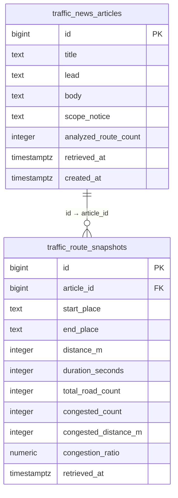

# 서울 도로교통정보·뉴스 브리핑 서비스

> **저장소 대표 README:** 이 문서는 `traffic_app_domain` 저장소 최상위 문서입니다. 현재 FastAPI 애플리케이션 소스는 [`traffic-api/`](traffic-api/) 아래에 있으며, 개발·테스트 시 이 폴더를 프로젝트 작업 디렉터리로 사용합니다.

> **문서 기준:** 2026-10-19 · **작업 브랜치:** `kakao` · **개발 방식:** 문서 선행 → 사용자 검토 → 코드 구현 → 테스트 → README 갱신
>
> **범위 안내:** 카카오 자동차 길찾기 API에서 조회한 **선택된 자동차 경로**에 한정된 교통정보 서비스입니다. 서울 전체 도로의 실시간 혼잡도나 서울의 대표 통계로 일반화하지 않습니다. 데이터의 ‘조회 완료 시각’은 도로 센서의 실제 관측 시각과 다릅니다.
>
> **상태 표시:** ✅ 구현·테스트 확인 / 🟡 부분 구현·추가 검증 필요 / ⬜ 계획(미구현). 아래의 계획 기능은 아직 사용할 수 없습니다.

## 0. 변경 관리 규칙 — 코드 수정 전에 반드시 확인

기능을 신규 추가하거나 수정할 때 **아래 순서**를 지킵니다.

1. **기능정의서 업데이트:** 기능 ID, 사용자 역할, 입력·출력, 예외, 상태(구현/계획)를 수정합니다.
2. **DB 설계 업데이트:** 컬럼·PK/FK·인덱스·RLS 및 데이터 이동/호환성 영향 여부를 기록합니다. DB 변경이 없다면 ‘변경 없음’으로 적습니다.
3. **화면설계서 업데이트:** 메뉴 트리, URL, 페이지 목적, 화면 요소, 접근 권한, 모바일 동작을 수정합니다.
4. **개발환경 업데이트:** Python·패키지·환경변수·외부 API·배포/보안 설정이 바뀌면 기록합니다. 변동이 없으면 ‘변경 없음’으로 적습니다.
5. **검토 게이트:** 위 4개 항목의 변경안을 README에 먼저 반영하고 **사용자 확인을 받은 후** 코드·SQL 변경 작업을 시작합니다.
6. **구현·테스트:** 로컬 테스트, 권한 검사, 기존 기능 회귀 테스트, 필요 시 DB 마이그레이션/백업을 수행합니다.
7. **완료 기록:** 구현 상태와 실제 검증 결과를 갱신하고, 코드와 README를 함께 커밋합니다. 비밀정보는 커밋하지 않습니다.

### 변경 이력

| 날짜 | 구분 | 내용 | 코드 변경 |
|---|---|---|---|
| 2026-10-19 | 문서 구조 개편 | 현행 기능·DB·화면·개발환경 명세 정리, 확장 메뉴 및 우선순위 제안 | 없음 — 검토 전 |
| 2026-10-19 | README 위치 변경 | `traffic-api/README.md`에서 저장소 최상위 `README.md`로 대표 명세 적용 | 앱 코드 변경 없음 |
| 2026-10-19 | 설계 상세화 | F13~F15 저장 API·중복 방지·관리자 UI·DB 변경안 문서화 | 앱 코드/DB 변경 없음 |
| 추후 | 예정 | 관리자 전용 뉴스 저장 API, 중복 방지, 웹 UI 연결 | 사용자 승인 후 진행 |

## 1. 서비스 개요

- **목적:** 이용자가 서울 주요 자동차 이동 경로의 현재 조회 결과를 비교하고, 그 수치를 근거로 만든 뉴스형 브리핑을 읽을 수 있도록 지원
- **대상:** 교통정보 이용자, 뉴스 브리핑 독자, 서비스 운영 관리자
- **데이터 원천:** Kakao Local 장소 검색, Kakao Mobility 자동차 길찾기
- **뉴스 생성 방식:** 현재는 별도의 생성형 AI 호출이 아니라 **수치 기반 Python 규칙/템플릿**으로 기사 제목·리드·본문을 만듭니다.
- **기본 경로:** 서울역→잠실역, 광화문→강남역, 여의도역→잠실역
- **현재 DB:** Supabase PostgreSQL; 별도 과제용 MySQL 전환은 이 프로젝트의 현재 범위에 포함되지 않습니다.

## 2. 기능정의서 (현행 + 확장)

| ID | 기능명 | 사용자 | 입력 → 출력 | 상태 |
|---|---|---|---|---|
| F01 | 장소 검색·자동차 경로 조회 | 방문자 | 출발지·목적지 → 경로·거리·소요시간 | ✅ |
| F02 | 구간별 교통정보·지도 | 방문자 | 경로 → 도로별 속도·교통상태·지도 | ✅ |
| F03 | 단일 경로 브리핑 | 방문자 | 경로 데이터 → 문장 브리핑 | ✅ |
| F04 | 3개 대표 경로 비교 | 방문자 | 고정 경로 3개 → 비교 지표 | ✅ |
| F05 | 뉴스형 브리핑 생성 | 방문자 | 경로별 수치 → 제목·리드·본문·한계 | ✅ |
| F06 | 뉴스 대시보드 | 방문자 | 분석 결과 → 카드·막대 비교 | ✅ |
| F07 | 조회 완료 시각 표시 | 방문자 | 서버 조회 시각 → 한국 시간 표시 | ✅ |
| F08 | 뉴스 DB 저장 모듈 | 개발자 | 뉴스+경로 → PostgreSQL 1+N 트랜잭션 | ✅ (CLI 검증) |
| F09 | 뉴스 이력 목록·상세 조회 | 방문자 | 기사 ID → 저장된 기사·경로 정보 | ✅ |
| F10 | 과거 기사 웹 조회 | 방문자 | 기사 선택 → 본문·그래프 복원 | ✅ |
| F11 | 관리자 로그인·권한 확인 | 관리자 | Supabase Auth 계정·토큰 → 관리자 검증 | ✅ (로컬 검증) |
| F12 | 관리자 로그인 화면 | 관리자 | 이메일·비밀번호 → 인증 상태 UI | ✅ (로컬 검증) |
| F13 | 관리자 전용 기사 저장 API | 관리자 | 인증된 저장 요청 → 기사 ID | ⬜ |
| F14 | 같은 기사 중복 저장 방지 | 관리자 | 생성 결과 식별자 → 1회 저장 | ⬜ |
| F15 | 뉴스 저장 UI | 관리자 | 생성된 기사 → 저장·결과 표시 | ⬜ |
| F16 | 기사 검색·필터·페이지네이션 | 방문자 | 기간·경로·키워드 → 이력 목록 | ⬜ |
| F17 | 일자·시간별 경로 통계 | 방문자 | 저장된 스냅샷 → 추세 그래프 | ⬜ |
| F18 | 경로 즐겨찾기·프리셋 | 방문자 | 자주 쓰는 경로 → 빠른 조회 | ⬜ |
| F19 | 자동 수집·캐시 | 운영자 | 예약 주기 → API 호출 최적화·저장 | ⬜ |
| F20 | 기사 검토·발행 상태 | 관리자 | 초안 → 검토·공개/보류 | ⬜ |
| F21 | 수집 실패·장애 모니터링 | 관리자 | 오류 로그 → 운영 경고·진단 | ⬜ |
| F22 | CSV 다운로드·데이터 출처 표기 | 방문자 | 분석 결과 → CSV·메타데이터 | ⬜ |

**기능 규칙:** 경로마다 거리가 달라 단순 소요시간 또는 정체·지체 **구간 개수만으로** 혼잡 우열을 판단하지 않습니다. 비율 비교도 조회된 경로의 거리 구성 비교일 뿐 실제 도시 전체 혼잡도를 뜻하지 않습니다. 중복 경로 구간 합산 시 별도 식별/제거 규칙을 수립해야 합니다.

### 주요 API

| 메서드 | 경로 | 설명/접근 |
|---|---|---|
| GET | `/` · `/map` · `/news` | 홈·지도·뉴스 페이지 |
| GET | `/api/route` | 경로 검색 |
| GET | `/api/briefing/overview` | 고정 3개 경로 종합 요약 |
| GET | `/api/briefing/news` | 새로운 데이터 기반 뉴스 생성(저장은 안 함) |
| GET | `/api/news/history` | 저장된 뉴스 목록 |
| GET | `/api/news/history/{article_id}` | 저장된 뉴스 상세 |
| GET | `/admin` | 관리자 로그인 페이지 |
| POST | `/api/admin/login` | 로그인, 액세스 토큰 응답 |
| GET | `/api/admin/me` | Bearer 토큰 + 관리자 UID 검증 |
| POST | `/api/admin/news/save` | **계획**: 관리자 전용 저장 API (미구현) |

## 3. DB 설계서 (PostgreSQL · Supabase)

**기존 보존:** `public.traffic_information`은 이전 ITS 개발 단계의 약 30,538행이 있는 구형 테이블이며, 현재 카카오 기능에서는 사용하지 않습니다. 이 테이블의 이름·컬럼을 추정해 수정하거나 삭제하지 않습니다.

### 현재 테이블 및 관계



| 테이블 | PK | FK | 주요 제약/인덱스 | 상태 |
|---|---|---|---|---|
| `traffic_news_articles` | `id` BIGINT IDENTITY | 없음 | 필수 제목·본문·리드, `retrieved_at`, `idx_traffic_news_retrieved_at` | ✅ |
| `traffic_route_snapshots` | `id` BIGINT IDENTITY | `article_id` → `traffic_news_articles.id` (ON DELETE RESTRICT) | 거리 양수·비율 0~100·정체 구간 수 제한·`idx_traffic_routes_article_id` | ✅ |
| `traffic_information` | `id` | 없음 | 과거 교통 데이터; 현재 저장 로직과 분리 | 보존 |

- **현재 저장 모델:** 기사 1건과 해당 경로 N건을 한 PostgreSQL 트랜잭션으로 저장. Python `app/news_database.py`의 `save_news_article()`로 **CLI 테스트 완료**. 웹 저장 엔드포인트는 아직 없음.
- **저장 검증 기준:** 현재 테스트로 뉴스 1건 + 관련 경로 3건 저장/조회 확인. 테스트 시점의 실제 행 수는 변할 수 있음.
- **보안:** 새 두 테이블은 RLS 활성화, `anon`/`authenticated` 직접 권한 제거. FastAPI가 서버 측 DB 연결. DB 비밀번호 브라우저 전달 금지.
- **미해결 보안 점검:** 기존 `traffic_information`은 RLS 비활성화 상태로 확인됨. 기존 연동 영향 분석 후 별도 승인하에 설정 변경 필요.
- **앞으로 필요한 DB 변경(계획):** 기사 중복 방지용 `generation_id` 또는 고유 키, 검토/발행 상태 및 관리자 ID, 필요 시 수집 배치·오류 로그 테이블. **설계 승인 전 마이그레이션 금지**.

## 4. 화면설계서 — 메뉴 구조 및 페이지 배치

### 역할별 정보 구조(IA) / 복잡한 메뉴 설계안

```text
서울 도로교통정보
├─ 1. 교통 현황
│  ├─ 주요 경로 종합 현황 [현재 /news]
│  ├─ 출발지·목적지 검색 [현재 /]
│  ├─ 지도에서 경로 확인 [현재 /map]
│  ├─ 구간별 속도·교통상태 [현재 /]
│  └─ 관심 경로/즐겨찾기 [계획]
├─ 2. 분석·통계
│  ├─ 경로별 비교 그래프 [현재 /news]
│  ├─ 시간대별 정체 추이 [계획]
│  ├─ 일별·주별 기록 비교 [계획]
│  ├─ 구간 데이터 내보내기 [계획]
│  └─ 데이터 출처·방법론 [계획]
├─ 3. 교통 뉴스
│  ├─ 최신 자동 브리핑 [현재 /news]
│  ├─ 저장된 뉴스 아카이브 [현재 /news]
│  ├─ 기사 검색·기간 필터 [계획]
│  ├─ 경로별 기사 모아보기 [계획]
│  └─ 기사 공유·읽기 모드 [계획]
├─ 4. 서비스 안내
│  ├─ 조회 범위와 통계 한계 [일부 화면 문구 구현]
│  ├─ 이용 방법·FAQ [계획]
│  ├─ API·데이터 이용 안내 [계획]
│  └─ 장애·공지 사항 [계획]
└─ 5. 관리자 전용 (/admin 로그인 후)
   ├─ 관리자 인증·계정 상태 [현재 /admin]
   ├─ 기사 생성 결과 검토 [계획]
   ├─ 기사 저장·중복 확인 [계획]
   ├─ 기사 승인·게시 상태 [계획]
   ├─ 수집 일정·API 호출량 [계획]
   ├─ 저장된 데이터 관리 [계획]
   └─ 오류 로그·운영 설정 [계획]
```

메뉴 복잡성은 **1차 메뉴 5개 / 2차 메뉴 약 25개 이상**으로 설계하되, 한꺼번에 모두 구현하지 않습니다. 방문자에게 관리자 메뉴를 불필요하게 노출하지 않고, 계획 메뉴는 비활성/개발 예정 표시 후 단계별 출시합니다.

### 화면별 정의

| 화면 | URL | 주요 구성 | 접근 | 구현 상태 |
|---|---|---|---|---|
| 메인·경로 검색 | `/` | 출발/도착 검색, 거리·시간, 도로별 속도, 단일 브리핑, 3개 경로 종합 카드/표 | 공개 | ✅ |
| 경로 지도 | `/map` | OpenLayers 경로·교통상태 구간 표시 | 공개 | ✅ |
| 뉴스·대시보드 | `/news` | 조회 버튼, 지표 카드, 비교 막대, 뉴스 본문·시각, 과거 기사 목록/상세 | 공개 | ✅ |
| 관리자 로그인 | `/admin` | 이메일·비밀번호, 인증 결과, 로그아웃(화면 메모리 토큰 초기화) | 공개 진입, 관리자 검증 | ✅ |
| 데이터 통계 | `/statistics` (가칭) | 시점·경로별 과거 비교 그래프 | 공개 | ⬜ |
| 기사 편집·저장 | `/admin/articles` (가칭) | 기사 미리보기, 저장, 중복 경고, 승인 | 관리자 | ⬜ |
| 운영·설정 | `/admin/operations` (가칭) | 수집 간격, 호출량, 오류 | 관리자 | ⬜ |

### 목표 화면 와이어프레임 (계획)

```text
┌───────────────────────────────────────────────────────────────┐
│ 로고/서비스명  [교통 현황 ▾] [분석·통계 ▾] [교통 뉴스 ▾]  안내 │
├───────────────────────────┬───────────────────────────────────┤
│ 선택 경로·기간 필터       │ [조회 시각] [분석 경로] [최고 비율] │
│ ┌───────────────────────┐ │ ┌───────────────────────────────┐ │
│ │ 경로 조회/프리셋      │ │ │ 경로별 비교/변화 차트        │ │
│ └───────────────────────┘ │ └───────────────────────────────┘ │
├───────────────────────────┴───────────────────────────────────┤
│ [지도/구간 정보]         [최신 교통 뉴스 브리핑]               │
├───────────────────────────────────────────────────────────────┤
│ 저장된 뉴스 · 필터 · 아카이브 · 데이터 출처/분석 한계         │
└───────────────────────────────────────────────────────────────┘
관리자 로그인 후 별도 운영 메뉴: 기사 검토/저장/이력/운영 설정
```

- **반응형 원칙(계획):** PC 상단 드롭다운 + 선택 페이지별 사이드바, 모바일 햄버거/아코디언. 주요 화면은 모바일에서 카드 1열 배치. 키보드 메뉴 접근·포커스 표시 필요.
- **상태 분리:** 조회 중/성공/조회 실패, 과거 조회 vs 방금 생성, 권한 없음, 저장 완료/중복 저장을 명확히 구분.
- **색상:** 교통 상태 색과 일반 UI 강조색의 의미를 혼동하지 않도록 별도 범례 제공.

## 5. 개발환경 정의서

| 구분 | 현재 적용 | 변경 발생 시 갱신할 항목 |
|---|---|---|
| OS/로컬 | Windows PowerShell, `traffic-api` 디렉터리 | OS·경로·실행 명령 |
| 서버 | Python / FastAPI / Uvicorn | Python 버전, FastAPI 버전, ASGI 엔트리 |
| 외부 API | Kakao Local, Kakao Mobility Directions | 권한, 응답 구조, 요청량 |
| 데이터 분석·기사 생성 | Python 규칙형 계산·템플릿 | 계산법, 수치 표시 기준, 생성기 변경 |
| DB | Supabase PostgreSQL, `psycopg[binary]` | 스키마·연결 방식·RLS·백업 |
| 인증 | Supabase Auth + FastAPI Bearer·관리자 UID 검증 | 로그인, 토큰 만료, 세션 정책 |
| 프런트엔드 | HTML/CSS/JavaScript, OpenLayers | 외부 CDN, 브라우저 호환성 |
| 협업 | Git / GitHub `kakao` 브랜치 | 브랜치·커밋·CI 정책 |
| 배포 | `vercel.json` 설정 파일 존재; 실제 운영 배포 확인 필요 | Vercel Root Directory, 환경변수, 네트워크·로그 |

### 실행

```powershell
cd C:\workspace\traffic_app_domain\traffic-api
py -m venv .venv
.\.venv\Scripts\python.exe -m pip install -r requirements.txt
.\.venv\Scripts\python.exe -m uvicorn app.main:app --reload
```

> 기존 `.venv`가 정상이라면 새로 만들지 않아도 됩니다. 앱 URL: `/`, `/map`, `/news`, `/admin`; 개발용 API 문서: `/docs`.

### 환경변수 이름(값은 절대 저장하지 않음)

- `KAKAO_REST_API_KEY`: 카카오 API 비밀키
- `POSTGRES_HOST`, `POSTGRES_PORT`, `POSTGRES_USER`, `POSTGRES_PASSWORD`, `POSTGRES_DB`, `POSTGRES_SSLMODE`: PostgreSQL 연결
- `SUPABASE_URL`, `SUPABASE_ANON_KEY`, `ADMIN_USER_ID`: Supabase Auth와 관리자 UID 검사

`.env`는 `.gitignore`로 제외합니다. 서비스 비밀키나 관리자 액세스 토큰은 README, 화면 캡처, 클라이언트 JS에 넣지 않습니다. 로그아웃의 화면 토큰 초기화와 **서버 측 토큰 무효화는 현재 서로 다름**을 유의합니다.

### 개발 환경/배포에 대한 주의

- `requirements.txt`에 과거 개발 단계의 MySQL 패키지가 남아 있으나 현재 카카오 교통정보 저장은 PostgreSQL 사용. 정리 전 사용 여부 점검 필요.
- **저장소 최상위 `README.md`가 `kakao` 브랜치의 기준 문서입니다.** 이전 위치의 `traffic-api/README.md`는 과거 사본이므로 향후 별도 정리 여부를 결정합니다.
- 배포 전 인증 로그인 요청 제한·저장 API 권한·중복 저장·토큰/세션 관리·에러 로그·Vercel 연결을 점검해야 합니다.

## 6. 확장 기능 제안 및 우선순위

| 우선순위 | 추가 기능 | 사용자 가치 | 선행 조건 |
|---|---|---|---|
| P0 | 관리자 저장 API + 중복 방지 | 기사·경로를 안전하고 일관되게 보관 | 서버 측 생성 결과 식별·권한 검사 |
| P0 | 기사 저장/검토 UX | 실수 저장 방지, 상태 파악 | 관리자 UI 흐름 |
| P1 | 기사 날짜·키워드·경로 필터 | 누적 기사 탐색 | DB 조회 필터·인덱스 |
| P1 | 시간대별 교통 추세 | 시점별 수치 비교 | 주기적 수집, 같은 경로 정의 |
| P1 | 조회 캐시·호출량 제한 | API 과호출 및 응답 지연 완화 | 만료 정책·운영 지표 |
| P2 | 관심 경로 프리셋 | 자주 조회하는 경로 재사용 | 사용자 선호 저장 방식 |
| P2 | 데이터 내보내기 CSV | 분석 결과 재사용 | 공개범위·출처 |
| P2 | 기사 승인·게시·수정 이력 | 뉴스 품질 및 편집 흐름 | 게시 상태·감사 로그 테이블 |
| P3 | 장애 대시보드·알림 | 운영 신뢰성 강화 | 모니터링 및 알림 연동 |
| P3 | 반응형 메뉴·접근성 향상 | 다양한 기기 사용성 | 화면설계 확정 |

## 7. 다음 개발 상세 설계 — F13/F14/F15 (2026-10-19 · 사용자 검토 전)

> **상태: 설계안, 아직 구현되지 않음.** 이 절의 내용은 사용자 검토/승인 전에는 앱 코드 또는 Supabase 스키마에 적용하지 않습니다.

### 7.1 기능정의서 변경안

| ID | 단계 | 입력 | 정상 결과 | 예외·검증 |
|---|---|---|---|---|
| F13 | 관리자 전용 교통 뉴스 생성 및 저장 API | Bearer 인증, 서버가 발급한 임시 기사 식별 증표 | 뉴스+연관 경로를 한 트랜잭션 저장하고 기사 ID 반환 | 인증 없음 401, 비관리자 403, 기한 초과·위조 400/422, DB 장애 503 |
| F14 | 동일 생성 결과 중복 저장 방지 | 서버가 생성한 고유 `generation_id` | 최초 저장 1회, 동일 ID 재요청 시 기존 ID 반환 | DB UNIQUE로 동시 저장 요청까지 차단 |
| F15 | 관리자 웹 기사 검토·저장 | 로그인 후 ‘새 기사 생성’ → 내용 검토 → ‘저장’ | 화면에서 확인한 정확히 같은 뉴스 데이터 저장; 저장 결과·이력 링크 표시 | 중복 클릭 방지, 토큰 만료 안내, 오류 발생 시 기존 미리보기 유지 |

**생성된 기사의 데이터 무결성:** 브라우저가 기사 제목·거리·본문을 자유롭게 바꿔서 저장하도록 허용하지 않습니다. 관리자 인증을 통과한 FastAPI가 카카오 데이터를 수집하고 기사·경로를 구성한 뒤, 서버에서 서명한 **만료 시각이 있는 기사 증표(signed draft token)**를 관리자 브라우저에 전달합니다. 미리보기는 해당 서버 생성 결과로 구성합니다. 저장 요청 때 서버는 관리자 토큰, 기사 증표 서명·유효시간·관리자 UID를 다시 검증하고, 증표에 서명된 동일 데이터를 DB에 저장합니다. 토큰 발급·서명에는 별도 `NEWS_DRAFT_SIGNING_KEY` 비밀키를 서버 환경변수로 관리합니다. 이 키는 브라우저/README에 기재하지 않습니다.

**API 구상(미구현):**

- `POST /api/admin/news/generate`: 관리자 인증 필수. 3개 경로 조회 → 뉴스 생성 → 관리자 UID와 `generation_id`, 발급/만료 시각을 포함한 서명 증표 및 화면 미리보기 응답. DB 저장 없음.
- `POST /api/admin/news/save`: 관리자 인증 필수. `draft_token`만 받아 서버 서명과 기한 확인, 트랜잭션 저장. 응답 `article_id`, `already_saved` 반환. 카카오 API 재호출 없음.
- 기존 `GET /api/briefing/news`는 공개 브리핑 조회·생성으로 유지(저장 없음).
- 기존 `GET /api/news/history`·`/{article_id}`는 이력 조회로 유지. 공개 범위는 배포 전 별도 재검토.

**보안 주의:** 문서와 GitHub에 실제 관리자 UID·DB 암호·서명 비밀키·토큰을 넣지 않습니다. 로그인 토큰/임시 기사 증표는 관리자 페이지 메모리에서만 보관하고 새로고침 시 초기화합니다. 서버는 저장 요청마다 `require_admin`을 호출하며, 서명 검증 실패 시 저장하지 않습니다. 로그인 시도 횟수 제한/세션 만료/운영 HTTPS는 배포 전 필수 검토 항목입니다.

### 7.2 DB 변경 설계안

기존 `traffic_news_articles`에 아래 **한 컬럼만 추가**하는 것을 제안합니다.

| 테이블 | 변경 | 타입/제약 | 기존 데이터 영향 |
|---|---|---|---|
| `traffic_news_articles` | `generation_id` 추가 | `uuid UNIQUE NULL` | 기존 레코드의 `NULL` 허용, 삭제/수정 없음 |
| `traffic_route_snapshots` | 변경 없음 | 기존 `article_id` FK 유지 | 없음 |
| `traffic_information` | 변경 없음 | 기존 데이터 유지 | 없음 |

- 서버가 기사 생성 시 매번 새로운 UUID를 부여합니다. 같은 기사를 다시 ‘저장’해도 **동일 생성 UUID이면 한 번만 저장**합니다. 내용이 동일해도 별도로 다시 생성한 경우는 새 기사로 취급합니다.
- UNIQUE 제약이 DB 레벨에서 동시 저장 중복을 차단합니다. `INSERT ... ON CONFLICT (generation_id) DO NOTHING` 후 이미 저장된 기사 ID를 확인하는 방식을 사용합니다.
- 기사 1건과 경로 N건의 원자적 트랜잭션을 유지합니다. 중복 요청에서는 경로를 다시 삽입하지 않습니다.
- 마이그레이션은 사용자 승인 뒤 사전 행 수·제약 검사 → 새 컬럼 추가 → 검증 순으로 수행. 기존 1건과 3개 경로 및 `traffic_information`을 보존합니다.
- RLS는 신규 테이블에 이미 적용되어 있으며, 구형 `traffic_information`의 RLS 문제는 별도 점검 과제로 유지합니다.

### 7.3 웹 화면·메뉴 변경 설계안

**관리자 메뉴:** `관리자 로그인` → `기사 작업실` → `기사 생성` → `기사 검토` → `Supabase 저장` → `저장 이력 보기`.

- 1차 구현은 이미 존재하는 `/admin`의 로그인 성공 패널을 **기사 생성/검토/저장 작업실**로 확장합니다. 별도의 `/admin/articles` 페이지는 관리 기능이 늘어날 때 분리합니다.
- 미리보기에는 제목·리드·본문·조회 시각·3개 경로 비교·범위 제한 설명을 배치합니다. ‘저장’은 생성 성공 이후에만 활성화합니다.
- 성공 시 `저장 완료 — 기사 #N`, 중복 시 `이미 저장된 기사 #N`, 인증 만료 시 `다시 로그인` 등 상태를 구분합니다.
- 방문자용 `/news`는 기존의 기사 생성·조회·아카이브 화면을 그대로 유지합니다. 관리자 토큰을 다른 페이지에 공유하거나 URL 쿼리에 싣지 않습니다.

### 7.4 개발환경 변경 설계안

- 기존 Python·FastAPI·psycopg·Supabase Auth·Kakao API·OpenLayers 유지.
- 신규 서버 전용 환경변수 **`NEWS_DRAFT_SIGNING_KEY`** 추가 예정: 충분히 예측하기 어려운 난수 기반 비밀키 사용. 실제 값은 `.env`/배포 설정에만 입력하고 README 및 소스에 작성하지 않음.
- 서명 구현은 Python 표준 라이브러리 `hmac`, `hashlib`, `secrets`, `base64`, `json`을 사용하여 별도 패키지 설치 없이 구현하는 방향을 제안. 서명 직렬화·시간 제한·검증은 별도 테스트로 확인.
- 수정 예정 파일: `app/main.py`, `app/news_database.py`, 별도 서명 모듈 `app/news_drafts.py`, `static/admin.html`; DB는 승인 후 마이그레이션 적용. 요구사항 변화 시 이 절을 먼저 수정.
- 기존 `/api/admin/login`의 브라우저 토큰 메모리 저장 방식과 `require_admin`을 유지. 배포 전 HTTPS·CORS·브루트포스 방어·토큰 수명 검토.

### 7.5 구현 전 테스트 기준

1. 관리자 아닌 요청으로 generate/save → 401/403, DB 저장 0건.
2. 관리자로 generate → 기사·3개 경로·서명 증표 반환; DB 쓰기 0건.
3. generate 이후 save → 기사 1건 + 연결 경로 3건 정확히 저장.
4. 동일 증표로 save 2회/동시 요청 → 기사와 경로가 추가 중복되지 않고 동일 기사 ID 반환.
5. 임의로 변조/만료/다른 관리자와 연결된 증표로 요청 → 차단.
6. 화면 미리보기와 DB 저장 값(제목·본문·거리·조회 시각)이 동일.
7. 기존 일반 뉴스 생성, 이력 읽기, 지도 및 로그인 동작 회귀 테스트.

**승인 상태:** ⬜ 사용자 검토 대기 — 문서 승인 전 SQL/코드 작업 금지.

---

## 8. 다음 구현 전 승인 체크리스트

- [x] 기존 구현 현황과 기능정의서 반영
- [x] 기존 테이블 보존·현재 PK/FK 및 보안 현황 정리
- [x] 현행 화면과 복잡한 확장 메뉴 트리 작성
- [x] 실행·인증·외부 API·DB 개발환경 기록
- [ ] **사용자 검토/승인**
- [ ] 승인된 첫 기능의 세부 DB 변경안(중복 키/저장 정책) 작성
- [ ] 코드 변경 및 로컬 테스트
- [ ] 배포 및 회귀 테스트
- [ ] README 상태·변경 이력 갱신

**다음 코드 작업은 사용자가 이 README의 기능 범위와 메뉴 구성을 검토한 후 시작합니다.**
